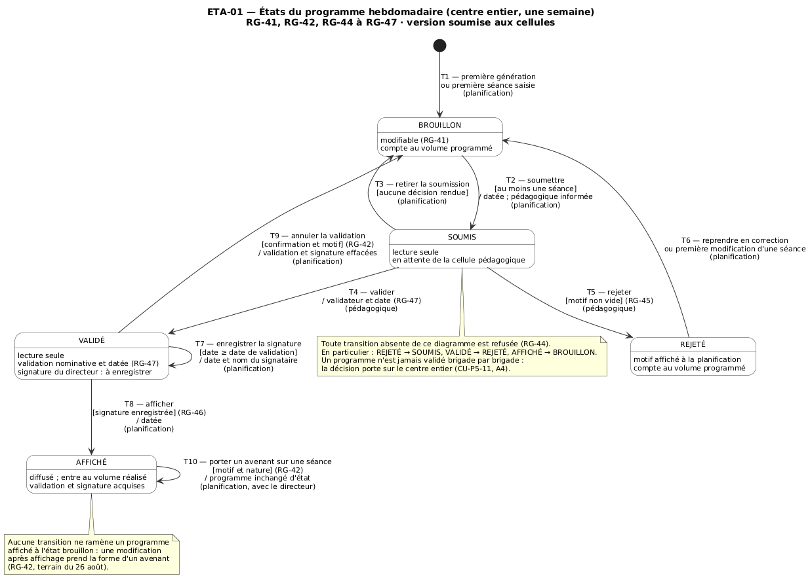

# Prompt 34 — Sprint 3, tâche 5.3.17 : diagramme d'états du programme (ETA-01)

Phase 5, sprint 3 (28/09 – 10/10). Première étape du sprint, avant toute story.
Ce n'est PAS une story : aucun point, aucun code de production, aucun test
exécutable. C'est la mesure préventive de R10 (coté 9, en hausse), reportée du
sprint 2. Le diagramme doit être validé par les cellules pédagogique et
planification AVANT US-VAL-01 et US-VAL-02.

Les arbitrages ci-dessous sont RENDUS. Ne les rediscute pas, ne les « améliore »
pas : ton travail est de les porter dans le dépôt, de confronter le code réel au
diagramme, et de tenir le suivi. Si le code réel rend l'un d'eux inexprimable
(principe 3 des leçons du sprint 2), ARRÊTE-TOI et signale-le avant d'écrire la
suite — ne tranche pas seul.

---

## 1. Ce que tu produis

| # | Fichier | Nature |
|---|---|---|
| A | `docs/conception/ETA-01_etats_programme.puml` + rendus `.svg` et `.png` | Le diagramme, source fournie au § 3, à recopier à l'identique |
| B | `docs/conception/ETA-01_table_transitions.md` | L'oracle : 11 événements × 5 états, fourni au § 4 ; il deviendra les tests d'US-VAL-03 |
| C | `docs/conception/ETA-01_audit_code.md` | Confrontation du code actuel au diagramme — LECTURE SEULE, § 5 |
| D | `docs/conception/ETA-01_note_cellules.md` | Note de deux pages pour les chefs de cellule, § 6 |
| E | Suivi : `DECISIONS.md`, `ECARTS-LIVRABLES-SPRINT-3.md` (nouveau), `sprint-3.md`, `AVANCEMENT.md`, `heures-sprint-3.md` (nouveau), skill de workflow de story | § 7 |

Interdits à cette étape : modifier un fichier sous `app/`, une migration, un
test, `requirements.txt`, le backlog. Les écarts au code relevés par l'audit
se referment dans les stories désignées, pas ici.

Pour le rendu PlantUML, retrouve la commande déjà utilisée dans le dépôt pour
les figures de conception (script, Makefile ou README de `docs/`) ; n'invente
pas de chemin vers `plantuml.jar`. Si aucune n'existe, dis-le et demande.

---

## 2. Les arbitrages rendus — et d'où ils viennent

Les livrables se contredisent sur la machine à états. Chaque arbitrage cite la
source retenue et le principe qui la fait l'emporter (leçon 5 du sprint 2 :
(1) la fiche plus précise l'emporte sur un critère vague ; (2) la règle
structurante l'emporte sur un critère qui la contredit ; (3) la règle doit être
exprimable sur le modèle implanté).

**A1 — Un programme affiché ne retombe JAMAIS à brouillon.** Une modification
après affichage est un avenant daté et motivé porté sur la séance ; le
programme reste AFFICHÉ, validation et signature acquises. Sources : RG-42 du
récapitulatif § 11.3 des cas d'utilisation v4 (structurante, et le
récapitulatif fait foi), BF-PLAN-05 du cahier des charges v8, SEQ-04 v3,
Avenant dans CLS-05, décision de terrain du 26 août. Le texte de RG-44 dans la
fiche CU-P5-11 (« validé ou affiché → brouillon ») est antérieur et obsolète —
principe 2.

**A2 — REJETÉ est un état stable, distinct de BROUILLON.** US-VAL-03 exige cinq
états et la visibilité du motif. On ne soumet que depuis BROUILLON (RG-44,
US-VAL-01 c.1, US-VAL-03 c.2). REJETÉ → BROUILLON (T6) a DEUX déclencheurs :
l'action explicite « reprendre en correction », OU la première modification
d'une séance — ce qui rend RG-41 (« modifiable aux états brouillon et
rejeté ») exacte vu de l'utilisateur. Le motif de rejet reste affiché en
BROUILLON après reprise ; il est effacé à la soumission suivante, le journal
en gardant la trace. SEQ-02 (« vérifier état = brouillon ou rejeté » avant
soumission) est l'écart — trois sources contre une. US-VAL-02 c.3 (« le rejet
fait revenir à brouillon ») se lit désormais : le rejet fait passer à REJETÉ,
la reprise ramène à BROUILLON.

**A3 — Retrait de soumission retenu (T3).** SOUMIS → BROUILLON tant qu'aucune
décision n'est rendue. Source : CU-P5-11 A2, et CU-P5-03 E2 qui y renvoie.
Absent de RG-44 et d'US-VAL-03 — principe 1. Soumis à la question Q1 des
cellules (§ 6).

**A4 — Annulation de validation (T9) : acte explicite, confirmé, motivé.**
VALIDÉ → BROUILLON, exercé par la planification. Déclenché par le traitement
d'une indisponibilité (US-PLAN-09, CU-P5-07 A4) ou par une modification
manuelle (US-PLAN-05). Jamais implicite : ni la génération ni une saisie ne
l'exécutent d'office — elles sont refusées et indiquent la marche à suivre.
Effet : validateur, date de validation, date de signature et signataire
effacés du programme (conservés au journal). Un programme validé et signé mais
non affiché repasse donc le circuit complet, nouvelle signature comprise —
cohérent avec SEQ-04 (« rien n'est sorti »), soumis à confirmation Q4.

**A5 — Signature et affichage : deux actes distincts de la planification.**
T7 enregistre la date de signature et le nom du signataire (RG-47) sur un
programme VALIDÉ ; réenregistrable tant que non affiché (correction de
saisie), date de signature postérieure ou égale à la date de validation,
jamais future. T8 affiche, refusé sans signature (RG-46). Sources : CU-P5-11
étape 6, SEQ-02, MAQ-03, US-VAL-04 c.1. La matrice § 11.2 (planification en
lecture sur « P5 — validation ») régit valider/rejeter, pas la signature —
écart à annoter, principe 1.

**A6 — RG-41 est gardée à la porte unique.** `ServiceEcritureSeance` (D-142)
consulte l'état du programme avant toute écriture — génération, saisie
manuelle, traitement d'indisponibilité, avenant confondus. Un seul point de
contrôle, déjà protégé par un test d'architecture : pas un contrôle par
appelant. Les transitions d'état ne s'exécutent que dans un service du circuit
(nom à fixer par US-VAL-03) ; un test d'architecture interdira toute
affectation de l'état ailleurs, sur le patron de D-142. RG-41 reste en couche
services (pas de trigger) ; les ÉTATS invalides, eux, sont rendus impossibles
en base (§ 4.3).

**A7 — D-140 est révisée : le volume programmé compte AUSSI les programmes
rejetés.** D-140 excluait REJETÉ en le traitant comme un abandon, et proposait
de « rejeter le brouillon » pour libérer le volume — transition qui n'existe
pas. Dans ETA-01, aucun état n'exprime l'abandon : un programme rejeté revient
à BROUILLON avec ses séances. L'exclure laisse une autre semaine consommer le
volume, puis la reprise produit un dépassement que personne n'a vu. Tous les
états comptent, le programme évalué restant exclu. Correction du code
reportée à US-VAL-03 (nouveau report à inscrire, § 7).

**A8 — D-154 est tranchée : la cellule pédagogique lit tous les programmes,
tous états.** US-VAL-02 c.1 exige qu'elle consulte le programme soumis avant
décision ; la ligne « P5 — validation » de la matrice lui donne l'écriture,
ce qui emporte la lecture. Pas de lecture conditionnée à l'état : complexité
sans bénéfice. Mise en œuvre reportée à US-VAL-02 (nouveau report).

**A9 — Pas de soumission d'un programme vide.** Garde de T2 : au moins une
séance. Arbitrage du chef de projet, aucune source ne le dit — à consigner
comme tel.

**A10 — Aucune fin de vie.** Pas d'état final : AFFICHÉ est stable. La
suppression d'un programme n'est offerte par aucune story (D-138 reste une
propriété technique de cascade).

**A11 — « La pédagogique est informée » (US-VAL-01 c.3)** s'entend dans
l'application — liste des programmes en attente de décision — et non par
messagerie : réseau interne, aucun service de courriel prévu.

---

## 3. Fichier A — source du diagramme, à recopier à l'identique

---

## 4. Fichier B — l'oracle des transitions

### 4.1 Table état × événement

Recopie cette table, puis ajoute sous chaque ligne le NOM du test qu'US-VAL-03
(ou la story indiquée) écrira pour chaque case — un nom par case, 55 noms.
Format : `test_<etat>_<evenement>_<admis|refuse>`.

| Événement ↓ / État → | BROUILLON | SOUMIS | REJETÉ | VALIDÉ | AFFICHÉ |
|---|---|---|---|---|---|
| **soumettre** | T2 → SOUMIS ; refus si aucune séance (A9) | refus — déjà soumis (US-VAL-01 c.4) | refus — reprendre d'abord (A2) | refus | refus |
| **retirer la soumission** | refus | T3 → BROUILLON | refus | refus — annuler la validation (T9) | refus |
| **valider** | refus — non soumis (CU-P5-11 E1) | T4 → VALIDÉ | refus | refus — déjà validé | refus |
| **rejeter** | refus (E1) | T5 → REJETÉ ; refus si motif vide ou blanc (RG-45) | refus | refus — VALIDÉ → REJETÉ n'existe pas | refus |
| **reprendre en correction** | refus — sans objet | refus | T6 → BROUILLON | refus | refus |
| **enregistrer la signature** | refus | refus | refus | T7, reste VALIDÉ ; refus si date < validation ou future | refus — figée |
| **afficher** | refus (RG-46) | refus (RG-46) | refus (RG-46) | T8 → AFFICHÉ si signature, sinon refus (RG-46) | refus — déjà affiché |
| **annuler la validation** | refus | refus | refus | T9 → BROUILLON ; refus sans confirmation ou sans motif | refus — avenant (A1) |
| **porter un avenant** | refus — modifier directement | refus | refus | refus | T10, reste AFFICHÉ ; refus sans motif ou sans nature |
| **modifier / ajouter / supprimer une séance** (sans avenant) | admis | refus (RG-41) — indique « retirer la soumission » | admis, précédé de T6 implicite | refus (RG-41) — indique « annuler la validation » | refus — avenant obligatoire |
| **générer** (US-PLAN-03, sélection de brigades) | admis, complète (D-146) | refus (RG-41) | admis, précédé de T6 implicite | refus (RG-41) | refus |

Chaque transition admise est journalisée (auteur, horodatage, état de départ,
état d'arrivée, motif s'il y en a) ; chaque refus rend un message qui nomme la
règle et, quand elle existe, la marche à suivre.

### 4.2 Acteur de chaque transition

| Transition | Profil autorisé | Refus attendu pour les autres profils |
|---|---|---|
| T2, T3, T6, T7, T8, T9, T10 | Cellule planification | 403 pour pédagogique, examens, direction, administrateur |
| T4, T5 | Cellule pédagogique | 403 pour planification, examens, direction, administrateur |

Direction de Formation : lecture de tous les programmes, aucune transition.

### 4.3 Contraintes à porter en base (implantées par US-VAL-03 et US-VAL-04)

Les transitions interdites ne s'expriment pas en CHECK (il faudrait l'ancien
état) ; les ÉTATS incohérents, si. Chacune aura son test qui force l'écriture
directe en base et attend `IntegrityError`.

| Nom | Règle | Contenu |
|---|---|---|
| `ck_programme_etat_connu` | RG-44 | état parmi les cinq valeurs |
| `ck_programme_rejet_motive` | RG-45 | état = REJETÉ ⇒ motif non vide après suppression des blancs |
| `ck_programme_motif_hors_circuit` | A2 | état ∈ {SOUMIS, VALIDÉ, AFFICHÉ} ⇒ motif de rejet vide |
| `ck_programme_soumission_datee` | US-VAL-01 | état ∈ {SOUMIS, VALIDÉ, REJETÉ, AFFICHÉ} ⇒ date de soumission renseignée |
| `ck_programme_validation_nominative` | RG-47 | état ∈ {VALIDÉ, AFFICHÉ} ⇒ validateur ET date de validation renseignés |
| `ck_programme_signature_complete` | RG-47 | date de signature et signataire tous deux renseignés ou tous deux vides |
| `ck_programme_signature_sur_validation` | A5 | signature renseignée ⇒ date de validation renseignée et date de signature ≥ date de validation |
| `ck_programme_affichage_signe` | RG-46, US-VAL-04 c.3 | état = AFFICHÉ ⇒ signature complète ET date d'affichage renseignée |

### 4.4 Cas de test par le vrai cycle HTTP (leçon D-50), à écrire dans les stories

Liste-les dans le fichier B, rattachés à leur story :

- US-VAL-01 — POST de soumission par la planification : redirection, état SOUMIS, ligne de journal ; même POST une seconde fois : refus, état inchangé.
- US-VAL-01 — le programme soumis apparaît dans la liste « en attente » de la pédagogique (GET réel).
- US-VAL-02 — POST de validation par la planification : 403, état inchangé en base.
- US-VAL-02 — POST de rejet sans motif (vide, puis blancs seuls) : formulaire réaffiché avec l'erreur, état inchangé.
- US-VAL-02 — après rejet, GET du détail par la planification : le motif est lisible.
- US-VAL-02 — GET du détail d'un programme soumis par la pédagogique : 200 (A8, ferme D-154).
- US-VAL-03 — POST de génération (écran réel de lancement, D-159) sur une semaine SOUMISE : refus, aucune séance créée, compte de séances inchangé.
- US-VAL-03 — POST de génération sur une semaine REJETÉE : état BROUILLON après coup, séances créées, journal portant la reprise PUIS la génération.
- US-VAL-04 — POST d'affichage sur un programme VALIDÉ sans signature : refus, état inchangé ; même tentative par écriture directe en base : `IntegrityError`.
- US-VAL-04 — le bouton « Afficher » est absent du détail tant que la signature n'est pas enregistrée ; le refus serveur tient quand on forge le POST quand même.
- US-PLAN-05 — POST de modification d'une séance d'un programme VALIDÉ : refus nommant « annuler la validation » ; sur AFFICHÉ sans motif d'avenant : refus.

Et deux tests d'architecture, pour US-VAL-03 : aucune affectation de l'état du
programme hors du service du circuit ; aucun appel d'écriture de séance qui
contourne la garde d'état de `ServiceEcritureSeance`.

---

## 5. Fichier C — audit du code actuel, LECTURE SEULE

Confronte le dépôt tel qu'il est aujourd'hui au diagramme et à la table.
Règle « Vérifier une absence » (`.claude/rules/tests.md`) : une recherche par
motif qui ne trouve rien ne prouve rien — ouvre les fichiers.

1. **Modèle** — `ProgrammeHebdomadaire` : champs présents contre ceux de CLS-05
   et du § 4.3 (état et ses choix, date de soumission, validateur, date de
   validation, motif de rejet, date de signature, signataire, date
   d'affichage) ; contraintes en base présentes ; valeur par défaut de l'état.
2. **Lecteurs et écrivains de l'état** — chaque endroit qui lit ou écrit
   l'état : services, sélecteurs, vues, gabarits, commandes (dont
   `charger_jeu_recette`), fabriques de test. Pour chacun : conforme, à
   modifier (par quelle story), ou sans objet.
3. **D-140** — le filtre qui exclut REJETÉ dans `regles_volume` et tout calcul
   qui le partage (dont le prérequis de D-141) ; les tests qui affirment
   aujourd'hui cette exclusion et devront changer à US-VAL-03.
4. **Porte d'écriture** — `ServiceEcritureSeance` et `ServiceGeneration`
   consultent-ils l'état aujourd'hui ? Quels appelants existent ?
5. **Habilitations** — permissions existantes touchant le programme, groupes
   qui les portent, confrontées au § 4.2. Ne crée rien ; dis ce qui manque
   pour valider/rejeter et pour la lecture de la pédagogique.
6. **Écran de lancement (D-159)** — affiche-t-il l'état du programme de la
   semaine ? Il devra l'afficher et refuser selon la table.

Rendu : un tableau `écart | fichier:ligne | story qui le referme`. Si un écart
ne relève d'aucune story du sprint 3, dis-le — ne l'assigne pas au hasard.

---

## 6. Fichier D — note aux cellules

Destinataires : chef de la cellule pédagogique, chef de la cellule
planification, par le Colonel Janati Idrissi. Deux pages au plus, vocabulaire
du centre, aucun terme technique (ni « transition », ni « état » sans
explication, ni nom de classe). Contenu :

1. Une phrase d'objet : ce qu'on leur demande (confirmer le circuit avant sa
   programmation) et la date de retour souhaitée — **lundi 5 octobre**.
2. Le circuit en phrases courtes, dans l'ordre de la vie d'un programme :
   préparé, soumis, validé ou renvoyé avec motif, signé, affiché — et les deux
   retours en arrière (retrait, annulation de validation), puis l'avenant.
3. Un tableau « qui fait quoi » à chaque étape.
4. Les quatre questions, chacune avec la réponse retenue PAR DÉFAUT si rien ne
   revient :
   - **Q1 (planification)** — Avant que la cellule pédagogique ait décidé,
     arrive-t-il de reprendre un programme déjà transmis pour le corriger ?
     *Par défaut : oui, le retrait est prévu.*
   - **Q2 (pédagogique)** — Une fois un programme validé, la cellule
     pédagogique peut-elle revenir sur sa décision avant la signature du
     directeur ? *Par défaut : non ; seule la planification peut annuler la
     validation, ce qui relance tout le circuit.*
   - **Q3 (planification)** — Est-ce bien la cellule planification qui
     consigne la date de signature et le nom du signataire, puis affiche ?
     *Par défaut : oui.*
   - **Q4 (les deux)** — Un programme validé et signé mais pas encore affiché,
     touché par une absence d'instructeur : il repart en validation et
     nécessite une nouvelle signature du directeur. Ce coût est-il accepté ?
     *Par défaut : oui, puisque rien n'a encore été diffusé.*
5. Un bloc de visa : nom, grade, fonction, date, pour chaque chef de cellule.
6. En annexe, le diagramme `.png`.

---

## 7. Suivi — à faire dans le même commit

**`DECISIONS.md`** — une entrée par arbitrage, au format habituel, auteur
« Lt Cissé (avec Claude Code) », mention « imposée par le prompt 34 » :
D-165 (A1), D-166 (A2), D-167 (A3), D-168 (A4), D-169 (A5), D-170 (A6),
D-171 (A7, révise D-140 — le dire en tête), D-172 (A8, tranche D-154),
D-173 (A9 et A10, arbitrage sans source). Chacune avec son alternative
écartée et son impact sur les livrables.

**`docs/suivi/ECARTS-LIVRABLES-SPRINT-3.md`** — nouveau, même gabarit que
celui du sprint 2. Écarts à y porter, numérotés à partir de 1 :

1. RG-44, fiche CU-P5-11 : « validé ou affiché → brouillon » — obsolète (D-165)
2. RG-42, fiche CU-P5-07, et CU-P5-07 A4 : « validé ou affiché » annule la validation — contredit le récapitulatif RG-42 (D-165)
3. SEQ-04 v3, commentaire « L'annulation de validation » : reprend « validé ou affiché », contredit le paragraphe qui le précède (D-165)
4. SEQ-02 v3 : soumission depuis « brouillon ou rejeté » (D-166)
5. US-VAL-02 c.3 : « le rejet fait revenir à brouillon » (D-166)
6. US-VAL-03 c.2 et RG-44 : T3, T7, T9, T10 absentes (D-167 à D-169, D-165)
7. CU-P5-03 E2 : « faire rejeter le programme » comme issue pour un programme validé — VALIDÉ → REJETÉ n'existe pas ; l'issue est l'annulation (D-168)
8. Matrice § 11.2, ligne « P5 — validation » : signature et affichage relèvent de la planification (D-169)
9. D-154 tranchée : lecture de la pédagogique (D-172)
10. D-140 révisée (D-171)

Colonne « action attendue du chef de projet » remplie ; le backlog n'est pas
touché.

**Reports** — ajoute au tableau des reports d'`AVANCEMENT.md` : D-171
(volume programmé, rejetés inclus → US-VAL-03) et D-172 (lecture de la
pédagogique → US-VAL-02), tous deux « Ouvert ». Recompte : 10 ouverts.

**`sprint-3.md`** —
- tâche transverse : « Diagramme d'états ETA-01 (5.3.17) — produit le 30/09, soumis aux cellules le __, validé le __ » ; NE PAS la cocher : elle se coche à la validation, pas à la production ;
- « Décision écrite go/no-go sur US-PLAN-08 » : cochée, « sans objet — arbitrée au sprint 2, D-164 » ; même correction dans la ligne du jalon J2 ;
- sous l'objectif, l'ordre retenu : ETA-01 ; US-EVAL-01 à 04 ; US-VAL-03, 01, 02, 04 ; US-PLAN-05, 06, 09 — avec ses deux motifs.

**`AVANCEMENT.md`** — date de mise à jour ; sous « Ce qu'il faut
surveiller », R10 : diagramme produit, en attente de validation, date de
retour demandée, stories bloquées (US-VAL-01 et 02). Le tableau des sprints
ne bouge pas : ce n'est pas une story.

**`docs/suivi/heures-sprint-3.md`** — nouveau (mesure corrective de R23).
Colonnes : date · élément (story ou tâche) · heure de début · heure de fin ·
heures humaines · points · commentaire. Première ligne : 5.3.17, heures de
début et de fin de TA session, colonne « heures humaines » laissée vide avec
la mention « à saisir le jour même par l'étudiant ». En tête du fichier, la
règle : une ligne par story à sa clôture, jamais reconstituée après coup.

**Skill de workflow de story** — ajoute à la définition de fini, après
« commitée » : « ligne ajoutée au tableau Sprints d'AVANCEMENT.md » et « ligne
ajoutée à heures-sprint-N.md, datée du jour ». C'est la mesure de R23 : elle
doit être mécanique, pas un rappel.

---

## 8. Avant de conclure

1. Fais relire A, B et le fichier des écarts par le sous-agent
   `relecteur-conception` : cohérence diagramme ↔ table (chaque flèche a sa
   case admise, chaque case admise a sa flèche), et chaque écart cité
   existe bien dans le livrable nommé.
2. Commit unique : `docs(conception): ETA-01 diagramme d'états du programme — tâche 5.3.17, prévention R10`.
3. Rends-moi : les chemins produits ; le tableau d'audit (§ 5) en entier ;
   tout arbitrage que le code rend inexprimable ; le nouveau compte des
   reports ; et ce que tu n'as pas pu vérifier.
