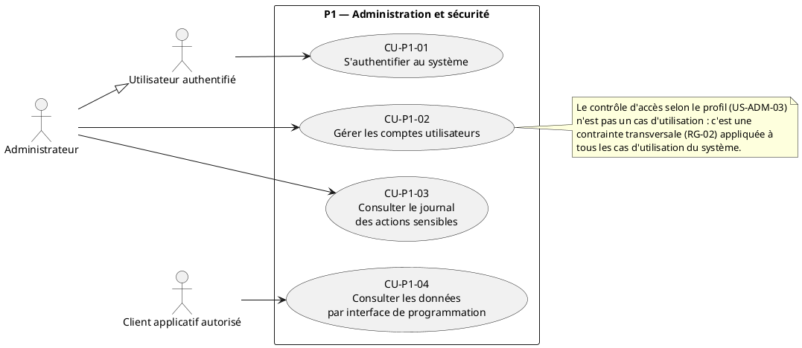
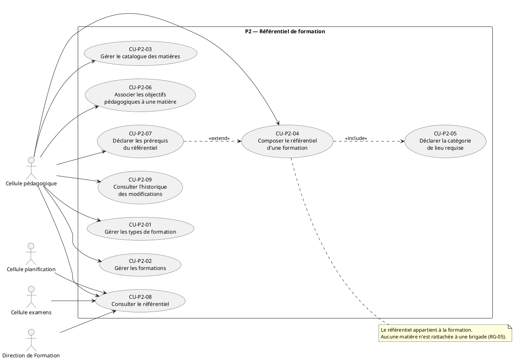
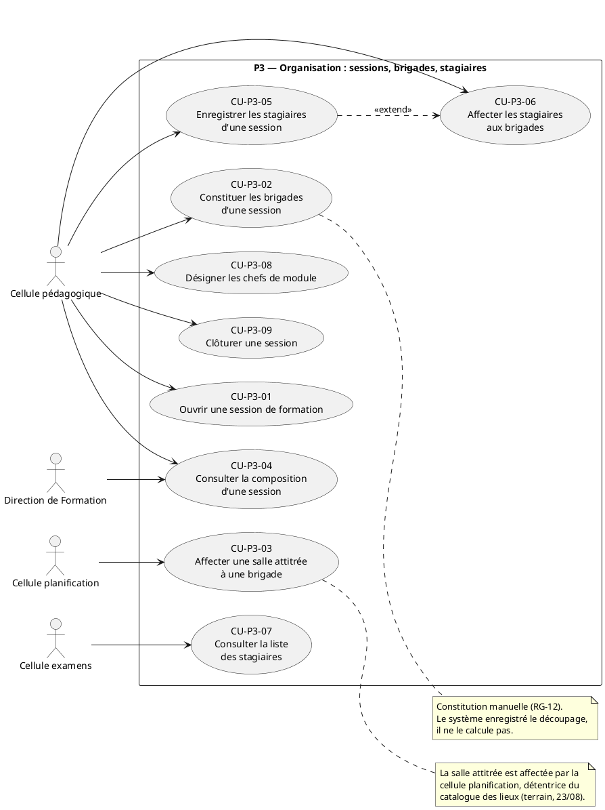
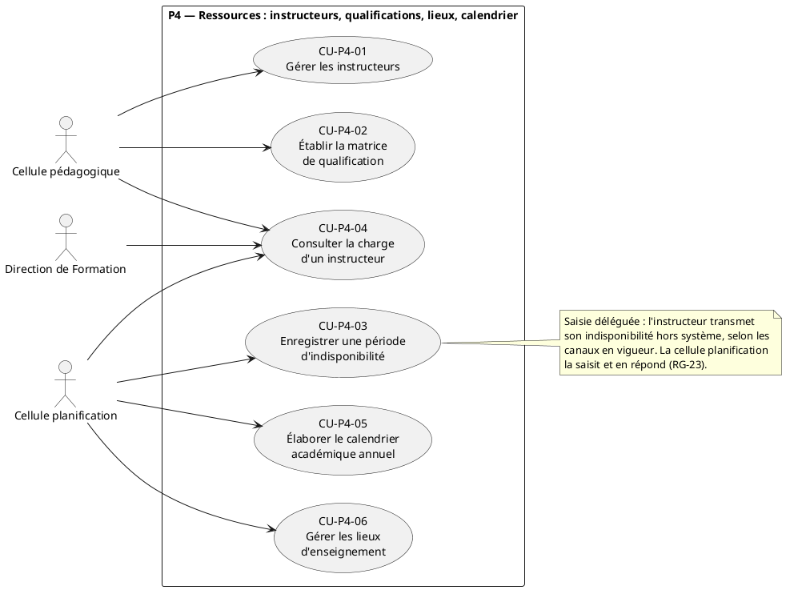
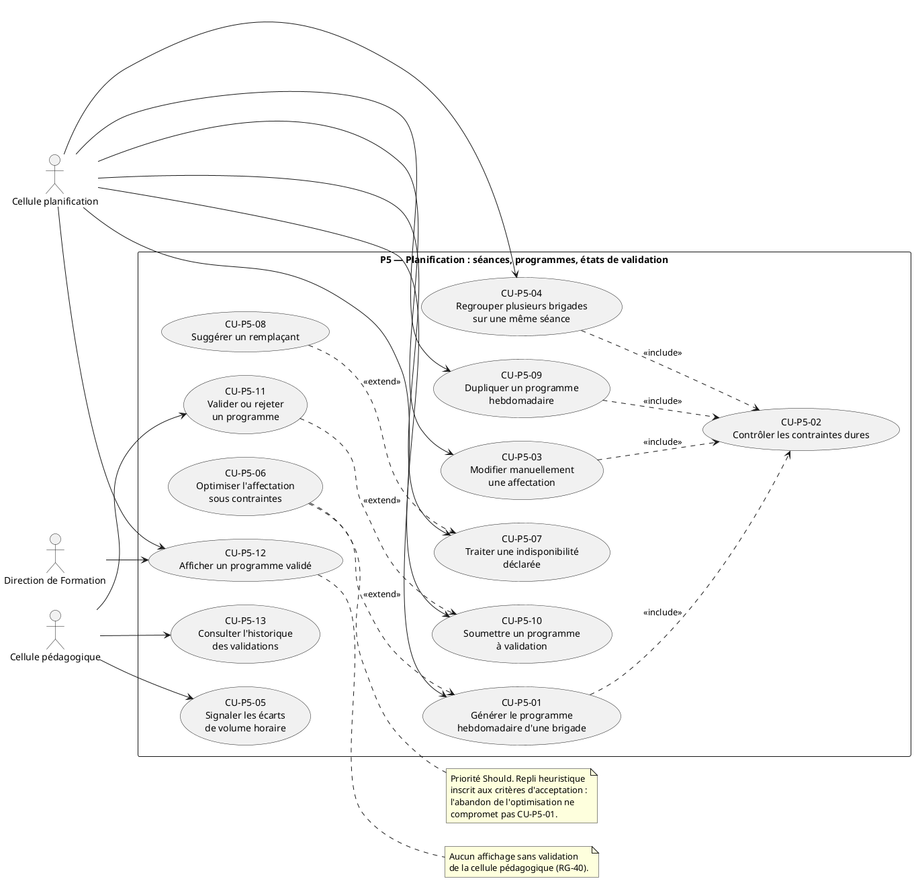
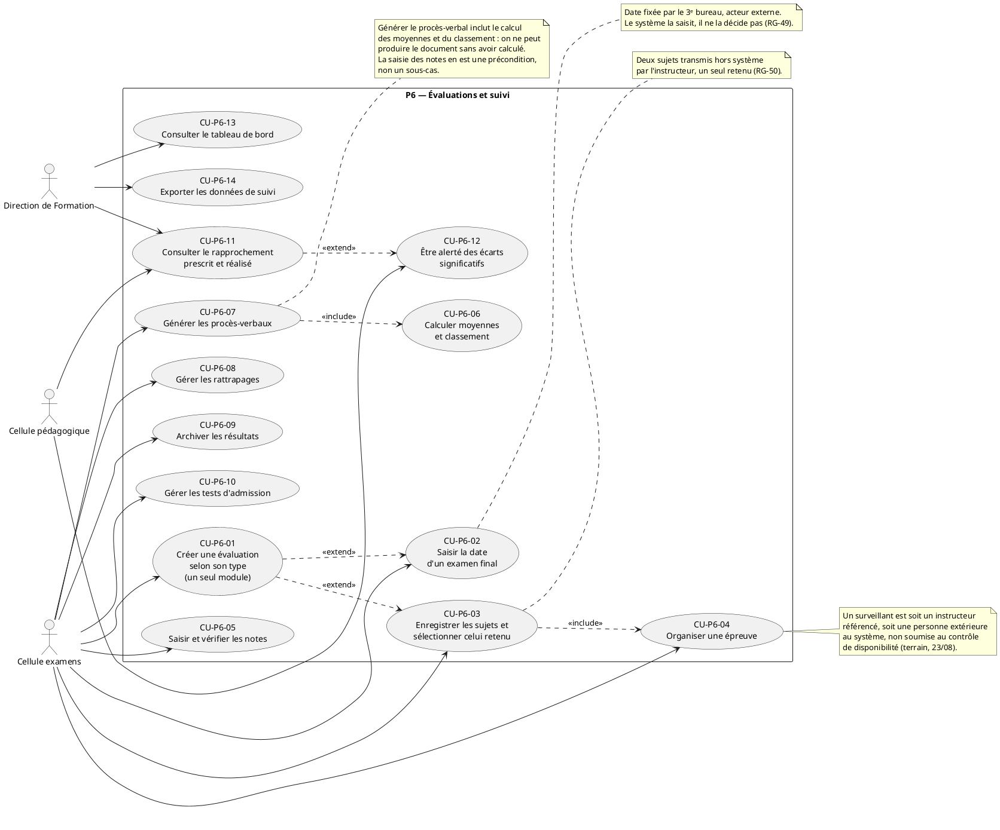

**CAS D'UTILISATION DÉTAILLÉS PAR PAQUETAGE**

Projet de fin d'études · Système de gestion des activités de formation du CIT

*Livrable 1 / 5 — Phase 4 : Analyse et conception · **Version 4 du 30 août 2026** · Remplace la version 3 du 26 août 2026 · Lot WBS 4.1.1*

# 1. Objet et méthode

## 1.1 Place dans la démarche

Ce document constitue le premier livrable de la phase d'analyse et de conception. Il transforme les besoins fonctionnels du cahier des charges et les user stories du backlog en **cas d'utilisation détaillés**, c'est-à-dire en descriptions d'interaction entre un acteur et le système, comportant un scénario nominal, des enchaînements alternatifs, des exceptions et des règles métier.

Le passage par les cas d'utilisation n'est pas une redite du backlog. Une user story exprime un besoin du point de vue de l'utilisateur et sert à planifier ; un cas d'utilisation décrit le déroulement complet d'une interaction et sert à concevoir. C'est en écrivant les enchaînements alternatifs et les exceptions que l'on découvre les entités, les attributs et les règles que le diagramme de classes devra porter. Les cas d'utilisation sont donc l'entrée des diagrammes de séquence (`SEQ-01` à `SEQ-04`) puis du diagramme de classes du domaine (`CLS-00`).

Ce document s'inscrit dans la règle **un seul modèle, plusieurs vues** : les six diagrammes produits ici sont des vues par paquetage d'un unique ensemble de cas d'utilisation. En cas de divergence entre une vue et la liste consolidée de la section 11, la liste consolidée fait foi.

## 1.2 Convention d'identification et chaîne de traçabilité

| Élément | Forme | Exemple |
| --- | --- | --- |
| Diagramme de cas d'utilisation d'un paquetage | `UC-0n` | `UC-05` |
| Cas d'utilisation | `CU-Pn-xx` | `CU-P5-01` |
| Règle métier | `RG-xx` | `RG-11` |

La chaîne de traçabilité arrêtée en ouverture de phase était `BF-xxx → US-xxx → SEQ-xx → CLS-xx`. Elle omet le niveau des cas d'utilisation, alors que c'est précisément à ce niveau que les règles métier sont formalisées et que les scénarios de séquence sont sélectionnés. **La chaîne est étendue comme suit** :

`OSn → BF-xxx → US-xxx → CU-Pn-xx → RG-xx → SEQ-xx → CLS-xx → cas de recette`

La matrice complète figure en section 11. Elle démontre qu'aucun besoin fonctionnel n'est orphelin et qu'aucun cas d'utilisation n'est injustifié.

## 1.3 Règle de rédaction des fiches détaillées

Rédiger une fiche complète pour les 55 cas d'utilisation produirait une trentaine de fiches quasi identiques décrivant des opérations de création, consultation, modification et archivage. Le procédé retenu est celui de la **fiche générique de gestion** (section 12) : elle décrit une fois pour toutes le déroulement d'un cas d'utilisation de type CRUD, et chaque cas d'utilisation concerné s'y rattache en ne précisant que ses écarts — règles de validation propres, conditions d'archivage, contrôles d'unicité.

Une fiche détaillée n'est rédigée que si le cas d'utilisation satisfait au moins un des trois critères suivants :

- il porte des règles métier dures dont la violation invalide une donnée métier ;
- il comporte des enchaînements alternatifs ou des exceptions non triviaux ;
- il traverse deux cellules ou fait intervenir un acteur externe.

**Vingt et une fiches détaillées** sont produites sur ce fondement. Ce critère est explicité ici parce qu'il devra être justifié devant le jury : c'est un choix d'économie de conception, pas un livrable incomplet.

## 1.4 Décision — outil de production des diagrammes

Le choix devait être arrêté en ouverture de phase entre PlantUML et Mermaid. **PlantUML est retenu.**

| Critère | PlantUML | Mermaid |
| --- | --- | --- |
| Diagramme de cas d'utilisation | Pris en charge | **Non pris en charge** |
| Diagramme de classes avec classes d'association | Pris en charge | Partiel, pas de classe d'association |
| Séquence, états, composants, déploiement | Pris en charge | Séquence et états seulement |
| Source texte versionnable dans Git | Oui | Oui |
| Rendu hors ligne | `plantuml.jar` + Graphviz, installés localement | Nécessite Node ou un rendu en ligne |
| Rendu natif dans GitHub | Non | Oui |

Le critère décisif est le premier : Mermaid ne sait pas produire de diagramme de cas d'utilisation, ce qui interdirait de tenir les six figures `UC-01` à `UC-06` avec un outil unique. S'y ajoutent l'absence de classes d'association, dont `CLS-00` aura besoin pour le référentiel et la matrice de qualification, et la contrainte BNF-06 : le poste cible est dépourvu de Node, ce qui a déjà imposé la précompilation de Tailwind. PlantUML se rend hors ligne avec une machine virtuelle Java et Graphviz.

**Conséquences opérationnelles.** Les sources `.puml` sont versionnées dans le dépôt sous `docs/diagrammes/`, un fichier par figure, nommé d'après le code de la figure. Le rendu produit un fichier SVG pour l'insertion dans le mémoire et un PNG pour les supports de présentation. Une commande de rendu de l'ensemble des diagrammes est ajoutée au dépôt afin qu'aucune figure du mémoire ne soit régénérée à la main. La perte du rendu natif dans GitHub est sans conséquence : le dépôt n'est pas le canal de diffusion des figures.

## 1.5 Évolutions depuis la version 1

La version 1 datait du 22 août. Trois sources l'ont corrigée : les réponses de terrain du chef de bureau pédagogique des 23 et 25 août, l'analyse de **quatre progressions d'instruction** — celles des 23, 24 et 25 février et du 7 mai 2026 —, et les travaux de conception eux-mêmes, diagrammes de séquence puis diagramme de classes.

**Neuf corrections structurelles.** Elles portent toutes sur des points où la version 1 décrivait un fonctionnement que le terrain ne pratique pas.

| Point | Version 1 | Version 2 |
| --- | --- | --- |
| Portée du programme | Une brigade, une semaine | **Le centre entier**, une semaine |
| Circuit de validation | Pédagogique, puis affichage | Pédagogique, **signature du directeur de la formation**, puis affichage |
| Types d'évaluation | Trois — contrôle, partiel, final | **Deux** — formative et certificative |
| Périmètre d'une évaluation | Toujours une brigade | **Explicite** : une session ou une brigade |
| Règle des deux sujets | Tout examen | **Certificatif seulement** ; le formatif porte un sujet |
| Auteur de la sélection du sujet | Cellule examens | **Commission d'examen**, la cellule enregistre |
| Classement | Au sein de la brigade | **Tous les stagiaires de la session** |
| Portée d'une période de calendrier | Cible unique | **Cibles multiples**, portée dérivée |
| Salle attitrée | Cellule pédagogique | **Cellule planification** |

**Trois notions apparues.** La **grille horaire** et le créneau type, qui n'existaient dans aucun document antérieur et que les progressions d'instruction ont révélés. La **déclaration de non-exécution**, qui referme l'objectif OS4. Et la **séance couvrant plusieurs créneaux consécutifs**, visible sur la progression du 7 mai.

**Une notion supprimée.** La modalité d'enseignement, introduite pour rendre licite un volume nul dans le cas du projet de fin d'études. Le terrain a établi que le PFE est un module enseigné comme les autres, avec volume horaire décompté à chaque apparition dans la progression. Sans cas d'usage, l'attribut a été retiré du modèle.

### Évolutions de la version 4

La version 4 procède d'une **relecture de conformité** du binôme, qui a comparé les trois familles de diagrammes entre elles et avec les fiches. Elle a mis au jour quatre défauts de cohérence : les décisions des 25 et 26 août avaient été portées dans les cas d'utilisation et le diagramme de classes, mais pas dans les diagrammes de séquence.

| Défaut | Correction |
| --- | --- |
| `SEQ-01` mentionnait encore la modalité d'enseignement du PFE, supprimée le 25 août | Note retirée |
| `SEQ-02` passait de *validé* à *affiché* sans enregistrement de la signature du directeur | Séquence de signature ajoutée |
| `SEQ-03` portait encore trois types d'évaluation et une brigade en paramètre | Réécrit : deux types, périmètre explicite, organisation par brigade, commission d'examen |
| `UC-06` portait les relations `include` **dans le mauvais sens** | Générer le procès-verbal inclut désormais le calcul des moyennes, et non l'inverse |

**Trois corrections de fond issues de la même relecture.** Le chef de module est désigné pour une **matière du catalogue**, non pour un couple formation-matière ni pour une session — ce qui supprime une classe du modèle. La cellule planification obtient l'accès à la charge d'un instructeur, que la matrice des profils lui accordait déjà mais que la fiche omettait. Et le **mode de partage d'un lieu**, attribut jusque-là orphelin, est câblé dans le contrôle du regroupement.

**Deux améliorations retenues.** Les habilitations deviennent configurables par un administrateur, et le tableau de bord est étendu aux quatre cellules.

**Conséquence sur la numérotation des règles.** Les règles `RG-28` à `RG-30`, `RG-31` à `RG-33`, `RG-41` à `RG-59` sont réécrites. Aucune n'est renumérotée : les codes sont conservés pour ne pas rompre les références des documents déjà produits. Le récapitulatif de la section 11.3 fait foi.

# 2. Acteurs du système

## 2.1 Acteurs utilisateurs

Cinq profils utilisateurs sont définis par BF-ADM-03. Ils partagent un comportement commun — s'authentifier, être soumis au contrôle d'accès, voir leurs actions sensibles journalisées — qui justifie une **généralisation** vers un acteur abstrait.

| Acteur | Nature | Portée |
| --- | --- | --- |
| **Utilisateur authentifié** | Acteur abstrait, parent des cinq profils | Porte les cas d'utilisation communs |
| Cellule pédagogique | Utilisateur direct | Référentiel, brigades, qualifications, validation croisée, suivi |
| Cellule planification | Utilisateur direct | Calendrier, lieux, génération et modification du programme, indisponibilités |
| Cellule examens | Utilisateur direct | Évaluations, sujets, épreuves, notes, procès-verbaux |
| Direction de Formation | Utilisateur direct, lecture seule | Tableaux de bord, suivi, référentiel en consultation |
| Administrateur | Utilisateur direct | Comptes, habilitations, journal |

Un sixième acteur, le **client applicatif autorisé**, consomme l'interface de programmation de consultation (BF-ADM-05, priorité Should). Il n'est pas un utilisateur humain et n'apparaît que dans `UC-01`.

## 2.2 Acteurs métier hors système

L'instructeur et le 3ᵉ bureau interviennent dans les processus métier mais **ne sont pas des acteurs du système** : ils n'ont pas de compte et n'accèdent à aucune fonctionnalité. Les représenter comme acteurs dans les diagrammes serait une erreur de modélisation qui contredirait l'exclusion du portail de consultation et le principe de saisie déléguée.

Ils figurent dans les diagrammes sous forme de **notes rattachées aux cas d'utilisation concernés**, avec la mention du canal de transmission. Cette convention rend visible l'origine de la donnée sans laisser croire à une interaction directe.

| Acteur métier | Donnée transmise | Cellule qui saisit | Cas d'utilisation concerné |
| --- | --- | --- | --- |
| Instructeur | Périodes d'indisponibilité | Planification | `CU-P4-03` |
| Instructeur | Sujets d'examen | Examens | `CU-P6-03` |
| Instructeur | Décision d'organiser un contrôle | Examens et planification | `CU-P6-01` |
| **Commission d'examen** | Choix du sujet retenu | Examens | `CU-P6-03` |
| 3ᵉ bureau | Date d'examen certificatif | Examens | `CU-P6-02` |
| **Directeur de la formation** | Signature du programme hebdomadaire | Planification | `CU-P5-12` |

**La commission d'examen** a été révélée par le terrain le 25 août : les deux sujets lui sont proposés et c'est elle qui en retient un. La version 1 attribuait cette décision à la cellule examens, ce qui était faux. Le schéma est celui, déjà connu, de la saisie déléguée : la cellule enregistre une décision prise ailleurs.

**Le directeur de la formation** signe le programme hebdomadaire pour l'ensemble du centre. Les progressions d'instruction des 23, 24 et 25 février portent toutes la même date de signature, le 20 février, et une seule signature. Il n'a pas de compte : le système enregistre la date et le nom du signataire sans prétendre porter la signature elle-même.

## 2.3 Exigences transversales qui ne donnent pas de cas d'utilisation

Deux user stories ne se traduisent pas par un cas d'utilisation. Le signaler explicitement évite qu'on les croie oubliées.

| User story | Nature réelle | Traitement |
| --- | --- | --- |
| **US-ADM-03** — Restreindre l'accès selon le profil | Contrainte transversale s'appliquant à **tous** les cas d'utilisation, non une interaction | Formalisée par la règle `RG-02` et par la matrice profils / cas d'utilisation en section 11.2. Réalisée par un mécanisme d'habilitation unique dans la couche services, **configurable par l'administrateur** — voir `RG-02 bis` |
| **US-VAL-03** — Gérer les états du programme | Machine à états, non une interaction | Formalisée par les règles `RG-19` et `RG-20`, et par le diagramme d'états `ETA-01` reporté au sprint 2 conformément au cadrage de phase |

De la même façon, BNF-14 — horodatage et rattachement à l'auteur de toute saisie — s'applique à l'ensemble des cas d'utilisation de création et de modification. Elle est portée par la règle `RG-26` et n'est plus rappelée fiche par fiche.

# 3. Découpage en six paquetages

Le découpage suit les epics du backlog, ce qui rend la traçabilité immédiate et fournit directement la liste des applications Django.

| Paquetage | Intitulé | Epics | User stories | Cas d'utilisation | Application Django |
| --- | --- | --- | --- | --- | --- |
| **P1** | Administration et sécurité | E1 | 5 | 4 | `administration` |
| **P2** | Référentiel de formation | E2 | 9 | 9 | `referentiel` |
| **P3** | Organisation : sessions, brigades, stagiaires | E3 | 9 | 9 | `organisation` |
| **P4** | Ressources : instructeurs, qualifications, lieux, calendrier | E4 + E5 partiel | 6 | 6 | `ressources` |
| **P5** | Planification : séances, programmes, états de validation | E5 + E6 | 14 | 13 | `planification` |
| **P6** | Évaluations et suivi | E7 + E8 | 14 | 14 | `evaluations`, `suivi` |
| | **Total** | | **57** | **55** | |

L'écart entre 57 user stories et 55 cas d'utilisation correspond aux deux exigences transversales de la section 2.3.

**Une septième application technique, `noyau`, est proposée.** Elle porte les éléments partagés sans entité métier propre : classe de base assurant l'horodatage et le rattachement à l'auteur (BNF-14), mécanisme d'habilitation (US-ADM-03), pagination et recherche (BNF-15), gabarits d'écran. Elle ne rompt pas l'alignement sur six paquetages parce qu'elle ne porte aucune entité métier et n'apparaît donc pas dans `CLS-00` — cohérent avec la règle selon laquelle le diagramme de classes ne porte que les entités métier.

**Ordre de dépendance entre paquetages.** P1 ne dépend de rien. P2 dépend de P1. P3 dépend de P2 et de P4 pour les salles. P4 dépend de P2 pour le catalogue des matières. P5 dépend de P2, P3 et P4. P6 dépend de P3 et de P5. Cet ordre est exactement celui du découpage en sprints arrêté en phase 3, ce qui confirme la cohérence entre le découpage de conception et le découpage de réalisation.

# 4. UC-01 — Paquetage P1, Administration et sécurité

## 4.1 Périmètre

Ce paquetage constitue le socle : sans authentification ni habilitation, aucun autre cas d'utilisation ne peut être livré de manière sécurisée. Il est traité au sprint 1.

## 4.2 Diagramme UC-01

## 4.3 Cas d'utilisation du paquetage

| Code | Cas d'utilisation | Acteur principal | BF | US | Priorité | Fiche |
| --- | --- | --- | --- | --- | --- | --- |
| `CU-P1-01` | S'authentifier au système | Utilisateur authentifié | BF-ADM-01 | US-ADM-01 | Must | Détaillée |
| `CU-P1-02` | Gérer les comptes utilisateurs | Administrateur | BF-ADM-02 | US-ADM-02 | Must | Générique + écarts |
| `CU-P1-03` | Consulter le journal des actions sensibles | Administrateur | BF-ADM-04 | US-ADM-04 | Must | Détaillée |
| `CU-P1-04` | Consulter les données par interface de programmation | Client applicatif autorisé | BF-ADM-05 | US-ADM-05 | Should | Générique + écarts |

## 4.4 Fiche — CU-P1-01 · S'authentifier au système

| | |
| --- | --- |
| **Paquetage** | P1 — Administration et sécurité |
| **Acteur principal** | Utilisateur authentifié (les cinq profils) |
| **Traçabilité** | BF-ADM-01 → US-ADM-01 → `RG-01`, `RG-03` → `CLS-01` |
| **Priorité** | Must · Sprint 1 |
| **Déclencheur** | L'utilisateur accède à une adresse du système sans session ouverte |
| **Préconditions** | Un compte actif existe, rattaché à un profil |
| **Postcondition en cas de succès** | Une session est ouverte ; le profil de l'utilisateur détermine les fonctionnalités et les données accessibles |
| **Postcondition en cas d'échec** | Aucune session n'est ouverte ; la tentative est journalisée |

**Scénario nominal**

1. Le système présente le formulaire d'authentification.
2. L'utilisateur saisit son identifiant et son mot de passe.
3. Le système vérifie que le compte existe et qu'il est actif.
4. Le système compare le mot de passe fourni au condensat enregistré.
5. Le système ouvre la session, enregistre la date de dernière connexion et charge le profil.
6. Le système redirige l'utilisateur vers l'écran d'accueil correspondant à son profil.

**Enchaînements alternatifs**

- **A1 — Session déjà ouverte.** Au point 1, le système redirige directement vers l'écran d'accueil.
- **A2 — Déconnexion.** L'utilisateur ferme sa session ; le système invalide la session et revient au point 1.

**Exceptions**

- **E1 — Identifiants invalides.** Au point 3 ou 4, le système affiche un message ne précisant pas lequel des deux éléments est erroné, incrémente le compteur d'échecs et revient au point 1. Le message respecte BNF-10 en indiquant l'action attendue sans révéler l'existence du compte.
- **E2 — Compte désactivé.** Au point 3, le système refuse l'ouverture de session et invite l'utilisateur à s'adresser à l'administrateur.
- **E3 — Trop d'échecs consécutifs.** Le compte est temporairement verrouillé selon `RG-03` ; l'événement est journalisé.
- **E4 — Session expirée en cours d'usage.** Le système invalide la session et redirige vers le formulaire en conservant l'adresse demandée.

**Règles métier**

- `RG-01` — Un compte est rattaché à un et un seul profil parmi les cinq définis.
- `RG-03` — Après cinq échecs consécutifs, le compte est verrouillé pendant quinze minutes. *Valeurs par défaut, paramétrables au titre de BNF-13. Décision de conception à confirmer auprès du chef de bureau pédagogique si le CIT applique une règle propre.*

**Exigences non fonctionnelles applicables** : BNF-03 (condensats), BNF-10 (messages d'erreur), BNF-14 (horodatage).

## 4.5 Fiche — CU-P1-03 · Consulter le journal des actions sensibles

| | |
| --- | --- |
| **Paquetage** | P1 — Administration et sécurité |
| **Acteur principal** | Administrateur |
| **Traçabilité** | BF-ADM-04 → US-ADM-04 → `RG-26` → `CLS-01` |
| **Priorité** | Must · Sprint 1 |
| **Déclencheur** | Besoin de vérification a posteriori : contestation d'une note, doute sur une validation, contrôle réglementaire |
| **Préconditions** | L'administrateur dispose d'une session ouverte |
| **Postcondition** | Aucune modification de données ; la consultation elle-même est journalisée |

**Scénario nominal**

1. L'administrateur accède au journal.
2. Le système présente les entrées les plus récentes, paginées.
3. L'administrateur filtre par nature d'action, par auteur, par période ou par objet concerné.
4. Le système présente les entrées correspondantes : horodatage, auteur, nature de l'action, objet concerné, valeur avant et après lorsque l'action est une modification.

**Enchaînements alternatifs**

- **A1 — Consultation ciblée depuis un objet.** L'administrateur accède au journal depuis la fiche d'une évaluation ou d'un programme ; le filtre sur l'objet est présélectionné.

**Exceptions**

- **E1 — Aucune entrée.** Le système l'indique explicitement et rappelle les filtres appliqués.

**Règles métier**

- `RG-26` — Sont journalisées, avec auteur et horodatage : la saisie et la modification d'une note, la validation ou le rejet d'un programme, la sélection d'un sujet d'examen, la création et la modification d'un compte, l'authentification échouée.
- `RG-27` — Une entrée de journal est **immuable** : elle ne peut être ni modifiée ni supprimée par aucun profil, administrateur compris. Cette règle est portée en base au titre de BNF-11 et non seulement par l'interface.

**Exigences non fonctionnelles applicables** : BNF-02 (restriction de consultation), BNF-11 (intégrité en base), BNF-15 (pagination et recherche).

## 4.6 Écarts à la fiche générique

| Cas d'utilisation | Écarts |
| --- | --- |
| `CU-P1-02` — Gérer les comptes | L'identifiant est unique. La désactivation remplace la suppression : un compte ayant produit des entrées de journal ne peut être supprimé (`RG-04`). Le mot de passe initial est défini par l'administrateur et son changement est exigé à la première connexion. Le profil est modifiable mais tout changement est journalisé |
| `CU-P1-04` — Interface de programmation | Consultation seule, aucune écriture. Périmètre limité aux données du référentiel, des sessions et du programme affiché. Les notes et les sujets en sont exclus au titre de BNF-02. L'accès est authentifié et journalisé. **Priorité Should : abandonnable sans conséquence fonctionnelle** |

# 5. UC-02 — Paquetage P2, Référentiel de formation

## 5.1 Périmètre

Ce paquetage porte le cœur du modèle métier : la chaîne `Type de formation → Formation → Référentiel → Matière` et les deux règles qui la gouvernent — le référentiel appartient à la formation et jamais à la brigade, et une matière du catalogue est réutilisable par plusieurs formations avec un volume horaire propre à chacune. La cellule pédagogique en est l'unique acteur en écriture ; les cellules planification et examens ainsi que la Direction de Formation y accèdent en lecture.

## 5.2 Diagramme UC-02

## 5.3 Cas d'utilisation du paquetage

| Code | Cas d'utilisation | Acteur principal | BF | US | Priorité | Fiche |
| --- | --- | --- | --- | --- | --- | --- |
| `CU-P2-01` | Gérer les types de formation | Cellule pédagogique | BF-REF-08 | US-REF-00 | Must | Générique |
| `CU-P2-02` | Gérer les formations | Cellule pédagogique | BF-REF-01 | US-REF-01 | Must | Générique + écarts |
| `CU-P2-03` | Gérer le catalogue des matières | Cellule pédagogique | BF-REF-02 | US-REF-02 | Must | Générique + écarts |
| `CU-P2-04` | Composer le référentiel d'une formation | Cellule pédagogique | BF-REF-03 | US-REF-03 | Must | **Détaillée** |
| `CU-P2-05` | Déclarer la catégorie de lieu requise | Cellule pédagogique | BF-REF-04 | US-REF-04 | Must | Incluse dans `CU-P2-04` |
| `CU-P2-06` | Associer les objectifs pédagogiques à une matière | Cellule pédagogique | BF-REF-05 | US-REF-05 | Must | Générique |
| `CU-P2-07` | Déclarer les prérequis du référentiel | Cellule pédagogique | BF-REF-06 | US-REF-06 | Must | **Détaillée** |
| `CU-P2-08` | Consulter le référentiel | Planification, examens, DF | BF-REF-07 | US-REF-07 | Must | Générique + écarts |
| `CU-P2-09` | Consulter l'historique des modifications | Cellule pédagogique | BF-REF-09 | US-REF-09 | Should | Générique |

## 5.4 Fiche — CU-P2-04 · Composer le référentiel d'une formation

| | |
| --- | --- |
| **Paquetage** | P2 — Référentiel de formation |
| **Acteur principal** | Cellule pédagogique |
| **Traçabilité** | BF-REF-03, BF-REF-04 → US-REF-03, US-REF-04 → `RG-05` à `RG-08` → `SEQ` non applicable → `CLS-02` |
| **Priorité** | Must · Sprint 1 · 8 points, story la plus lourde de l'epic E2 |
| **Déclencheur** | Création d'une formation, ou révision de son cursus |
| **Préconditions** | La formation existe et est rattachée à un type ; le catalogue des matières est alimenté |
| **Postcondition** | La formation porte un référentiel : un ensemble de matières, chacune assortie d'un volume horaire prescrit et d'une catégorie de lieu requise |

**Scénario nominal**

1. La cellule pédagogique sélectionne une formation.
2. Le système présente le référentiel courant : matières déjà rattachées, volume horaire prescrit de chacune, catégorie de lieu requise, et le total des volumes.
3. La cellule pédagogique recherche une matière dans le catalogue et la rattache au référentiel.
4. Le système demande le volume horaire prescrit de cette matière **pour cette formation**.
5. La cellule pédagogique saisit le volume et déclare la catégorie de lieu requise — salle attitrée, lieu partagé ou aucun lieu — ce qui exécute `CU-P2-05`.
6. Le système enregistre le rattachement, recalcule le total et journalise la modification.
7. Les points 3 à 6 sont répétés pour chaque matière du cursus.

**Enchaînements alternatifs**

- **A1 — Matière absente du catalogue.** Au point 3, la cellule pédagogique crée la matière par `CU-P2-03` sans quitter l'écran, puis reprend au point 4.
- **A2 — Modification d'un volume prescrit.** La cellule pédagogique modifie le volume d'une matière déjà rattachée ; le système applique `RG-08` avant d'enregistrer.
- **A3 — Retrait d'une matière.** Le système vérifie `RG-07` puis retire le rattachement après confirmation explicite au titre de BNF-09.
- **A4 — Duplication d'un référentiel existant.** La cellule pédagogique reprend le référentiel d'une autre formation comme point de départ, puis l'ajuste. *Confort de saisie, non exigé par le cahier des charges — à traiter en Could si la capacité le permet.*

**Exceptions**

- **E1 — Matière déjà rattachée.** Le système refuse le doublon et propose la modification du volume existant (`RG-06`).
- **E2 — Volume horaire non conforme.** Volume nul, négatif ou non numérique : refus avec indication de l'intervalle attendu.
- **E3 — Retrait impossible.** La matière est référencée par un prérequis, par une évaluation ou par une séance programmée : le retrait est refusé, avec l'énumération des éléments qui s'y opposent (`RG-07`).

**Règles métier**

- `RG-05` — Le référentiel appartient à la formation. Aucune matière n'est jamais rattachée directement à une brigade ni à une session : toutes les brigades d'une session suivent le référentiel de la formation de cette session.
- `RG-06` — Une matière ne peut être rattachée qu'une seule fois au référentiel d'une formation donnée.
- `RG-07` — Une matière ne peut être retirée d'un référentiel si elle est référencée par un prérequis, une séance programmée ou une évaluation.
- `RG-08` — Le volume horaire prescrit est propre au couple formation-matière. La même matière peut porter des volumes différents dans deux formations. Il est strictement positif.

**Point de conception pour `CLS-00`.** Le couple formation-matière portant un volume horaire prescrit et une catégorie de lieu requise, il constitue une **classe d'association** entre `Formation` et `Matière`, et non une simple association plusieurs-à-plusieurs. C'est cette classe que référenceront les séances programmées et le rapprochement prescrit/réalisé.

**Exigences non fonctionnelles applicables** : BNF-08 (terminologie), BNF-09 (confirmation), BNF-11, BNF-14, BNF-15.

## 5.5 Fiche — CU-P2-07 · Déclarer les prérequis du référentiel

| | |
| --- | --- |
| **Paquetage** | P2 — Référentiel de formation |
| **Acteur principal** | Cellule pédagogique |
| **Traçabilité** | BF-REF-06 → US-REF-06 → `RG-09`, `RG-10` → `SEQ-01` → `CLS-02` |
| **Priorité** | Must · Sprint 1 |
| **Déclencheur** | Le référentiel d'une formation est composé et la progressivité doit être garantie |
| **Préconditions** | Au moins deux matières sont rattachées au référentiel de la formation |
| **Postcondition** | Le référentiel porte un graphe de prérequis acyclique, exploitable par la génération du programme |

**Scénario nominal**

1. La cellule pédagogique sélectionne le référentiel d'une formation.
2. Le système présente les matières du référentiel et les prérequis déjà déclarés.
3. La cellule pédagogique désigne une matière et lui déclare une ou plusieurs matières prérequises, choisies parmi celles du même référentiel.
4. Le système vérifie l'appartenance au même référentiel (`RG-09`) et l'absence de cycle (`RG-10`).
5. Le système enregistre le prérequis et présente le graphe mis à jour.

**Enchaînements alternatifs**

- **A1 — Suppression d'un prérequis.** Après confirmation, le lien est retiré ; aucune vérification supplémentaire n'est requise, la suppression ne pouvant créer de cycle.
- **A2 — Consultation de l'ordre de progression.** Le système présente un ordre topologique admissible des matières, qui servira de point de départ à la génération du programme.

**Exceptions**

- **E1 — Cycle détecté.** Le système refuse l'enregistrement et **affiche la chaîne de matières formant le cycle**. Signaler seulement l'erreur sans montrer le chemin rendrait la correction impraticable sur un référentiel de trente matières.
- **E2 — Matière hors référentiel.** Une matière d'un autre référentiel est proposée comme prérequis : refus au titre de `RG-09`.
- **E3 — Auto-prérequis.** Une matière est déclarée comme son propre prérequis : refus, cas particulier de `RG-10`.

**Règles métier**

- `RG-09` — Un prérequis ne peut lier que deux matières appartenant au référentiel de la **même** formation.
- `RG-10` — Le graphe des prérequis d'un référentiel est **acyclique**. Cette propriété est vérifiée à chaque ajout, et non seulement à la génération du programme.

**Point de conception.** L'acyclicité ne peut être portée par une contrainte de base de données ; elle relève de la couche services, ce qui illustre l'utilité de la règle d'architecture imposant une couche services même pour des opérations en apparence simples. Le contrôle est un parcours en profondeur sur un graphe de quelques dizaines de sommets : le coût est négligeable et il n'est pas nécessaire de le différer.

**Exigences non fonctionnelles applicables** : BNF-10 (message indiquant l'action corrective), BNF-12 (logique en couche services).

## 5.6 Écarts à la fiche générique

| Cas d'utilisation | Écarts |
| --- | --- |
| `CU-P2-02` — Formations | L'intitulé est unique au sein d'un type de formation. Le rattachement à un type est obligatoire. L'archivage remplace la suppression dès qu'une session a été ouverte sur la formation |
| `CU-P2-03` — Catalogue des matières | Le catalogue est **indépendant des formations** : une matière existe sans être rattachée à aucune. La suppression est refusée si la matière figure dans un référentiel ou dans une matrice de qualification |
| `CU-P2-08` — Consulter le référentiel | Lecture seule, sans exception : aucune action de modification n'est offerte aux profils planification, examens et Direction de Formation. La consultation présente le référentiel complet avec volumes prescrits, catégories de lieu, objectifs pédagogiques et prérequis |
| `CU-P2-09` — Historique | Consultation seule d'entrées immuables, alimentées par `RG-26`. Priorité Should |

# 6. UC-03 — Paquetage P3, Organisation : sessions, brigades, stagiaires

## 6.1 Périmètre

Ce paquetage porte l'exécution datée du référentiel : `Session → Brigade → Stagiaire`. Deux principes le gouvernent. La brigade est un **outil de séparation des effectifs**, non une spécialité pédagogique : toutes les brigades d'une session suivent le même référentiel, seul l'ordre de déroulement diffère. Et la constitution des brigades est **manuelle** : le système enregistre un découpage décidé par le terrain, il ne le calcule pas.

## 6.2 Diagramme UC-03

## 6.3 Cas d'utilisation du paquetage

| Code | Cas d'utilisation | Acteur principal | BF | US | Priorité | Fiche |
| --- | --- | --- | --- | --- | --- | --- |
| `CU-P3-01` | Ouvrir une session de formation | Cellule pédagogique | BF-SES-01 | US-SES-01 | Must | **Détaillée** |
| `CU-P3-02` | Constituer les brigades d'une session | Cellule pédagogique | BF-SES-02 | US-SES-02 | Must | **Détaillée** |
| `CU-P3-03` | Affecter une salle attitrée à une brigade | **Cellule planification** | BF-SES-03 | US-SES-03 | Must | Générique + écarts |
| `CU-P3-04` | Consulter la composition d'une session | Cellule pédagogique, DF | BF-SES-04 | US-SES-04 | Must | Générique |
| `CU-P3-05` | Enregistrer les stagiaires d'une session | Cellule pédagogique | BF-SES-05 | US-SES-05 | Must | **Détaillée** |
| `CU-P3-06` | Affecter les stagiaires aux brigades | Cellule pédagogique | BF-SES-06 | US-SES-06 | Must | **Détaillée** |
| `CU-P3-07` | Consulter la liste des stagiaires | Cellule pédagogique, examens | BF-SES-07 | US-SES-07 | Must | Générique |
| `CU-P3-08` | Désigner les chefs de module | Cellule pédagogique | BF-SES-08 | US-SES-08 | Should | Générique + écarts |
| `CU-P3-09` | Clôturer une session | Cellule pédagogique | BF-SES-09 | US-SES-09 | Should | Générique + écarts |

## 6.4 Fiche — CU-P3-01 · Ouvrir une session de formation

| | |
| --- | --- |
| **Paquetage** | P3 — Organisation |
| **Acteur principal** | Cellule pédagogique |
| **Traçabilité** | BF-SES-01 → US-SES-01 → `RG-11` → `CLS-03` |
| **Priorité** | Must · Sprint 2 |
| **Déclencheur** | Décision d'ouverture d'une formation, prise sur ordre selon la disponibilité des stagiaires et les besoins de l'arme |
| **Préconditions** | La formation existe et son référentiel est composé |
| **Postcondition** | Une session datée existe, prête à recevoir ses brigades et ses stagiaires |

**Scénario nominal**

1. La cellule pédagogique sélectionne la formation à ouvrir.
2. Le système présente le référentiel de cette formation à titre d'information : nombre de matières et volume horaire total prescrit.
3. La cellule pédagogique saisit les dates de début et de fin ainsi que l'effectif attendu.
4. Le système vérifie la cohérence des dates et de l'effectif (`RG-11`).
5. Le système crée la session à l'état ouverte et propose d'enchaîner sur la constitution des brigades.

**Enchaînements alternatifs**

- **A1 — Sessions simultanées d'une même formation.** Deux sessions d'une même formation peuvent se chevaucher dans le temps ; le système ne s'y oppose pas. Le partage des instructeurs et des lieux entre ces sessions est arbitré à la planification, non à l'ouverture.
- **A2 — Modification des dates après ouverture.** Le système signale les séances déjà programmées hors de la nouvelle période et exige un arbitrage avant enregistrement.

**Exceptions**

- **E1 — Dates incohérentes.** Date de fin antérieure ou égale à la date de début : refus.
- **E2 — Durée incompatible avec le référentiel.** Le volume horaire total prescrit excède le nombre d'heures ouvrables de la période. Le système **avertit sans bloquer** : la période peut inclure des activités non prises en compte, et l'arbitrage relève du terrain. C'est un avertissement, non une erreur.
- **E3 — Effectif nul.** Refus : une session comporte au moins un stagiaire attendu.
- **E4 — Référentiel vide.** L'ouverture est refusée : une session sans référentiel ne peut donner lieu à aucun programme.

**Règles métier**

- `RG-11` — Une session porte une date de début strictement antérieure à sa date de fin, un effectif attendu strictement positif, et est rattachée à une formation dont le référentiel n'est pas vide.

**Exigences non fonctionnelles applicables** : BNF-08, BNF-10, BNF-14.

## 6.5 Fiche — CU-P3-02 · Constituer les brigades d'une session

| | |
| --- | --- |
| **Paquetage** | P3 — Organisation |
| **Acteur principal** | Cellule pédagogique |
| **Traçabilité** | BF-SES-02, BF-SES-03 → US-SES-02, US-SES-03 → `RG-12` à `RG-14` → `CLS-03` |
| **Priorité** | Must · Sprint 2 |
| **Déclencheur** | Une session vient d'être ouverte |
| **Préconditions** | La session existe ; le catalogue des lieux est alimenté (paquetage P4) |
| **Postcondition** | La session comporte au moins une brigade, chacune dotée d'une salle attitrée pour toute sa durée |

**Scénario nominal**

1. La cellule pédagogique sélectionne une session ouverte.
2. Le système rappelle l'effectif attendu et présente les brigades déjà constituées, le cas échéant.
3. La cellule pédagogique crée une brigade en lui donnant une désignation et un effectif prévisionnel.
4. Le système présente les salles attitrées disponibles sur la période de la session, avec leur capacité.
5. La cellule pédagogique choisit la salle attitrée de la brigade, ce qui exécute `CU-P3-03`.
6. Le système vérifie la capacité (`RG-13`) et la disponibilité de la salle sur toute la période (`RG-14`), puis enregistre.
7. Les points 3 à 6 sont répétés autant de fois que nécessaire.

**Enchaînements alternatifs**

- **A1 — Session à brigade unique.** Une seule brigade est créée ; le programme hebdomadaire pourra être présenté au niveau de la formation.
- **A2 — Changement de salle en cours de session.** La cellule pédagogique substitue une autre salle attitrée ; le système vérifie sa disponibilité sur la période restante et journalise le changement.
- **A3 — Ajout d'une brigade après démarrage.** Autorisé. Le système signale que le programme de cette brigade reste à générer et que sa progression démarrera nécessairement en décalage — situation normale au regard de `RG-16`.

**Exceptions**

- **E1 — Capacité insuffisante.** L'effectif prévisionnel de la brigade excède la capacité de la salle : refus avec indication de l'écart (`RG-13`).
- **E2 — Salle déjà attitrée.** La salle est déjà attitrée à une autre brigade sur une période sécante : refus avec désignation de la brigade occupante (`RG-14`).
- **E3 — Suppression d'une brigade non vide.** Refus tant que des stagiaires y sont affectés ou que des séances y sont programmées.
- **E4 — Somme des effectifs incohérente.** La somme des effectifs prévisionnels s'écarte de l'effectif attendu de la session : **avertissement, non blocage** (`RG-15`). L'effectif attendu est prévisionnel et l'effectif réel ne sera connu qu'à l'inscription des stagiaires.

**Règles métier**

- `RG-12` — Le nombre et la composition des brigades relèvent d'une **décision humaine**. Le système enregistre ce découpage sans le calculer, conformément à la contrainte du cahier des charges. Aucune répartition automatique n'est proposée à ce niveau.
- `RG-13` — La capacité de la salle attitrée est supérieure ou égale à l'effectif de la brigade.
- `RG-14` — Une salle ne peut être attitrée qu'à une seule brigade sur une période donnée. Elle demeure néanmoins mobilisable comme lieu partagé pour des séances ponctuelles d'autres brigades, si sa typologie l'autorise.
- `RG-15` — La somme des effectifs des brigades est comparée à l'effectif attendu de la session : tout écart donne lieu à un avertissement, jamais à un refus.
- `RG-16` — Les brigades d'une même session suivent des matières et des volumes identiques ; **seul l'ordre de déroulement diffère**. Ce décalage est délibéré et le système ne doit jamais chercher à l'aligner.

**Point tranché par le terrain le 23 août.** L'affectation de la salle attitrée relève de la **cellule planification**, détentrice du catalogue des lieux. `CU-P3-03` n'est donc plus inclus dans ce cas d'utilisation : c'est un cas d'utilisation autonome, porté par un autre acteur. La cellule pédagogique constitue les brigades, la cellule planification les loge. Le modèle de données est inchangé ; seule l'habilitation diffère.

**Exigences non fonctionnelles applicables** : BNF-08, BNF-09, BNF-10, BNF-11.

## 6.6 Fiche — CU-P3-05 · Enregistrer les stagiaires d'une session

| | |
| --- | --- |
| **Paquetage** | P3 — Organisation |
| **Acteur principal** | Cellule pédagogique |
| **Traçabilité** | BF-SES-05 → US-SES-05 → `RG-17`, `RG-18` → `CLS-03` |
| **Priorité** | Must · Sprint 2 |
| **Déclencheur** | Réception de la liste nominative des stagiaires convoqués |
| **Préconditions** | La session existe et est ouverte |
| **Postcondition** | Les stagiaires sont rattachés à la session, en attente d'affectation à une brigade |

**Scénario nominal — import d'un fichier tabulaire**

1. La cellule pédagogique sélectionne une session et demande l'import.
2. Le système présente le format attendu et un fichier modèle téléchargeable.
3. La cellule pédagogique dépose son fichier.
4. Le système analyse le fichier **sans rien enregistrer** et présente un compte rendu : lignes valides, lignes en anomalie avec leur numéro et la nature de l'anomalie, doublons détectés.
5. La cellule pédagogique confirme l'import des lignes valides.
6. Le système enregistre les stagiaires et journalise l'opération avec le nombre de lignes traitées.

**Enchaînements alternatifs**

- **A1 — Saisie individuelle.** Un stagiaire est ajouté un à un ; les mêmes contrôles s'appliquent.
- **A2 — Import complémentaire.** Un second fichier est importé sur une session déjà pourvue ; les stagiaires déjà présents sont identifiés comme doublons et ignorés, non dupliqués.
- **A3 — Correction puis réimport.** La cellule pédagogique corrige son fichier hors système et recommence au point 3.
- **A4 — Radiation d'un stagiaire.** Un stagiaire quitte la formation ; il est marqué comme radié avec un motif et une date. Il n'est pas supprimé, ses évaluations éventuelles devant être conservées.

**Exceptions**

- **E1 — Format de fichier non reconnu.** Refus avec rappel du format attendu et renvoi vers le fichier modèle.
- **E2 — Colonnes obligatoires manquantes.** Refus global : le fichier n'est pas importé partiellement. La liste des colonnes manquantes est présentée.
- **E3 — Fichier entièrement en anomalie.** Le compte rendu est présenté, aucun enregistrement n'est proposé.
- **E4 — Matricule en doublon dans le fichier.** La ligne est signalée en anomalie et exclue ; les autres restent importables.

**Règles métier**

- `RG-17` — Un stagiaire est identifié de manière unique au sein d'une session par son matricule.
- `RG-18` — L'import est **transactionnel après confirmation** : soit l'ensemble des lignes valides est enregistré, soit aucune. Un import partiellement appliqué sur une liste nominative laisserait un état impossible à diagnostiquer.

**Point de conception.** L'analyse préalable sans enregistrement, au point 4, est le point coûteux de ce cas d'utilisation et justifie ses cinq points d'estimation. Elle est indispensable : un import direct sur une liste de soixante stagiaires, échouant à la quarantième ligne, laisserait une session à moitié pourvue sans moyen simple de revenir en arrière.

**Exigences non fonctionnelles applicables** : BNF-09, BNF-10, BNF-11, BNF-14.

## 6.7 Fiche — CU-P3-06 · Affecter les stagiaires aux brigades

| | |
| --- | --- |
| **Paquetage** | P3 — Organisation |
| **Acteur principal** | Cellule pédagogique |
| **Traçabilité** | BF-SES-06 → US-SES-06 → `RG-19`, `RG-20` → `CLS-03` |
| **Priorité** | Must · Sprint 2 |
| **Déclencheur** | Les stagiaires d'une session sont enregistrés et les brigades sont constituées |
| **Préconditions** | La session comporte au moins une brigade et au moins un stagiaire non affecté |
| **Postcondition** | Chaque stagiaire est affecté à une brigade et une seule |

**Scénario nominal**

1. La cellule pédagogique sélectionne une session.
2. Le système présente les brigades avec leur effectif courant et leur capacité, ainsi que la liste des stagiaires non affectés.
3. Le système **propose** une répartition équilibrée des stagiaires non affectés entre les brigades.
4. La cellule pédagogique ajuste la proposition en déplaçant des stagiaires d'une brigade à l'autre.
5. Le système contrôle les capacités à chaque déplacement.
6. La cellule pédagogique valide la répartition ; le système l'enregistre et la journalise.

**Enchaînements alternatifs**

- **A1 — Affectation entièrement manuelle.** La proposition est ignorée et chaque stagiaire est placé individuellement.
- **A2 — Réaffectation en cours de session.** Un stagiaire change de brigade. Le système **avertit** que ses évaluations et sa progression restent rattachées à son parcours et que sa brigade d'origine figurera dans son historique. Le changement est journalisé avec sa date d'effet.
- **A3 — Arrivée tardive.** Un stagiaire enregistré après le démarrage est affecté à une brigade ; le système signale le volume horaire déjà dispensé dans cette brigade.

**Exceptions**

- **E1 — Capacité de salle atteinte.** L'affectation dépasserait la capacité de la salle attitrée : refus avec indication de la marge restante (`RG-19`).
- **E2 — Stagiaire déjà affecté.** Refus au titre de `RG-20` ; le système propose le déplacement, qui est un enchaînement distinct.
- **E3 — Stagiaires non affectés à la validation.** Le système avertit et énumère les stagiaires restants ; la validation reste possible, l'affectation pouvant se poursuivre ultérieurement.

**Règles métier**

- `RG-19` — L'effectif d'une brigade ne peut excéder la capacité de sa salle attitrée.
- `RG-20` — Un stagiaire est affecté à **une seule brigade à la fois** au sein d'une session. Un changement de brigade est daté et historisé, il ne crée pas une seconde affectation.

**Distinction à ne pas perdre.** La répartition automatique proposée ici porte sur les **stagiaires dans des brigades déjà constituées**. Elle ne contredit pas `RG-12`, qui interdit le calcul automatique du **nombre et de la composition des brigades**. Le cahier des charges demande explicitement la première et exclut la seconde. Cette distinction devra être rappelée en soutenance : les deux points se ressemblent et la confusion est facile.

**Exigences non fonctionnelles applicables** : BNF-09, BNF-10, BNF-15.

## 6.8 Écarts à la fiche générique

| Cas d'utilisation | Écarts |
| --- | --- |
| `CU-P3-04` — Composition d'une session | Consultation seule. Présente les brigades, leur effectif, leur salle attitrée et le taux d'occupation. Accessible à la Direction de Formation |
| `CU-P3-07` — Liste des stagiaires | Consultation seule, filtrable par session et par brigade. Accessible à la cellule examens, qui en a besoin pour la saisie des notes |
| `CU-P3-08` — Chefs de module | Désignation d'un instructeur comme chef de module pour une **matière du catalogue**, et non pour un couple formation-matière ni pour une session. Correction apportée par le terrain le 30 août : la version 3 en faisait une désignation ternaire, ce qui multipliait inutilement les enregistrements. L'instructeur désigné doit être **qualifié** pour la matière. Le cas d'utilisation demeure dans le paquetage P3 pour rester aligné sur l'epic E3 du backlog, bien qu'il agisse sur une entité de P2. Priorité Should |
| `CU-P3-09` — Clôturer une session | Passage à l'état clôturée. Refus si des notes sont manquantes ou si des programmes restent à l'état soumis. Après clôture, la session est en lecture seule ; aucune suppression n'est possible. Priorité Should |

# 7. UC-04 — Paquetage P4, Ressources : instructeurs, qualifications, lieux, calendrier

## 7.1 Périmètre

Ce paquetage rassemble les ressources que la planification consomme : les instructeurs et leurs qualifications, les lieux et leur typologie, le calendrier académique qui définit les créneaux ouverts. Il regroupe l'epic E4 et deux stories de l'epic E5 — le calendrier et les lieux — parce que ce sont des référentiels de ressources et non des actes de planification. Deux cellules y écrivent : la pédagogique pour les qualifications, la planification pour les lieux, le calendrier et les indisponibilités.

## 7.2 Diagramme UC-04

## 7.3 Cas d'utilisation du paquetage

| Code | Cas d'utilisation | Acteur principal | BF | US | Priorité | Fiche |
| --- | --- | --- | --- | --- | --- | --- |
| `CU-P4-01` | Gérer les instructeurs | Cellule pédagogique | BF-INS-01 | US-INS-01 | Must | Générique + écarts |
| `CU-P4-02` | Établir la matrice de qualification | Cellule pédagogique | BF-INS-02 | US-INS-02 | Must | **Détaillée** |
| `CU-P4-03` | Enregistrer une période d'indisponibilité | Cellule planification | BF-INS-03 | US-INS-03 | Must | **Détaillée** |
| `CU-P4-04` | Consulter la charge d'un instructeur | Cellule pédagogique, **planification**, DF | BF-INS-04 | US-INS-04 | Should | Générique + écarts |
| `CU-P4-05` | Élaborer le calendrier académique annuel | Cellule planification | BF-PLAN-01 | US-PLAN-01 | Must | **Détaillée** |
| `CU-P4-06` | Gérer les lieux d'enseignement | Cellule planification | BF-PLAN-02 | US-PLAN-02 | Must | Générique + écarts |
| `CU-P4-07` | **Gérer les grilles horaires et désigner la grille active** | Cellule planification | *à créer* | *à créer* | Must | **Détaillée** |

**`CU-P4-07` n'a ni besoin fonctionnel ni user story d'origine.** La notion de grille horaire a été révélée par les progressions d'instruction, postérieurement au cahier des charges et au backlog. La chaîne de traçabilité est donc rompue sur ce point, ce qu'un jury vérifie. Un besoin et une story sont à créer — estimation 5 points, priorité Must, sprint 2, la génération en dépendant — dans le cahier des charges v7 et le backlog v7.

## 7.4 Fiche — CU-P4-02 · Établir la matrice de qualification

| | |
| --- | --- |
| **Paquetage** | P4 — Ressources |
| **Acteur principal** | Cellule pédagogique |
| **Traçabilité** | BF-INS-02 → US-INS-02 → `RG-21`, `RG-22` → `SEQ-04` → `CLS-04` |
| **Priorité** | Must · Sprint 1 |
| **Déclencheur** | Arrivée d'un instructeur, ou révision périodique des habilitations |
| **Préconditions** | L'instructeur existe ; le catalogue des matières est alimenté |
| **Postcondition** | L'instructeur est associé aux matières qu'il est habilité à enseigner ; la génération du programme et la suggestion de remplaçant peuvent s'appuyer sur cette association |

**Scénario nominal**

1. La cellule pédagogique sélectionne un instructeur.
2. Le système présente les matières du catalogue et celles pour lesquelles l'instructeur est déjà qualifié.
3. La cellule pédagogique ajoute ou retire des qualifications.
4. Le système enregistre et journalise chaque modification.

**Enchaînements alternatifs**

- **A1 — Saisie par matière.** La cellule pédagogique part d'une matière et désigne les instructeurs qualifiés. La matrice est symétrique et les deux entrées mènent à la même donnée.
- **A2 — Consultation de la couverture.** Le système présente, pour un référentiel donné, les matières et le nombre d'instructeurs qualifiés pour chacune.

**Exceptions**

- **E1 — Retrait d'une qualification utilisée.** L'instructeur est affecté à des séances futures de cette matière : le système **refuse le retrait** et énumère les séances concernées, laissant le choix entre les réaffecter d'abord ou renoncer (`RG-22`).
- **E2 — Matière sans instructeur qualifié.** Le retrait laisserait une matière du référentiel d'une session en cours sans aucun instructeur qualifié : avertissement explicite, sans blocage. C'est une décision de commandement, pas une erreur de saisie.

**Règles métier**

- `RG-21` — Un instructeur ne peut être affecté à une séance que s'il est qualifié pour la matière de cette séance. Cette règle est **dure** : elle est contrôlée à la génération, à la modification manuelle et au remplacement.
- `RG-22` — Une qualification ne peut être retirée tant que l'instructeur est affecté à des séances futures de la matière concernée.

**Point de conception pour `CLS-00`.** La qualification associe un instructeur et une matière du **catalogue**, jamais un instructeur et une matière d'un référentiel : un instructeur habilité pour une matière l'est indépendamment de la formation dans laquelle elle est enseignée. Cette précision évite une erreur de cardinalité qui multiplierait inutilement les enregistrements. Si le terrain devait ultérieurement introduire un niveau d'habilitation ou une date de validité, la classe d'association est le point d'extension naturel — aucune anticipation n'est faite à ce stade.

**Exigences non fonctionnelles applicables** : BNF-10, BNF-14, BNF-15.

## 7.5 Fiche — CU-P4-03 · Enregistrer une période d'indisponibilité

| | |
| --- | --- |
| **Paquetage** | P4 — Ressources |
| **Acteur principal** | Cellule planification |
| **Acteur métier hors système** | Instructeur — transmet l'information par les canaux en vigueur au CIT |
| **Traçabilité** | BF-INS-03 → US-INS-03 → `RG-23`, `RG-24` → `SEQ-04` → `CLS-04` |
| **Priorité** | Must · Sprint 2 |
| **Déclencheur** | Réception hors système d'une indisponibilité : mission, permission, stage, indisponibilité médicale |
| **Préconditions** | L'instructeur existe |
| **Postcondition** | La période est enregistrée ; les séances déjà programmées qui la recoupent sont identifiées |

**Scénario nominal**

1. La cellule planification sélectionne un instructeur.
2. Elle saisit la période d'indisponibilité avec sa granularité horaire — d'une demi-journée à plusieurs semaines — et son motif.
3. Le système vérifie la cohérence de la période (`RG-24`).
4. Le système **recherche les séances programmées de cet instructeur recoupant la période**.
5. Si des séances sont impactées, le système les énumère avec leur brigade, leur matière et leur créneau, et propose d'enchaîner sur `CU-P5-07`.
6. Le système enregistre la période, l'horodate et la rattache à l'agent qui l'a saisie.

**Enchaînements alternatifs**

- **A1 — Aucune séance impactée.** Le point 5 est omis ; la période est simplement enregistrée.
- **A2 — Indisponibilité annulée.** La période est supprimée. Les séances antérieurement remplacées **ne sont pas rétablies automatiquement** : le remplacement est un fait accompli qui a pu être communiqué.
- **A3 — Indisponibilité prolongée.** La période est étendue ; le système relance la recherche du point 4 sur la seule extension.
- **A4 — Indisponibilité rétroactive.** La période couvre des séances déjà passées. Le système enregistre et signale les séances concernées comme relevant du suivi prescrit/réalisé, sans proposer de remplacement.

**Exceptions**

- **E1 — Période incohérente.** Fin antérieure au début : refus.
- **E2 — Chevauchement avec une indisponibilité existante.** Le système propose la fusion des deux périodes plutôt que la création d'un doublon (`RG-24`).

**Règles métier**

- `RG-23` — L'indisponibilité est **saisie de manière déléguée**. Elle est horodatée et rattachée à l'agent de la cellule planification qui l'enregistre, jamais à l'instructeur concerné. La responsabilité de l'exactitude incombe à la cellule qui saisit.
- `RG-24` — Les périodes d'indisponibilité d'un même instructeur ne se chevauchent pas ; deux périodes sécantes sont fusionnées.
- `RG-25` — Un instructeur en période d'indisponibilité ne peut recevoir aucune nouvelle affectation sur cette période. Cette règle est **dure** au même titre que `RG-21`.

**Exigences non fonctionnelles applicables** : BNF-08, BNF-14.

## 7.6 Fiche — CU-P4-05 · Élaborer le calendrier académique annuel

| | |
| --- | --- |
| **Paquetage** | P4 — Ressources |
| **Acteur principal** | Cellule planification |
| **Traçabilité** | BF-PLAN-01 → US-PLAN-01 → `RG-28` à `RG-30` → `SEQ-01` → `CLS-03` |
| **Priorité** | Must · Sprint 2 · 8 points |
| **Déclencheur** | Ouverture de l'année de formation, ou insertion d'un événement en cours d'année |
| **Préconditions** | L'utilisateur appartient à la cellule planification |
| **Postcondition** | Le calendrier définit, pour chaque période et pour les cibles qu'elle vise, si les créneaux sont ouverts à la programmation |

**Deux couches de nature différente.** Le calendrier présente les **sessions** sous forme de bandes de durée, et les **événements** sous forme de périodes. Seule la seconde couche donne lieu à un enregistrement : les dates des sessions sont **projetées** depuis l'entité Session, jamais saisies ici. Sans cette règle, le même fait serait enregistré à deux endroits et divergerait au premier report — défaut le plus courant des calendriers d'établissement.

**Scénario nominal**

1. La cellule planification ouvre le calendrier d'une année.
2. Le système présente les sessions en cours et les périodes déjà déclarées.
3. La cellule planification déclare une période : nature, dates et heures de début et de fin.
4. Elle désigne les **cibles** — aucune, une ou plusieurs sessions, une ou plusieurs brigades, indépendamment les unes des autres.
5. Le système propose l'**effet par défaut** attaché à la nature choisie ; la cellule planification peut le surcharger.
6. Le système vérifie la cohérence et recherche les intersections avec les périodes existantes.
7. Le système enregistre et met à jour la vue.

**Enchaînements alternatifs**

- **A1 — Période de moins d'une journée.** Une conférence de deux heures est déclarée avec ses heures précises : la granularité horaire est native.
- **A2 — Cibles multiples.** Une conférence réunit trois sessions sur les cinq du centre ; un bivouac mobilise deux brigades appartenant à des formations différentes. Les deux ensembles de cibles sont indépendants.
- **A3 — Portée centre entier.** Aucune cible n'est désignée : la période s'applique à tous.
- **A4 — Effet surchargé.** Une visite d'autorité, informative par défaut, est déclarée bloquante pour une manifestation d'ampleur.
- **A5 — Suppression ou report.** Le système énumère les séances qui redeviennent programmables et journalise l'opération.

**Exceptions**

- **E1 — Doublon exact.** Mêmes dates, mêmes heures, mêmes cibles, même nature : refus, il s'agit d'une double saisie.
- **E2 — Période bloquante recouvrant des séances programmées.** Le système énumère les séances concernées et exige un arbitrage explicite. Aucune séance n'est déprogrammée sans décision de l'utilisateur.
- **E3 — Intersection avec une autre période.** **Avertissement, jamais refus.** Les périodes se cumulent sans se contredire : un congé centre-entier le lundi et un bivouac de brigade du lundi au mercredi laissent cette brigade bloquée trois jours et les autres un seul.

**Règles métier**

- `RG-28` — Une période porte une **granularité horaire** : date et heure de début, date et heure de fin. La journée n'est pas l'unité du calendrier.
- `RG-29` — L'**effet** d'une période — bloquante ou informative — est **dissocié de sa nature**. Chaque nature porte une valeur par défaut paramétrable, surchargeable période par période. Ce qui varie selon l'usage est une donnée, non du code. Seul le doublon exact est refusé ; toute autre intersection donne un avertissement.
- `RG-30` — Une période porte **deux ensembles de cibles** : un ensemble de sessions et un ensemble de brigades, tous deux éventuellement vides. Les deux vides, la portée est le centre entier. La **portée est dérivée des cibles**, jamais stockée : un attribut renseigné indépendamment finirait par les contredire.
- `RG-30 bis` — Les dates des sessions ne sont pas enregistrées au calendrier : elles sont projetées depuis l'entité Session, seule source de vérité.

**Fondement de terrain.** La progression du 24 février montre « EXAMIN FIN STAGE CAT/1 » occupant la journée entière des lignes CAT-1 pendant que les autres blocs suivent des cours normaux. C'est exactement une période bloquante ciblant un sous-ensemble : la cible unique de la version 1 ne savait pas l'exprimer.

**Exigences non fonctionnelles applicables** : BNF-05, BNF-08, BNF-09, BNF-10, BNF-13.

## 7.6 bis Fiche — CU-P4-07 · Gérer les grilles horaires et désigner la grille active

| | |
| --- | --- |
| **Paquetage** | P4 — Ressources |
| **Acteur principal** | Cellule planification |
| **Traçabilité** | *besoin à créer* → *story à créer* → `RG-62` à `RG-64` → `SEQ-01` → `CLS-03` |
| **Priorité** | Must · Sprint 2 · 5 points estimés |
| **Déclencheur** | Ouverture du système, changement d'horaire saisonnier, période de Ramadan |
| **Préconditions** | L'utilisateur appartient à la cellule planification |
| **Postcondition** | Une grille et une seule est active ; la génération s'y réfère pour proposer des créneaux |

**Trois notions à distinguer.** La **grille horaire** est le squelette de la semaine, sans matière ni instructeur. Le **créneau type** est une case de ce squelette — *lundi, deuxième créneau, de 10:10 à 12:00* — porteur d'un jour de semaine, d'un rang, d'une heure de début et d'une heure de fin, et d'aucune date : c'est un patron répété chaque semaine. La **séance** est ce qui remplit une case un jour donné, et elle porte des dates réelles.

**Scénario nominal**

1. La cellule planification crée une grille en lui donnant un intitulé.
2. Elle y ajoute ses créneaux types, jour par jour : jour de semaine, rang, heure de début, heure de fin.
3. Le système vérifie que les créneaux d'un même jour ne se recouvrent pas.
4. La cellule planification désigne la grille comme active.
5. Le système désactive la grille précédemment active, enregistre la date d'activation et l'agent qui l'a décidée.

**Enchaînements alternatifs**

- **A1 — Grille de Ramadan.** Une seconde grille est créée avec ses horaires propres et demeure inactive jusqu'à son activation.
- **A2 — Retour à l'horaire ordinaire.** La grille ordinaire est réactivée ; la grille de Ramadan est conservée pour l'année suivante.
- **A3 — Duplication.** Une grille existante sert de point de départ à une nouvelle, puis est ajustée.
- **A4 — Jour sans créneau.** Le samedi et le dimanche reçoivent une liste vide, ce qui les rend non programmables par défaut sans les interdire.

**Exceptions**

- **E1 — Créneaux qui se recouvrent.** Deux créneaux types du même jour se chevauchent : refus.
- **E2 — Suppression d'une grille active.** Refusée : il faut d'abord en activer une autre.
- **E3 — Grille sans aucun créneau.** L'activation est refusée : aucune génération ne serait possible.

**Règles métier**

- `RG-62` — Plusieurs grilles coexistent, **une seule est active**. L'activation d'une grille désactive la précédente.
- `RG-63` — L'activation est une **décision de la cellule planification**, datée et nominative. Elle n'est jamais déduite du calendrier : le passage à l'horaire de Ramadan est un acte de commandement, non une conséquence d'une date.
- `RG-64` — La grille contraint ce que la génération **propose**, jamais ce que la saisie manuelle décide. Une séance porte ses heures réelles et une référence *facultative* au créneau type dont elle est issue.

**Ce que `RG-64` protège.** Trois comportements dépendent de ce choix : une séance peut couvrir plusieurs créneaux consécutifs — l'algorithmique d'INFO1 sur les deux plages du matin, progression du 7 mai ; une séance peut être placée hors grille, un samedi ou à un horaire décalé ; et changer la grille active ne réécrit pas l'historique, les séances passées conservant leurs heures réelles. Si la séance ne connaissait que son créneau type, aucun des trois ne serait possible.

**Deux grilles sont déjà connues**, établies par les progressions d'instruction.

| Grille | Créneaux |
| --- | --- |
| Ordinaire (mai) | 08:00–09:45 · 10:10–12:00 · 13:00–14:15 · 14:40–16:00 |
| Ramadan (février) | 08:30–09:50 · 10:00–11:20 · 11:30–12:50 · 13:10–14:30 |

Les durées sont inégales et les pauses irrégulières : aucune arithmétique ne les engendre, ce qui interdit de calculer les créneaux et impose de les saisir.

**Exigences non fonctionnelles applicables** : BNF-08, BNF-10, BNF-13, BNF-14.

## 7.7 Écarts à la fiche générique

| Cas d'utilisation | Écarts |
| --- | --- |
| `CU-P4-01` — Instructeurs | Le statut — militaire du centre, vacataire, civil — est obligatoire. L'archivage remplace la suppression dès qu'une séance ou une qualification est rattachée. Un instructeur archivé n'apparaît plus dans les propositions d'affectation mais demeure dans l'historique |
| `CU-P4-04` — Charge d'un instructeur | Consultation seule sur une période choisie, **toutes brigades et toutes sessions confondues**. Une séance regroupant plusieurs brigades n'est comptée qu'une fois (`RG-40`). Ouverte à la **cellule planification**, qui affecte les instructeurs et ne peut arbitrer sans voir leur charge — la matrice des profils le prévoyait déjà, la fiche l'omettait. Priorité Should |
| `CU-P4-06` — Lieux d'enseignement | Chaque lieu porte une **typologie** : salle attitrée, lieu partagé ou sans salle, ainsi qu'une capacité. Un lieu partagé porte en outre son mode de partage, simultané ou séquentiel. La suppression est refusée si le lieu est attitré à une brigade ou porte des séances futures |

# 8. UC-05 — Paquetage P5, Planification : séances, programmes, états de validation

## 8.1 Périmètre

Ce paquetage porte le cœur du système et sa principale difficulté technique. Il rassemble la génération du programme, le respect des contraintes dures, la modification manuelle, le regroupement de brigades, le traitement des indisponibilités et le circuit de validation.

**Correction majeure de la version 2 : le programme couvre le centre entier.** La version 1 en faisait le programme d'une brigade pour une semaine. Les progressions d'instruction des 23, 24 et 25 février portent toutes la même date de signature, le 20 février, et **une seule signature du directeur de la formation** pour l'ensemble du centre. Le programme est donc hebdomadaire et centre-entier ; l'impression par journée est un format de sortie sans effet sur le modèle.

Trois conséquences. L'unité de validation n'est plus la brigade mais la semaine : la validation groupée devient la norme et non un enchaînement alternatif. Le circuit gagne un acte — soumettre, valider, **signer**, afficher. Et deux cellules interviennent, la planification élaborant, la pédagogique validant, avant la signature du directeur.

## 8.2 Diagramme UC-05

## 8.3 Cas d'utilisation du paquetage

| Code | Cas d'utilisation | Acteur principal | BF | US | Priorité | Fiche |
| --- | --- | --- | --- | --- | --- | --- |
| `CU-P5-01` | Générer le programme hebdomadaire du centre | Cellule planification | BF-PLAN-03, 12 | US-PLAN-03 | Must | **Détaillée** |
| `CU-P5-02` | Contrôler les contraintes dures | Système (inclus) | BF-PLAN-04 | US-PLAN-04 | Must | **Détaillée** |
| `CU-P5-03` | Modifier manuellement une affectation | Cellule planification | BF-PLAN-05 | US-PLAN-05 | Must | **Détaillée** |
| `CU-P5-04` | Regrouper plusieurs brigades sur une même séance | Cellule planification | BF-PLAN-06 | US-PLAN-06 | Must | **Détaillée** |
| `CU-P5-05` | Signaler les écarts de volume horaire | Cellule pédagogique | BF-PLAN-07 | US-PLAN-07 | Should | Générique + écarts |
| `CU-P5-06` | Optimiser l'affectation sous contraintes | Cellule planification | BF-PLAN-08 | US-PLAN-08 | Should | Extension de `CU-P5-01` |
| `CU-P5-07` | Traiter une indisponibilité déclarée | Cellule planification | BF-PLAN-09 | US-PLAN-09 | Must | **Détaillée** |
| `CU-P5-08` | Suggérer un remplaçant | Cellule planification | BF-PLAN-10 | US-PLAN-10 | Could | Extension de `CU-P5-07` |
| `CU-P5-09` | Dupliquer un programme hebdomadaire | Cellule planification | BF-PLAN-11 | US-PLAN-11 | Should | Générique + écarts |
| `CU-P5-10` | Soumettre un programme à validation | Cellule planification | BF-VAL-01 | US-VAL-01 | Must | Incluse dans `CU-P5-11` |
| `CU-P5-11` | Valider, signer et afficher un programme | Cellule pédagogique | BF-VAL-02 | US-VAL-02 | Must | **Détaillée** |
| `CU-P5-12` | Enregistrer la signature et afficher | Cellule planification | BF-VAL-04 | US-VAL-04 | Must | Incluse dans `CU-P5-11` |
| `CU-P5-13` | Consulter l'historique des validations | Cellule pédagogique | BF-VAL-05 | US-VAL-05 | Should | Générique |

## 8.4 Fiche — CU-P5-01 · Générer le programme hebdomadaire

| | |
| --- | --- |
| **Paquetage** | P5 — Planification |
| **Acteur principal** | Cellule planification |
| **Traçabilité** | BF-PLAN-03, BF-PLAN-12 → US-PLAN-03 → `RG-31` à `RG-33` → `SEQ-01` → `CLS-04` |
| **Priorité** | Must · Sprint 2 · 8 points · **risque R6, criticité élevée** |
| **Déclencheur** | Préparation de la semaine à venir |
| **Préconditions** | Référentiel composé, calendrier déclaré, **grille horaire active**, qualifications établies, lieux enregistrés, brigades constituées |
| **Postcondition en cas de succès** | Un programme hebdomadaire du centre existe à l'état brouillon, sans violation de contrainte dure |
| **Postcondition en cas d'échec** | Un programme partiel est présenté avec les créneaux non pourvus et le motif de chaque échec |

**Scénario nominal**

1. La cellule planification sélectionne une semaine et les brigades à traiter, appartenant le cas échéant à des sessions différentes.
2. Le système projette les créneaux types de la **grille active** sur les dates de la semaine, puis retire ceux que le calendrier bloque compte tenu de la portée de chaque période.
3. Le système lit les **affectations existantes de toutes les sessions actives** sur la semaine, ainsi que les séances verrouillées — contrôles programmés notamment.
4. Le système détermine, pour chaque brigade, les matières programmables : prérequis achevés, volume prescrit non épuisé.
5. Le système affecte les matières aux créneaux, puis un instructeur qualifié et disponible, puis un lieu conforme à la catégorie requise.
6. Chaque affectation candidate est soumise à `CU-P5-02`.
7. Le système présente le programme obtenu à l'état brouillon, avec le volume programmé et le volume restant par matière et par brigade.

**Enchaînements alternatifs**

- **A1 — Sélection libre, résolution centre-entier.** La sélection porte sur une session ou plusieurs ; la résolution tient compte de **toutes** les sessions actives. Sans cette portée, `RG-34` n'est pas vérifiable et le résultat dépend de l'ordre de traitement des sessions.
- **A2 — Optimisation activée.** `CU-P5-06` étend ce cas d'utilisation. Le résultat reste un brouillon soumis aux mêmes contrôles.
- **A3 — Régénération.** Le système préserve les affectations **verrouillées**, qu'elles l'aient été manuellement ou parce qu'elles portent un contrôle programmé.
- **A4 — Séance sur plusieurs créneaux.** Une matière peut occuper deux créneaux consécutifs. La séance porte alors ses heures réelles et aucune référence à un créneau type unique.
- **A5 — Créneau vide.** Un créneau non pourvu est présenté comme tel ; à l'affichage, il porte la mention **AD/GROUPEMENT**, conformément à l'usage du centre.

**Exceptions**

- **E1 — Aucun créneau ouvert.** La semaine est entièrement bloquée : le système l'indique sans produire de programme.
- **E2 — Aucune matière programmable.** Le système énumère les matières et le motif de blocage.
- **E3 — Aucun instructeur qualifié disponible.** Le créneau reste non pourvu, avec un motif explicite : matière, instructeurs qualifiés, cause d'indisponibilité de chacun.
- **E4 — Aucun lieu partagé disponible.** Le système propose un autre créneau ou le report de la matière.
- **E5 — Dépassement du temps de génération.** Au-delà de cinq minutes (BNF-04), le système retourne **la meilleure solution admissible obtenue**. Il ne retourne jamais rien.
- **E6 — Aucune grille active.** La génération est impossible : le système renvoie vers `CU-P4-07`.

**Règles métier**

- `RG-31` — La génération produit un programme à l'état **brouillon**. Elle ne diffuse rien.
- `RG-32` — Le programme porte **une ligne par brigade**, y compris lorsque plusieurs brigades partagent la même séance.
- `RG-33` — La génération **ne cherche jamais à aligner les progressions** des brigades d'une même session. Le décalage est une contrainte métier à préserver.
- `RG-33 bis` — Le programme couvre **le centre entier pour une semaine**. L'impression par journée est un format de sortie.

**Traitement du risque R6.** La portée centre-entier augmente la taille du problème : les variables de décision couvrent toutes les brigades de toutes les sessions actives. Le prototype du sprint 2 doit être dimensionné sur plusieurs sessions simultanées, faute de quoi il validerait une faisabilité qui n'est pas celle du système réel. Le repli heuristique demeure inscrit aux critères d'acceptation et `CU-P5-06` reste de priorité Should.

**Exigences non fonctionnelles applicables** : BNF-04, BNF-05, BNF-10, BNF-12.

## 8.5 Fiche — CU-P5-02 · Contrôler les contraintes dures

| | |
| --- | --- |
| **Paquetage** | P5 — Planification |
| **Nature** | Cas d'utilisation inclus, déclenché par `CU-P5-01`, `CU-P5-03`, `CU-P5-04` et `CU-P5-09`. Sans acteur propre |
| **Traçabilité** | BF-PLAN-04 → US-PLAN-04 → `RG-34` à `RG-39` → `SEQ-01` → `CLS-05` |
| **Priorité** | Must · Sprint 2 · 8 points |
| **Déclencheur** | Toute affectation candidate, qu'elle soit générée ou saisie |
| **Postcondition** | L'affectation est acceptée, ou refusée avec le motif désignant la règle violée |

**Scénario nominal**

1. Le cas d'utilisation appelant soumet une affectation candidate : brigade, matière, créneau, instructeur, lieu.
2. Le système évalue successivement les six règles `RG-34` à `RG-39`.
3. Si toutes sont satisfaites, l'affectation est acceptée.

**Enchaînements alternatifs**

- **A1 — Évaluation en lot.** Un ensemble d'affectations est soumis en une fois lors d'une génération ; le système retourne le verdict de chacune.
- **A2 — Évaluation sans enregistrement.** Le contrôle est appelé pour tester une modification envisagée sans l'appliquer, ce qui permet de présenter le verdict à la cellule planification avant qu'elle ne confirme.

**Exceptions**

- **E1 — Contrainte violée.** L'affectation est refusée. Le motif désigne **la règle violée et l'élément en cause** — l'instructeur déjà affecté et la brigade concernée, le lieu occupé et par qui, la matière prérequise non achevée. Un refus non motivé est inexploitable.
- **E2 — Violations multiples.** **Toutes** les règles violées sont retournées, pas seulement la première. Sans quoi la cellule planification corrigerait une contrainte pour en découvrir une autre à l'essai suivant.

**Les six contraintes dures**

- `RG-34` — **Unicité d'affectation de l'instructeur**, toutes brigades et toutes sessions confondues : un instructeur ne peut être affecté à deux séances distinctes sur des créneaux sécants. Exception unique : la séance regroupée de `RG-40`.
- `RG-35` — **Qualification requise** : l'instructeur affecté est qualifié pour la matière (`RG-21`).
- `RG-36` — **Disponibilité de l'instructeur** : aucun recouvrement avec une période d'indisponibilité déclarée (`RG-25`).
- `RG-37` — **Disponibilité et capacité du lieu** lorsqu'un lieu est requis : un lieu partagé ne peut accueillir deux séances distinctes sur des créneaux sécants, et sa capacité couvre l'effectif accueilli. Les matières déclarées sans lieu échappent à ce contrôle.
- `RG-38` — **Créneau ouvert** : le créneau n'est bloqué par aucune période du calendrier dont la portée couvre la brigade.
- `RG-39` — **Volume prescrit non dépassé et prérequis respectés** : le volume programmé d'une matière pour une brigade ne peut excéder le volume prescrit du couple formation-matière, et une matière ne peut être programmée avant achèvement de ses prérequis.

**Point de conception majeur.** Ce cas d'utilisation est le point de convergence de tout le système : il est appelé par quatre autres cas d'utilisation, il matérialise six règles, et il constitue **l'unique implantation des contraintes dures**. Il justifie à lui seul la règle d'architecture imposant une couche services. Une duplication de ces contrôles entre la génération et la saisie manuelle produirait mécaniquement des divergences de comportement : un programme généré et un programme saisi n'obéiraient plus aux mêmes règles. Le service de contrôle est unique et l'ensemble des chemins d'affectation y passe, sans exception.

**Exigences non fonctionnelles applicables** : BNF-10, BNF-11, BNF-12, BNF-13.

## 8.6 Fiche — CU-P5-03 · Modifier manuellement une affectation

| | |
| --- | --- |
| **Paquetage** | P5 — Planification |
| **Acteur principal** | Cellule planification |
| **Traçabilité** | BF-PLAN-05 → US-PLAN-05 → `RG-34` à `RG-39`, `RG-41` → `CLS-05` |
| **Priorité** | Must · Sprint 3 |
| **Déclencheur** | Indisponibilité imprévue d'une salle, arbitrage local, complément d'un programme partiel |
| **Préconditions** | Un programme existe à l'état brouillon ou rejeté |
| **Postcondition** | L'affectation est modifiée sans violer aucune contrainte dure ; la modification est journalisée |

**Scénario nominal**

1. La cellule planification ouvre le programme du centre pour une semaine et filtre sur la brigade concernée.
2. Elle sélectionne une séance et modifie l'un de ses éléments : instructeur, lieu, créneau ou matière.
3. Le système soumet l'affectation modifiée à `CU-P5-02`.
4. Le système enregistre, marque la séance comme **verrouillée manuellement** et journalise.

**Enchaînements alternatifs**

- **A1 — Substitution de lieu.** La salle devient indisponible ; un autre lieu conforme à la catégorie requise est substitué.
- **A2 — Bascule vers une activité sans lieu.** Aucun lieu n'est disponible : la séance est remplacée par une activité ne nécessitant aucun lieu — ordre serré, sport, travaux pratiques en extérieur. **Cette substitution est une décision humaine que le système enregistre sans jamais la proposer d'office.**
- **A3 — Suppression d'une séance.** La séance est retirée ; le volume programmé de la matière est décrémenté d'autant.
- **A4 — Ajout d'une séance sur un créneau libre.** Mêmes contrôles que pour une modification.
- **A5 — Déverrouillage.** Le verrou manuel est retiré pour rendre la séance de nouveau modifiable par une régénération.

**Exceptions**

- **E1 — Contrainte dure violée.** L'enregistrement est refusé, avec le motif retourné par `CU-P5-02`. Aucun contournement n'est offert : les contraintes dures sont dures pour tous les chemins.
- **E2 — Programme non modifiable.** Le programme est à l'état soumis, validé ou affiché : la modification est refusée au titre de `RG-41`. Le système indique la marche à suivre — retirer la soumission, ou faire rejeter le programme.
- **E3 — Modification d'une séance regroupée.** La séance réunit plusieurs brigades : le système avertit que la modification les affecte toutes et exige une confirmation.

**Règles métier**

- `RG-41` — Un programme n'est modifiable qu'aux états **brouillon** et **rejeté**. Aux états soumis, validé et affiché, il est en lecture seule. Cette règle est le garde-fou de la validation croisée : sans elle, un programme validé pourrait être modifié après coup et la validation ne vaudrait rien.

**Exigences non fonctionnelles applicables** : BNF-09, BNF-10, BNF-11, BNF-14.

## 8.7 Fiche — CU-P5-04 · Regrouper plusieurs brigades sur une même séance

| | |
| --- | --- |
| **Paquetage** | P5 — Planification |
| **Acteur principal** | Cellule planification |
| **Traçabilité** | BF-PLAN-06 → US-PLAN-06 → `RG-40` → `SEQ-01` → `CLS-05` |
| **Priorité** | Must · Sprint 3 |
| **Déclencheur** | Une matière se prête à un enseignement commun : conférence en amphithéâtre, ou travaux pratiques en effectifs successifs |
| **Préconditions** | Plusieurs brigades ont la matière à leur programme ; un lieu partagé de capacité suffisante est disponible |
| **Postcondition** | Une séance unique existe, vue depuis chaque brigade comme une ligne de son programme ; la charge de l'instructeur n'est comptée qu'une fois |

**Scénario nominal**

1. La cellule planification sélectionne une séance et demande à y associer d'autres brigades.
2. Le système présente les brigades pour lesquelles la matière est programmable au même créneau.
3. La cellule planification sélectionne les brigades à regrouper.
4. Le système vérifie que la capacité du lieu couvre la somme des effectifs et soumet l'ensemble à `CU-P5-02`.
5. Le système rattache les lignes concernées à un **identifiant de séance commun**, et enregistre.
6. Chaque brigade voit la séance à son programme ; la charge de l'instructeur est comptée une seule fois.

**Enchaînements alternatifs**

- **A1 — Partage séquentiel.** Le matériel ne permet pas d'accueillir les brigades ensemble : chacune reçoit son propre créneau dans le même lieu. Il ne s'agit alors **pas** d'une séance regroupée mais de plusieurs séances distinctes partageant un lieu, et la charge de l'instructeur est comptée autant de fois qu'il y a de créneaux.
- **A2 — Retrait d'une brigade du regroupement.** La ligne de cette brigade redevient une séance autonome.
- **A3 — Dissolution du regroupement.** L'identifiant commun est retiré ; chaque ligne redevient une séance indépendante.

**Exceptions**

- **E1 — Capacité insuffisante.** La somme des effectifs excède la capacité du lieu partagé : refus avec indication de l'écart.
- **E2 — Matière non programmable pour une brigade.** Prérequis non satisfaits ou volume prescrit épuisé pour l'une des brigades : elle est exclue du regroupement, motif à l'appui.
- **E3 — Catégorie de lieu incompatible.** La matière est déclarée en salle attitrée ou sans lieu : le regroupement est refusé, seul un lieu partagé pouvant accueillir plusieurs brigades.

**Règles métier**

- `RG-40` — Les lignes d'une **séance regroupée** partagent le même créneau, le même lieu, la même matière et le même instructeur. Elles constituent une séance unique vue depuis chaque brigade. L'intervention de l'instructeur n'est comptée **qu'une fois** dans sa charge et ne constitue pas une violation de `RG-34`. En revanche, le volume horaire est décompté **pour chaque brigade** au titre de son volume prescrit : chaque brigade a bien suivi la matière. Le regroupement n'est possible que si le lieu est de **mode de partage simultané** : un lieu séquentiel, tel un laboratoire à postes limités, n'accueille les brigades que l'une après l'autre et donne alors plusieurs séances distinctes partageant un lieu, non une séance regroupée.

**Point de conception pour `CLS-00`.** Ce cas d'utilisation impose de distinguer la **séance** — l'événement d'enseignement, portant créneau, lieu, matière et instructeur — de la **ligne de programme** qui rattache une séance à une brigade. Une séance porte une à plusieurs lignes. C'est le mécanisme d'identifiant commun annoncé au cahier des charges comme point de conception à traiter, et il est ici tranché. Sans cette distinction, la charge des instructeurs serait surévaluée et le moteur de génération verrait un conflit d'affectation là où il n'y en a pas.

**Exigences non fonctionnelles applicables** : BNF-10, BNF-11.

## 8.8 Fiche — CU-P5-07 · Traiter une indisponibilité déclarée

| | |
| --- | --- |
| **Paquetage** | P5 — Planification |
| **Acteur principal** | Cellule planification |
| **Traçabilité** | BF-PLAN-09, BF-PLAN-10 → US-PLAN-09, US-PLAN-10 → `RG-42`, `RG-43` → `SEQ-04` → `CLS-05` |
| **Priorité** | Must · Sprint 3 |
| **Déclencheur** | Enregistrement d'une indisponibilité par `CU-P4-03`, ou consultation ultérieure des séances impactées |
| **Préconditions** | Une indisponibilité est enregistrée et recoupe des séances programmées |
| **Postcondition** | Chaque séance impactée est traitée : remplacement d'instructeur, substitution de séance, ou déprogrammation assumée |

**Scénario nominal**

1. Le système présente les séances impactées : brigade, matière, créneau, lieu, état du programme.
2. La cellule planification sélectionne une séance.
3. Le système propose les traitements possibles : remplacer l'instructeur, substituer une autre matière programmable sur le créneau, ou déprogrammer.
4. La cellule planification choisit le remplacement d'instructeur.
5. Le système présente les instructeurs qualifiés pour la matière et disponibles sur le créneau, en appliquant `RG-35` et `RG-36`. Si `CU-P5-08` est disponible, cette liste est **classée** selon `RG-43`.
6. La cellule planification désigne un remplaçant ; le système soumet l'affectation à `CU-P5-02`, enregistre et journalise.
7. Les points 2 à 6 sont répétés pour chaque séance impactée.

**Enchaînements alternatifs**

- **A1 — Substitution de séance.** Aucun remplaçant n'est retenu : une autre matière programmable est placée sur le créneau et la matière initiale est reportée. Son volume restant est recalculé.
- **A2 — Déprogrammation assumée.** Le créneau reste vide. Le système signale l'impact sur le volume programmé de la matière, qui apparaîtra au suivi prescrit/réalisé.
- **A3 — Traitement en lot.** Une indisponibilité longue impacte de nombreuses séances : le système propose le même remplaçant pour toutes celles de la même matière, la cellule planification confirmant globalement.
- **A4 — Séance appartenant à un programme validé ou affiché.** Le traitement exige de faire repasser le programme à l'état brouillon, ce qui **annule sa validation** et impose une nouvelle soumission (`RG-42`). Le système l'annonce avant toute action.

**Exceptions**

- **E1 — Aucun remplaçant qualifié et disponible.** Le système l'indique et n'offre plus que la substitution ou la déprogrammation.
- **E2 — Le remplaçant devient indisponible entre la proposition et la confirmation.** `CU-P5-02` refuse ; la liste est rafraîchie.
- **E3 — Séance déjà passée.** Aucun traitement n'est proposé ; la séance relève du suivi prescrit/réalisé.

**Règles métier**

- `RG-42` — Le traitement d'une séance appartenant à un programme validé ou affiché **annule la validation** de ce programme et impose une nouvelle soumission. Il n'existe aucune modification silencieuse d'un programme validé.
- `RG-43` — Le classement des remplaçants repose sur des **règles explicites**, jamais sur un apprentissage : qualification pour la matière — éliminatoire —, disponibilité sur le créneau — éliminatoire —, puis charge d'enseignement courante croissante, antériorité d'intervention sur la matière dans la brigade, statut. **Le classement est ordonné et son critère est affiché** ; l'utilisateur reste libre de désigner un autre instructeur qualifié et disponible.

**Justification de `RG-43`.** L'absence d'apprentissage automatique est une contrainte du projet : l'historique des affectations est confidentiel et inaccessible. Un scoring à base de règles est en outre **explicable**, ce qui compte davantage qu'un gain marginal de pertinence dans un contexte où l'affectation d'un instructeur est un acte de commandement. `CU-P5-08` est de priorité Could : en son absence, `CU-P5-07` reste pleinement opérant, la liste des remplaçants étant simplement non classée.

**Exigences non fonctionnelles applicables** : BNF-09, BNF-10, BNF-13, BNF-14.

## 8.9 Fiche — CU-P5-11 · Valider, signer et afficher un programme

| | |
| --- | --- |
| **Paquetage** | P5 — Planification |
| **Acteurs** | Cellule planification, cellule pédagogique |
| **Acteur métier hors système** | Directeur de la formation, signataire |
| **Traçabilité** | BF-VAL-01, BF-VAL-02, BF-VAL-04 → US-VAL-01, US-VAL-02, US-VAL-04 → `RG-44` à `RG-47` → `SEQ-02` → `CLS-04` |
| **Priorité** | Must · Sprint 3 |
| **Préconditions** | Le programme du centre pour la semaine est à l'état brouillon |
| **Postcondition** | Le programme est validé, signé et affiché, ou rejeté avec motif et de nouveau modifiable |

**Scénario nominal**

1. La cellule planification soumet le programme de la semaine, ce qui le fait passer à l'état **soumis** et le rend non modifiable.
2. Le système signale la soumission à la cellule pédagogique.
3. La cellule pédagogique consulte le programme : séances, instructeurs, lieux, et écart entre volume programmé et volume prescrit par matière et par brigade.
4. La cellule pédagogique valide ; le programme passe à l'état **validé**, avec l'agent et la date.
5. Le programme est édité et soumis à la signature du **directeur de la formation**.
6. La cellule planification enregistre la date de signature et le nom du signataire.
7. Le programme passe à l'état **affiché**, ce qui déclenche le décompte du volume réalisé.

**Enchaînements alternatifs**

- **A1 — Rejet.** Motif obligatoire. Le programme passe à l'état rejeté et redevient modifiable ; la cellule planification est informée avec le motif.
- **A2 — Retrait de la soumission.** Avant décision, le programme repasse à brouillon.
- **A3 — Impression par journée.** Le programme validé est édité en autant de feuilles que de jours, chacune portant l'en-tête, les blocs par type de formation et le pied de signature. **Format de sortie, sans effet sur l'objet.**
- **A4 — Validation partielle refusée.** Le programme couvrant le centre, il n'existe pas de validation brigade par brigade. La cellule pédagogique valide ou rejette l'ensemble.

**Exceptions**

- **E1 — Programme non soumis.** Toute décision sur un programme à un autre état est refusée.
- **E2 — Rejet sans motif.** Refus : sans motif, la cellule planification ne saurait que corriger.
- **E3 — Affichage sans signature.** Refus au titre de `RG-46`. La règle est portée en base et non seulement par l'interface.
- **E4 — Contrainte dure violée découverte à la validation.** Une indisponibilité déclarée après la soumission invalide une séance : le système le signale, la cellule pédagogique rejette.

**Règles métier**

- `RG-44` — Les états du programme sont **brouillon, soumis, validé, rejeté, affiché**. Transitions admises : brouillon → soumis ; soumis → validé ou rejeté ; rejeté → brouillon ; validé → affiché après enregistrement de la signature ; validé ou affiché → brouillon en cas de traitement d'indisponibilité. *Diagramme d'états `ETA-01`, sprint 2.*
- `RG-45` — Le rejet exige un motif non vide.
- `RG-46` — **Aucun programme ne peut être affiché sans avoir été validé par la cellule pédagogique et signé par le directeur de la formation.** C'est la règle centrale de la validation croisée.
- `RG-47` — La validation est **nominative** et datée. La signature du directeur est enregistrée par sa date et le nom du signataire : le système ne prétend pas porter la signature elle-même, qui demeure manuscrite.

**Exigences non fonctionnelles applicables** : BNF-01, BNF-09, BNF-11, BNF-14.

## 8.10 Écarts à la fiche générique

| Cas d'utilisation | Écarts |
| --- | --- |
| `CU-P5-05` — Écarts de volume horaire | Consultation seule, par brigade et par matière : volume prescrit, volume programmé, écart en heures et en pourcentage. Alimente `CU-P6-11`. Priorité Should |
| `CU-P5-09` — Dupliquer un programme | La duplication vise une semaine cible ; **toutes les contraintes dures sont rejouées sur la semaine cible** par `CU-P5-02`, et les séances non transposables sont énumérées sans être créées. Le programme obtenu est à l'état brouillon. Priorité Should |
| `CU-P5-12` — Signature et affichage | Enregistrement de la date de signature et du nom du signataire, puis transition à l'état affiché. Refusée si le programme n'est pas validé (`RG-46`). Consultation ouverte à la Direction de Formation. L'édition papier et la diffusion s'effectuent hors système |
| `CU-P5-13` — Historique des validations | Consultation d'entrées immuables : auteur, date, décision, motif de rejet. Priorité Should |

# 9. UC-06 — Paquetage P6, Évaluations et suivi

## 9.1 Périmètre

Ce paquetage réunit deux epics dont l'un alimente l'autre. Les évaluations produisent les notes, le suivi rapproche le volume prescrit du volume dispensé.

**Correction majeure de la version 2 : il n'existe que deux types d'évaluation.** Le terrain a fixé le vocabulaire officiel le 25 août — *examen partiel = contrôle = évaluation formative*, *examen final = évaluation certificative*. Le partiel que la version 1 traitait comme un troisième circuit n'existe pas : c'est le contrôle sous un autre nom.

| | Formative | Certificative |
| --- | --- | --- |
| Autre nom | Contrôle, examen partiel | Examen final |
| Finalité | Mesurer où en est le stagiaire pendant l'apprentissage | Sanctionner la fin du parcours, fonder le certificat |
| Décideur de la date | L'instructeur, qui informe les cellules | Le 3ᵉ bureau |
| Périmètre habituel | Brigade | Session |
| Sujets | **Un seul**, rédigé par l'instructeur | **Deux proposés, un retenu par la commission** |
| Organisation | Séance insérée au programme | Une salle et des surveillants par brigade |

**Le type d'un même module peut varier selon la formation.** Le projet de fin d'études en donne le cas d'école : formatif dans la plupart des formations, **certificatif pour le stage Analyste en informatique**. Ce n'est pas le module qui change de nature, c'est son rôle dans la formation. Le modèle l'absorbe sans modification, le type étant porté par chaque évaluation.

## 9.2 Diagramme UC-06

## 9.3 Cas d'utilisation du paquetage

| Code | Cas d'utilisation | Acteur principal | BF | US | Priorité | Fiche |
| --- | --- | --- | --- | --- | --- | --- |
| `CU-P6-01` | Créer une évaluation | Cellule examens | BF-EVAL-01 | US-EVAL-01 | Must | **Détaillée** |
| `CU-P6-02` | Saisir la date d'une évaluation certificative | Cellule examens | BF-EVAL-02 | US-EVAL-02 | Must | Générique + écarts |
| `CU-P6-03` | Enregistrer les sujets et le sujet retenu | Cellule examens | BF-EVAL-03 | US-EVAL-03 | Must | **Détaillée** |
| `CU-P6-04` | Organiser une épreuve | Cellule examens | BF-EVAL-04 | US-EVAL-04 | Must | **Détaillée** |
| `CU-P6-05` | Saisir et vérifier les notes | Cellule examens | BF-EVAL-05 | US-EVAL-05 | Must | **Détaillée** |
| `CU-P6-06` | Calculer moyennes et classement | Cellule examens | BF-EVAL-06 | US-EVAL-06 | Must | Générique + écarts |
| `CU-P6-07` | Générer les procès-verbaux de résultats | Cellule examens | BF-EVAL-07 | US-EVAL-07 | Must | **Détaillée** |
| `CU-P6-08` | Gérer les rattrapages | Cellule examens | BF-EVAL-08 | US-EVAL-08 | Should | Générique + écarts |
| `CU-P6-09` | Archiver les résultats | Cellule examens | BF-EVAL-09 | US-EVAL-09 | Should | Générique + écarts |
| `CU-P6-10` | Gérer les tests d'admission aux stages | Cellule examens | BF-EVAL-10 | US-EVAL-10 | Could | Générique + écarts |
| `CU-P6-11` | Consulter le rapprochement prescrit et réalisé | Cellule pédagogique, DF | BF-SUI-01 | US-SUI-01 | Must | **Détaillée** |
| `CU-P6-12` | Être alerté des écarts significatifs | Cellule pédagogique | BF-SUI-02 | US-SUI-02 | Should | Générique + écarts |
| `CU-P6-13` | Consulter le tableau de bord des formations | Direction de Formation | BF-SUI-03 | US-SUI-03 | Should | Générique |
| `CU-P6-14` | Exporter les données de suivi | Direction de Formation | BF-SUI-04 | US-SUI-04 | Could | Générique + écarts |

## 9.4 Fiche — CU-P6-01 · Créer une évaluation

| | |
| --- | --- |
| **Paquetage** | P6 — Évaluations et suivi |
| **Acteur principal** | Cellule examens |
| **Acteurs métier hors système** | Instructeur, 3ᵉ bureau |
| **Traçabilité** | BF-EVAL-01, BF-EVAL-02 → US-EVAL-01, US-EVAL-02 → `RG-48`, `RG-49`, `RG-52` → `SEQ-03` → `CLS-05` |
| **Priorité** | Must · Sprint 3 |
| **Préconditions** | Le module appartient au référentiel de la formation concernée |
| **Postcondition** | Une évaluation existe, de type et de périmètre déterminés, portant une date |

**Scénario nominal**

1. La cellule examens sélectionne un module du référentiel d'une formation.
2. Elle choisit le **type** : formative ou certificative.
3. Elle choisit le **périmètre** : une brigade, ou la session entière. Le type propose une valeur par défaut — brigade pour le formatif, session pour le certificatif — que la cellule peut modifier.
4. Le système adapte la suite selon `RG-48` : pour une évaluation formative, la date est celle communiquée par l'instructeur et une séance est insérée au programme ; pour une certificative, la date est celle notifiée par le 3ᵉ bureau et l'organisation matérielle est requise.
5. Le système vérifie que le module appartient au référentiel et la cohérence de la date.
6. Le système crée l'évaluation.

**Enchaînements alternatifs**

- **A1 — Contrôle inséré au programme.** L'instructeur informe la cellule examens de son intention ; celle-ci pose le créneau, qui crée une séance **verrouillée** rattachée à l'évaluation. La cellule pédagogique en est notifiée. À la génération suivante, la séance est traitée comme une contrainte fixe et n'est pas déplacée.
- **A2 — Date passée.** Une évaluation formative admet une date antérieure à la saisie, afin d'être déclarée après coup. C'est une **exception**, avec motif : la règle est que le contrôle est programmé à l'avance.
- **A3 — Semaine d'examens.** Les évaluations certificatives d'une formation sont créées une par module et réparties sur la semaine bloquée au calendrier. Une formation de sept modules donne sept évaluations, chacune avec sa date, son sujet et son organisation.
- **A4 — Report d'une date certificative.** Ne peut résulter que d'une notification du 3ᵉ bureau ; le motif doit le mentionner.

**Exceptions**

- **E1 — Module hors référentiel.** Refus au titre de `RG-52`.
- **E2 — Périmètre incompatible.** Un périmètre session est demandé pour une évaluation dont les brigades ont des progressions trop décalées : le système avertit sans bloquer.
- **E3 — Créneau occupé.** L'insertion d'un contrôle recoupe une séance existante ou une période bloquante : le conflit est signalé **à la cellule examens au moment de l'insertion**, avant toute notification.

**Règles métier**

- `RG-48` — Le type d'évaluation détermine **le décideur de la date** et le niveau d'organisation requis. Deux types seulement : formative et certificative.
- `RG-49` — La date d'une évaluation certificative est **fixée par le 3ᵉ bureau**, acteur externe. Le système l'enregistre comme une contrainte subie.
- `RG-52` — Une évaluation porte sur **un seul module** du référentiel, et son **périmètre est explicite** : une session ou une brigade, jamais les deux, jamais aucun. La raison profonde n'est pas la date mais le sujet — deux brigades composant à des dates différentes ne peuvent pas partager un sujet.
- `RG-52 bis` — Une évaluation formative donne lieu à une **séance verrouillée** au programme, rattachée à l'évaluation. L'évaluation certificative n'en donne pas : elle se déroule dans une semaine où aucune séance n'est programmée.

**Une asymétrie assumée.** Le contrôle occupe un créneau du programme hebdomadaire ; l'épreuve certificative vit hors du programme. Ce sont deux mécanismes d'occupation de ressources différents pour deux objets voisins. L'asymétrie est métier, non un défaut de conception, et elle doit rester explicite : sans quoi quelqu'un cherchera plus tard à unifier les deux et cassera le modèle.

**Exigences non fonctionnelles applicables** : BNF-01, BNF-08, BNF-14.

## 9.5 Fiche — CU-P6-03 · Enregistrer les sujets et le sujet retenu

| | |
| --- | --- |
| **Paquetage** | P6 — Évaluations et suivi |
| **Acteur principal** | Cellule examens |
| **Acteurs métier hors système** | Instructeur, proposant · **Commission d'examen**, décisionnaire |
| **Traçabilité** | BF-EVAL-03 → US-EVAL-03 → `RG-50`, `RG-51` → `SEQ-03` → `CLS-05` |
| **Priorité** | Must · Sprint 3 |
| **Postcondition** | Les sujets sont enregistrés ; pour une certificative, celui retenu par la commission est marqué |

**Scénario nominal — évaluation certificative**

1. La cellule examens sélectionne une évaluation certificative.
2. Elle enregistre les **deux sujets** transmis par l'instructeur.
3. Le système vérifie que le nombre de sujets est bien de deux.
4. La commission d'examen se réunit **hors système** et retient un sujet.
5. La cellule examens enregistre le sujet retenu.
6. Le système le marque, restreint sa consultation et journalise l'enregistrement avec son auteur et sa date.

**Enchaînements alternatifs**

- **A1 — Évaluation formative.** Un seul sujet est enregistré, sans mécanisme de sélection : l'instructeur rédige et corrige son contrôle.
- **A2 — Sujet unique transmis pour une certificative.** Le système **avertit** que la règle des deux sujets n'est pas respectée et exige une confirmation explicite. Il ne bloque pas : le déficit est un fait de terrain, et le forcer produirait une saisie fictive.
- **A3 — Changement de sujet retenu avant l'épreuve.** Autorisé, journalisé, avec motif obligatoire mentionnant la décision de commission.
- **A4 — Consultation du sujet retenu.** Restreinte aux habilités et journalisée à chaque accès.

**Exceptions**

- **E1 — Plus de deux sujets pour une certificative, ou plus d'un pour une formative.** Refus.
- **E2 — Sélection après l'épreuve.** Refus : le sujet retenu est arrêté avant le déroulement.
- **E3 — Aucun sujet à la date de l'épreuve.** L'évaluation est signalée comme non prête dans la liste des épreuves à venir.

**Règles métier**

- `RG-50` — Une évaluation **certificative** porte **deux sujets proposés**, dont **un seul est retenu par la commission d'examen**. Une évaluation **formative** porte **un seul sujet**, sans sélection. Le dispositif des deux sujets limite le risque de divulgation ; sa transposition ne doit pas être simplifiée.
- `RG-50 bis` — Le choix du sujet retenu **n'est pas une décision de la cellule examens** : elle enregistre une décision prise par la commission. La saisie est horodatée et rattachée à l'agent qui la porte, jamais présentée comme un arbitrage de la cellule.
- `RG-51` — Les sujets, et particulièrement le sujet retenu, sont des **données sensibles** au sens de BNF-02 : consultation restreinte aux profils habilités et **journalisée à chaque accès**, non seulement à la modification.

**Exigences non fonctionnelles applicables** : BNF-01, BNF-02, BNF-14.

## 9.6 Fiche — CU-P6-04 · Organiser une épreuve

| | |
| --- | --- |
| **Paquetage** | P6 — Évaluations et suivi |
| **Acteur principal** | Cellule examens |
| **Traçabilité** | BF-EVAL-04 → US-EVAL-04 → `RG-53` → `SEQ-03` → `CLS-05` |
| **Priorité** | Must · Sprint 3 |
| **Déclencheur** | Une évaluation certificative approche |
| **Préconditions** | L'évaluation existe et porte une date |
| **Postcondition** | L'épreuve dispose d'un créneau, d'un ou plusieurs lieux et de surveillants désignés |

**Scénario nominal**

1. La cellule examens sélectionne une évaluation.
2. Elle précise le créneau horaire de l'épreuve à l'intérieur de la date fixée.
3. Le système présente les lieux disponibles sur ce créneau, avec leur capacité.
4. La cellule examens affecte un ou plusieurs lieux et désigne les surveillants.
5. Le système vérifie la capacité, la disponibilité des lieux et celle des surveillants (`RG-53`).
6. Le système enregistre l'organisation.

**Enchaînements alternatifs**

- **A1 — Épreuve répartie sur plusieurs salles.** L'effectif excède la capacité d'un lieu : plusieurs lieux sont affectés, chacun avec ses surveillants et la répartition des stagiaires.
- **A2 — Épreuve sans lieu affecté.** Épreuve pratique en extérieur : aucun lieu n'est requis, les surveillants restent désignés.
- **A3 — Modification de l'organisation.** Autorisée jusqu'au déroulement de l'épreuve.

**Exceptions**

- **E1 — Lieu occupé.** Le créneau recoupe une séance programmée ou une autre épreuve : refus, avec désignation de l'occupant.
- **E2 — Surveillant indisponible.** Le surveillant est en indisponibilité déclarée ou affecté à une séance sur le créneau : refus (`RG-53`).
- **E3 — Capacité insuffisante.** Le système indique l'écart et propose l'affectation d'un lieu complémentaire.

**Règles métier**

- `RG-53` — Un lieu ne peut accueillir deux épreuves sur des créneaux sécants, ni une épreuve et une séance. **Les épreuves et les séances consomment les mêmes ressources et sont donc soumises au même contrôle de disponibilité.** Le contrôle de disponibilité d'un surveillant ne s'applique qu'aux instructeurs référencés : il est inapplicable à une personne extérieure au système.
- `RG-53 bis` — Une évaluation certificative de périmètre session se déroule **simultanément pour toutes les brigades**, chacune dans une salle dédiée avec ses propres surveillants, sur le même sujet. L'organisation est donc un **triplet brigade — lieu — surveillants**, et non une liste de salles. Le multi-salles est le cas nominal, non une exception.

**Point de conception.** `RG-53` implique que le contrôle de disponibilité des lieux et des personnes ne peut être propre au paquetage P5 : il est appelé également depuis P6. Le service correspondant appartient donc au paquetage P4, qui porte les ressources, et non à P5. Cette précision évite une dépendance circulaire entre P5 et P6 dans le squelette Django.

**Exigences non fonctionnelles applicables** : BNF-10, BNF-11.

## 9.7 Fiche — CU-P6-05 · Saisir et vérifier les notes

| | |
| --- | --- |
| **Paquetage** | P6 — Évaluations et suivi |
| **Acteur principal** | Cellule examens |
| **Traçabilité** | BF-EVAL-05 → US-EVAL-05 → `RG-54`, `RG-55` → `SEQ-03` → `CLS-05` |
| **Priorité** | Must · Sprint 4 |
| **Déclencheur** | L'épreuve s'est déroulée et les copies sont corrigées |
| **Préconditions** | L'évaluation existe ; les stagiaires de la brigade sont affectés |
| **Postcondition** | Chaque stagiaire de la brigade porte une note ou une mention d'absence ; toute saisie est journalisée |

**Scénario nominal**

1. La cellule examens sélectionne une évaluation.
2. Le système présente la liste des stagiaires de la brigade et une zone de saisie par stagiaire.
3. La cellule examens saisit les notes.
4. Le système contrôle chaque note au regard de l'échelle définie (`RG-54`).
5. La cellule examens demande la vérification ; le système présente un récapitulatif : nombre de notes saisies, notes manquantes, valeurs extrêmes, moyenne de l'évaluation.
6. La cellule examens confirme ; le système enregistre et journalise chaque saisie avec son auteur et son horodatage.

**Enchaînements alternatifs**

- **A1 — Absence.** Un stagiaire est marqué absent au lieu de recevoir une note. Le traitement de l'absence — note nulle, exclusion du calcul, rattrapage — dépend de la règle du CIT et est **paramétrable** au titre de BNF-13.
- **A2 — Correction avant verrouillage.** Une note est corrigée ; l'ancienne valeur, la nouvelle, l'auteur et la date sont conservés.
- **A3 — Saisie partielle.** La saisie est interrompue et reprise plus tard ; les notes déjà saisies sont conservées.
- **A4 — Correction après verrouillage.** Refusée par `RG-55`. La procédure de rectification d'un procès-verbal relève de la réglementation et sort du périmètre du système.

**Exceptions**

- **E1 — Note hors échelle.** Refus avec rappel de l'échelle.
- **E2 — Notes manquantes au verrouillage.** La génération du procès-verbal est refusée tant que la liste est incomplète ; les stagiaires concernés sont énumérés.
- **E3 — Stagiaire radié.** Aucune saisie n'est proposée ; il n'apparaît pas au procès-verbal.

**Règles métier**

- `RG-54` — Une note est comprise dans l'échelle définie pour l'évaluation, et rattachée à un stagiaire, une évaluation et donc une matière et une brigade.
- `RG-55` — Une note est modifiable tant que le procès-verbal de l'évaluation n'est pas généré. **La génération du procès-verbal verrouille les notes.** Toute modification antérieure est journalisée avec l'ancienne et la nouvelle valeur.

**Exigences non fonctionnelles applicables** : BNF-01, BNF-02, BNF-09, BNF-10, BNF-14.

## 9.8 Fiche — CU-P6-07 · Générer les procès-verbaux de résultats

| | |
| --- | --- |
| **Paquetage** | P6 — Évaluations et suivi |
| **Acteur principal** | Cellule examens |
| **Traçabilité** | BF-EVAL-06, BF-EVAL-07 → US-EVAL-06, US-EVAL-07 → `RG-56` à `RG-59` → `SEQ-03` → `CLS-05` |
| **Priorité** | Must · Sprint 4 · **risque R17** |
| **Déclencheur** | Toutes les notes d'une évaluation, ou de l'ensemble des évaluations d'une brigade, sont saisies et vérifiées |
| **Préconditions** | Aucune note manquante |
| **Postcondition** | Un document est produit, les notes concernées sont verrouillées, la liste des admis et des ajournés est établie |

**Scénario nominal**

1. La cellule examens sélectionne une brigade et le périmètre du procès-verbal.
2. Le système vérifie l'absence de notes manquantes.
3. Le système calcule les moyennes selon `RG-56` et le classement selon `RG-57`, ce qui exécute `CU-P6-06`.
4. Le système présente un aperçu : moyennes, classement, admis et ajournés selon le seuil paramétré.
5. La cellule examens confirme ; le système produit le document à partir du **gabarit paramétrable** correspondant (`RG-58`).
6. Le système verrouille les notes et journalise la génération.

**Enchaînements alternatifs**

- **A1 — Procès-verbal d'une évaluation.** Le document ne porte que sur une évaluation, et non sur l'ensemble de la formation. Il se distingue du procès-verbal de fin de formation, unique pour la session (`RG-59 bis`).
- **A2 — Régénération.** Le document est régénéré à l'identique sans déverrouiller les notes, par exemple après une perte de l'exemplaire imprimé.
- **A3 — Liste des admis et ajournés seule.** Produite indépendamment du procès-verbal complet.

**Exceptions**

- **E1 — Notes manquantes.** Refus, avec énumération des stagiaires concernés.
- **E2 — Gabarit non conforme au format réglementaire.** Le gabarit est corrigé par paramétrage, sans intervention sur le code (`RG-58`).
- **E3 — Échec de la production du document.** Aucun verrouillage n'est appliqué : l'opération est atomique.

**Règles métier**

- `RG-56` — La moyenne d'un stagiaire est calculée à partir de ses notes, **pondérées par un coefficient porté par le couple formation-matière**, dont la valeur par défaut est 1 et qui est paramétrable au titre de BNF-13. *Le cahier des charges ne mentionne aucun coefficient : cette règle est une hypothèse de conception à confirmer auprès du chef de bureau pédagogique — voir la section 13, point 2.*
- `RG-57` — Le classement est établi **au niveau de la session**, tous stagiaires confondus. La version 1 le posait au sein de la brigade, hypothèse tenable tant que les examens étaient supposés organisés par brigade avec des sujets distincts. L'épreuve certificative étant de périmètre session, même sujet et même date, le classement de la promotion est à la fois possible et attendu. Le rang au sein de la brigade demeure calculable si le procès-verbal le demande.
- `RG-58` — Les documents imprimables sont produits à partir de **gabarits paramétrables** portant l'en-tête, les mentions obligatoires, l'ordre de présentation et les blocs de signature. Un écart de format réglementaire ne doit coûter qu'un changement de gabarit.
- `RG-59` — La génération d'un procès-verbal **verrouille** les notes qu'il porte (`RG-55`).
- `RG-59 bis` — Il existe **un seul procès-verbal par fin de formation**, rattaché à la session et portant les résultats de toutes ses brigades. Sa génération exige que **toutes** les évaluations concernées aient leurs notes complètes : une seule manquante bloque le document entier. Le système énumère alors les manquants **par module et par brigade**, sans quoi la cellule examens chercherait à l'aveugle dans quatre-vingts lignes.

**Traitement du risque R17.** Le format réglementaire des documents imprimables n'est pas connu. Deux mesures le maîtrisent : la conception en gabarits paramétrables, portée ici par `RG-58` ; et la question à poser au chef de bureau pédagogique **avant le sprint 3**, la génération n'intervenant qu'au sprint 4. Cette question est reprise à la section 13.

**Exigences non fonctionnelles applicables** : BNF-01, BNF-02, BNF-06 (polices et ressources embarquées, aucune dépendance en ligne), BNF-13, BNF-14.

## 9.9 Fiche — CU-P6-11 · Consulter le rapprochement prescrit et réalisé

| | |
| --- | --- |
| **Paquetage** | P6 — Évaluations et suivi |
| **Acteur principal** | Cellule pédagogique, Direction de Formation |
| **Traçabilité** | BF-SUI-01, BF-PLAN-07 → US-SUI-01 → `RG-60`, `RG-61` → `CLS-05` |
| **Priorité** | Must · Sprint 4 · **objectif OS4** |
| **Déclencheur** | Vérification de la conformité de la formation dispensée, en cours ou en fin de session |
| **Préconditions** | Une session est en cours ou achevée ; des programmes ont été affichés |
| **Postcondition** | Aucune modification de données ; l'écart est présenté par brigade et par matière |

**Scénario nominal**

1. La cellule pédagogique sélectionne une session, ou filtre par formation, brigade ou période.
2. Le système présente, pour chaque brigade et chaque matière du référentiel, **trois volumes** : le volume prescrit issu du couple formation-matière, le volume programmé issu des séances de tous états, et le volume réalisé issu des séances des programmes affichés (`RG-60`).
3. Le système exprime l'écart en heures et en pourcentage du volume prescrit.
4. La cellule pédagogique ouvre le détail d'une matière : liste des séances, dates, instructeurs.

**Enchaînements alternatifs**

- **A1 — Vue par formation.** L'agrégation porte sur toutes les brigades d'une session, avec la dispersion entre brigades. Le décalage des progressions ne constitue pas un écart au sens de ce cas d'utilisation (`RG-16`).
- **A2 — Alerte sur seuil.** `CU-P6-12` étend ce cas d'utilisation en signalant les matières dont l'écart dépasse un seuil paramétrable (`RG-61`), en distinguant retards et dépassements.
- **A3 — Export.** `CU-P6-14` produit un fichier CSV ou un document PDF respectant les filtres appliqués. Priorité Could.

**Exceptions**

- **E1 — Aucun programme affiché.** Le volume réalisé est nul pour toutes les matières. Le système l'indique explicitement plutôt que de laisser croire à un retard généralisé.
- **E2 — Matière sans séance programmée.** Elle figure avec un volume programmé et réalisé nuls, ce qui est l'information utile.

**Règles métier**

- `RG-60` — Le **volume réalisé** est calculé à partir des séances appartenant à des programmes à l'état **affiché**. Les séances de programmes en brouillon, soumis ou rejetés alimentent le volume **programmé**, jamais le volume réalisé.
- `RG-61` — Le seuil d'alerte est exprimé en pourcentage du volume prescrit et est paramétrable au titre de BNF-13. L'alerte distingue les retards des dépassements et disparaît lorsque l'écart repasse sous le seuil.

**Alerte d'analyse — le réalisé n'est pas constaté.** `RG-60` reprend fidèlement le critère d'acceptation de US-SUI-01, mais il assimile le réalisé au programmé-affiché. Une séance annulée le jour même — instructeur absent sans déclaration préalable, salle indisponible, contrordre — est comptée comme réalisée. Or l'objectif OS4 porte sur le rapprochement entre le prescrit et **ce qui a effectivement été dispensé**. En l'état, le système mesurerait un écart entre le prescrit et le prévu, ce qui est utile mais n'est pas ce qui est annoncé. Le traitement proposé figure à la section 13, point 1.

**Exigences non fonctionnelles applicables** : BNF-05, BNF-13, BNF-15.

## 9.10 Écarts à la fiche générique

| Cas d'utilisation | Écarts |
| --- | --- |
| `CU-P6-02` — Date d'examen final | Saisie d'une date **subie**, notifiée par le 3ᵉ bureau. Toute modification exige un motif mentionnant la notification. Le système ne propose ni ne contrôle l'opportunité de la date (`RG-49`) |
| `CU-P6-06` — Moyennes et classement | Calcul, sans saisie. Inclus dans `CU-P6-07` mais consultable indépendamment avant verrouillage. Pondération à deux niveaux selon `RG-56`, classement au niveau de la session selon `RG-57` |
| `CU-P6-08` — Rattrapages | Une session de rattrapage est rattachée à l'évaluation initiale et ne concerne que les stagiaires ajournés. La note de rattrapage ne remplace pas la note initiale : les deux sont conservées, la règle de prise en compte étant paramétrable. Priorité Should |
| `CU-P6-09` — Archiver les résultats | Passage en archive des procès-verbaux et des notes d'une session clôturée. Les données archivées sont en lecture seule et ne peuvent être supprimées. La durée de conservation relève de la réglementation et est paramétrable. Priorité Should |
| `CU-P6-10` — Tests d'admission | **Porte sur des candidats, qui ne sont pas des stagiaires** : ils ne sont rattachés à aucune session ni à aucune brigade tant qu'ils ne sont pas admis. Épreuves, seuils et décision d'admission. Priorité **Could** — voir section 13, point 6 : cette entité n'est pas portée par `CLS-00` |
| `CU-P6-12` — Alerte sur écarts | Extension de `CU-P6-11`, sans donnée propre : l'alerte est un état calculé, non un enregistrement. Priorité Should |
| `CU-P6-13` — Tableau de bord | Consultation seule : taux d'avancement horaire par brigade, matières achevées, en cours et non commencées, mise en évidence des alertes. Priorité Should  **Étendu aux quatre cellules**, chacune voyant un contenu filtré sur son domaine : la pédagogique le suivi des référentiels et les validations en attente, la planification les créneaux non pourvus et les indisponibilités à traiter, les examens les évaluations sans sujet ou sans notes, la Direction de Formation la vue d'ensemble. Les données sont déjà calculées ; il ne s'agit que de les filtrer. Priorité Should, donc abandonnable si le sprint 3 dérape |
| `CU-P6-14` — Export | CSV pour retraitement, PDF pour diffusion, respectant les filtres appliqués, et journalisé. Priorité Could |

# 10. Fiche générique — cas d'utilisation de gestion

Cette fiche décrit une fois pour toutes le déroulement des cas d'utilisation de création, consultation, modification et archivage. Les fiches particulières ne mentionnent que leurs écarts.

| | |
| --- | --- |
| **Acteur principal** | La cellule détentrice du domaine, selon la matrice de la section 11.2 |
| **Préconditions** | L'acteur dispose d'une session ouverte et son profil l'habilite au cas d'utilisation (`RG-02`) |
| **Postcondition** | La donnée est créée, modifiée ou archivée ; l'opération est horodatée et rattachée à son auteur (`RG-26`) |

**Scénario nominal — consultation**

1. L'acteur accède à la liste des éléments.
2. Le système présente la liste, **paginée et dotée d'une recherche** sur les champs identifiants dès que le nombre d'éléments peut dépasser vingt (BNF-15).
3. L'acteur filtre ou recherche, puis ouvre le détail d'un élément.

**Scénario nominal — création**

1. L'acteur demande la création.
2. Le système présente le formulaire, en français et avec la terminologie en usage au CIT (BNF-08).
3. L'acteur saisit les données et valide.
4. Le système contrôle les champs obligatoires, les formats, l'unicité et les règles propres au cas d'utilisation.
5. Le système enregistre, horodate, rattache à l'auteur et confirme.

**Scénario nominal — modification**

1. L'acteur ouvre un élément et demande sa modification.
2. Les points 3 à 5 de la création s'appliquent, l'ancienne valeur étant conservée au journal si l'action est sensible.

**Scénario nominal — archivage**

1. L'acteur demande l'archivage.
2. Le système vérifie qu'aucune dépendance ne s'y oppose.
3. Le système demande une **confirmation explicite** (BNF-09).
4. L'élément est archivé : il n'apparaît plus dans les listes de sélection mais demeure dans l'historique et dans les données qui le référencent.

**Exceptions communes**

- **E1 — Champ obligatoire manquant ou format invalide.** Refus, le message indiquant la cause et l'action corrective attendue (BNF-10).
- **E2 — Violation d'unicité.** Refus avec désignation de l'élément existant.
- **E3 — Élément référencé.** L'archivage ou la suppression est refusé, avec énumération des éléments qui s'y opposent.
- **E4 — Habilitation insuffisante.** L'accès est refusé sans divulguer l'existence de l'élément (`RG-02`, BNF-01).
- **E5 — Modification concurrente.** Deux agents modifient le même élément : le second est averti que la donnée a changé depuis son ouverture et doit reprendre sa saisie.

**Règle générale.** **L'archivage remplace la suppression** dès qu'un élément est référencé par une donnée historique. La suppression physique n'est offerte que pour des éléments jamais utilisés. Cette règle vaut pour l'ensemble du système et découle de l'exigence de traçabilité BNF-14 : un système dont on peut effacer les éléments perd la capacité de rendre compte a posteriori.

# 11. Traçabilité

## 11.1 Matrice besoin — user story — cas d'utilisation

| Besoin | User story | Cas d'utilisation | Paquetage |
| --- | --- | --- | --- |
| BF-REF-01 | US-REF-01 | `CU-P2-02` | P2 |
| BF-REF-02 | US-REF-02 | `CU-P2-03` | P2 |
| BF-REF-03 | US-REF-03 | `CU-P2-04` | P2 |
| BF-REF-04 | US-REF-04 | `CU-P2-05` | P2 |
| BF-REF-05 | US-REF-05 | `CU-P2-06` | P2 |
| BF-REF-06 | US-REF-06 | `CU-P2-07` | P2 |
| BF-REF-07 | US-REF-07 | `CU-P2-08` | P2 |
| BF-REF-08 | US-REF-00 | `CU-P2-01` | P2 |
| BF-REF-09 | US-REF-09 | `CU-P2-09` | P2 |
| BF-SES-01 | US-SES-01 | `CU-P3-01` | P3 |
| BF-SES-02 | US-SES-02 | `CU-P3-02` | P3 |
| BF-SES-03 | US-SES-03 | `CU-P3-03` | P3 |
| BF-SES-04 | US-SES-04 | `CU-P3-04` | P3 |
| BF-SES-05 | US-SES-05 | `CU-P3-05` | P3 |
| BF-SES-06 | US-SES-06 | `CU-P3-06` | P3 |
| BF-SES-07 | US-SES-07 | `CU-P3-07` | P3 |
| BF-SES-08 | US-SES-08 | `CU-P3-08` | P3 |
| BF-SES-09 | US-SES-09 | `CU-P3-09` | P3 |
| BF-INS-01 | US-INS-01 | `CU-P4-01` | P4 |
| BF-INS-02 | US-INS-02 | `CU-P4-02` | P4 |
| BF-INS-03 | US-INS-03 | `CU-P4-03` | P4 |
| BF-INS-04 | US-INS-04 | `CU-P4-04` | P4 |
| BF-PLAN-01 | US-PLAN-01 | `CU-P4-05` | P4 |
| BF-PLAN-02 | US-PLAN-02 | `CU-P4-06` | P4 |
| BF-PLAN-03, BF-PLAN-12 | US-PLAN-03 | `CU-P5-01` | P5 |
| BF-PLAN-04 | US-PLAN-04 | `CU-P5-02` | P5 |
| BF-PLAN-05 | US-PLAN-05 | `CU-P5-03` | P5 |
| BF-PLAN-06 | US-PLAN-06 | `CU-P5-04` | P5 |
| BF-PLAN-07 | US-PLAN-07 | `CU-P5-05` | P5 |
| BF-PLAN-08 | US-PLAN-08 | `CU-P5-06` | P5 |
| BF-PLAN-09 | US-PLAN-09 | `CU-P5-07` | P5 |
| BF-PLAN-10 | US-PLAN-10 | `CU-P5-08` | P5 |
| BF-PLAN-11 | US-PLAN-11 | `CU-P5-09` | P5 |
| BF-VAL-01 | US-VAL-01 | `CU-P5-10` | P5 |
| BF-VAL-02 | US-VAL-02 | `CU-P5-11` | P5 |
| BF-VAL-03 | US-VAL-03 | *Machine à états `ETA-01`, `RG-44`* | P5 |
| BF-VAL-04 | US-VAL-04 | `CU-P5-12` | P5 |
| BF-VAL-05 | US-VAL-05 | `CU-P5-13` | P5 |
| BF-EVAL-01 | US-EVAL-01 | `CU-P6-01` | P6 |
| BF-EVAL-02 | US-EVAL-02 | `CU-P6-02` | P6 |
| BF-EVAL-03 | US-EVAL-03 | `CU-P6-03` | P6 |
| BF-EVAL-04 | US-EVAL-04 | `CU-P6-04` | P6 |
| BF-EVAL-05 | US-EVAL-05 | `CU-P6-05` | P6 |
| BF-EVAL-06 | US-EVAL-06 | `CU-P6-06` | P6 |
| BF-EVAL-07 | US-EVAL-07 | `CU-P6-07` | P6 |
| BF-EVAL-08 | US-EVAL-08 | `CU-P6-08` | P6 |
| BF-EVAL-09 | US-EVAL-09 | `CU-P6-09` | P6 |
| BF-EVAL-10 | US-EVAL-10 | `CU-P6-10` | P6 |
| BF-SUI-01 | US-SUI-01 | `CU-P6-11` | P6 |
| BF-SUI-02 | US-SUI-02 | `CU-P6-12` | P6 |
| BF-SUI-03 | US-SUI-03 | `CU-P6-13` | P6 |
| BF-SUI-04 | US-SUI-04 | `CU-P6-14` | P6 |
| BF-SUI-05 | US-SUI-05 | *déclaration de non-exécution, fiche à rédiger* | P6 |
| *à créer* | *à créer* | `CU-P4-07` — grilles horaires | P4 |
| *à créer* | *à créer* | `CU-P6-15` — progression réalisée hebdomadaire | P6 |
| BF-ADM-01 | US-ADM-01 | `CU-P1-01` | P1 |
| BF-ADM-02 | US-ADM-02 | `CU-P1-02` | P1 |
| BF-ADM-03 | US-ADM-03 | *Contrainte transversale, `RG-02`* | P1 |
| BF-ADM-04 | US-ADM-04 | `CU-P1-03` | P1 |
| BF-ADM-05 | US-ADM-05 | `CU-P1-04` | P1 |

**Vérification.** Les 59 besoins fonctionnels du cahier des charges v6 sont couverts. Deux lignes sans cas d'utilisation correspondent aux exigences transversales de la section 2.3, traitées par une règle métier et par un diagramme d'états.

**Trois ruptures de chaîne subsistent et doivent être refermées avant le sprint 2.** `CU-P4-07`, la gestion des grilles horaires, et `CU-P6-15`, l'édition de la progression réalisée, n'ont ni besoin ni story : ces notions ont été révélées par les progressions d'instruction et par les échanges de terrain, postérieurement au cahier des charges. Et BF-SUI-05, créé en version 6 du cahier des charges, n'a pas encore de fiche de cas d'utilisation ici. Ces trois points sont à traiter dans le cahier des charges v7, le backlog v7 et la version 4 du présent document.

## 11.2 Matrice profils — paquetages

Cette matrice matérialise la contrainte transversale US-ADM-03 (`RG-02`). **É** désigne un accès en écriture, **L** un accès en lecture seule, une case vide un accès refusé.

| Paquetage | Pédagogique | Planification | Examens | Direction de Formation | Administrateur |
| --- | --- | --- | --- | --- | --- |
| P1 — Administration | | | | | É |
| P2 — Référentiel | É | L | L | L | |
| P3 — Organisation | É | L | L | L | |
| P4 — Ressources : instructeurs, qualifications | É | L | | L | |
| P4 — Ressources : lieux, calendrier | L | É | L | L | |
| P5 — Planification : génération, modification | | É | | L | |
| P5 — Planification : validation | É | L | | L | |
| P6 — Évaluations | | | É | L | |
| P6 — Suivi | É | L | L | L | |

Deux lignes du paquetage P4 et deux du paquetage P5 sont distinguées parce que le détenteur de l'écriture y diffère selon le domaine. C'est précisément ce que matérialise la validation croisée : la cellule planification écrit le programme sans pouvoir le valider, la cellule pédagogique le valide sans pouvoir l'écrire.

## 11.3 Récapitulatif des règles métier

| Code | Règle | Paquetage | Nature |
| --- | --- | --- | --- |
| `RG-01` | Un compte, un seul profil parmi cinq | P1 | Dure |
| `RG-02` | Contrôle d'accès selon le profil, applicable à tous les cas d'utilisation | Transverse | Dure |
| `RG-02 bis` | Les habilitations d'un profil sont **configurables** par l'administrateur, sans modification du code | P1 | Paramétrable |
| `RG-03` | Verrouillage après échecs répétés | P1 | Paramétrable |
| `RG-04` | Compte non supprimable s'il a produit des entrées de journal | P1 | Dure |
| `RG-05` | Le référentiel appartient à la formation, jamais à la brigade | P2 | **Structurante** |
| `RG-06` | Unicité d'une matière dans un référentiel | P2 | Dure |
| `RG-07` | Retrait impossible d'une matière référencée | P2 | Dure |
| `RG-08` | Volume prescrit propre au couple formation-matière, strictement positif | P2 | **Structurante** |
| `RG-09` | Prérequis limités au même référentiel | P2 | Dure |
| `RG-10` | Graphe des prérequis acyclique | P2 | Dure |
| `RG-11` | Cohérence des dates et de l'effectif d'une session | P3 | Dure |
| `RG-12` | Constitution manuelle des brigades | P3 | **Structurante** |
| `RG-13` | Capacité de la salle attitrée supérieure ou égale à l'effectif | P3 | Dure |
| `RG-14` | Une salle attitrée à une seule brigade sur une période | P3 | Dure |
| `RG-15` | Écart d'effectif : avertissement, jamais refus — cas particulier de `RG-65` | P3 | Souple |
| `RG-16` | Progressions décalées préservées | P3 | **Structurante** |
| `RG-17` | Unicité du matricule dans une session | P3 | Dure |
| `RG-18` | Import transactionnel après confirmation | P3 | Dure |
| `RG-19` | Effectif de brigade inférieur ou égal à la capacité de sa salle | P3 | Dure |
| `RG-20` | Un stagiaire dans une seule brigade à la fois | P3 | Dure |
| `RG-21` | Qualification requise pour enseigner une matière | P4 | Dure |
| `RG-22` | Retrait de qualification impossible si séances futures | P4 | Dure |
| `RG-23` | Indisponibilité en saisie déléguée, rattachée à l'agent saisisseur | P4 | **Structurante** |
| `RG-24` | Non-chevauchement des indisponibilités d'un instructeur | P4 | Dure |
| `RG-25` | Aucune affectation pendant une indisponibilité | P4 | Dure |
| `RG-26` | Journalisation des actions sensibles | Transverse | Dure |
| `RG-27` | Entrée de journal immuable | P1 | Dure |
| `RG-28` | Granularité horaire des périodes du calendrier | P4 | **Structurante** |
| `RG-29` | Effet dissocié de la nature, paramétrable ; seul le doublon exact est refusé | P4 | **Structurante** |
| `RG-30` | Cibles multiples — sessions et brigades — portée dérivée | P4 | **Structurante** |
| `RG-30 bis` | Les dates des sessions sont projetées, jamais saisies au calendrier | P4 | **Structurante** |
| `RG-31` | La génération produit un brouillon, elle ne diffuse pas | P5 | Dure |
| `RG-32` | Une ligne de programme par brigade | P5 | **Structurante** |
| `RG-33` | La génération n'aligne jamais les progressions | P5 | **Structurante** |
| `RG-33 bis` | Le programme couvre le centre entier pour une semaine | P5 | **Structurante** |
| `RG-34` | Unicité d'affectation de l'instructeur, toutes brigades confondues | P5 | **Dure — contrainte** |
| `RG-35` | Qualification de l'instructeur affecté | P5 | **Dure — contrainte** |
| `RG-36` | Disponibilité de l'instructeur | P5 | **Dure — contrainte** |
| `RG-37` | Disponibilité et capacité du lieu, capacité renseignable sur toute typologie | P5 | **Dure — contrainte** |
| `RG-38` | Créneau ouvert au calendrier | P5 | **Dure — contrainte** |
| `RG-39` | Volume prescrit non dépassé, prérequis respectés | P5 | **Dure — contrainte** |
| `RG-40` | Séance regroupée : charge instructeur comptée une fois, volume compté par brigade | P5 | **Structurante** |
| `RG-41` | Programme modifiable aux seuls états brouillon et rejeté | P5 | Dure |
| `RG-42` | Programme validé : retour à brouillon. Programme affiché : avenant daté, validation acquise | P5 | **Structurante** |
| `RG-42 bis` | L'ajustement après affichage relève de la planification avec le directeur | P5 | **Structurante** |
| `RG-42 ter` | Une séance reportée n'entame pas le réalisé ; une non-exécution le retranche | P5 | **Structurante** |
| `RG-43` | Classement des remplaçants par règles explicites, sans apprentissage | P5 | **Structurante** |
| `RG-44` | Machine à états du programme | P5 | Dure |
| `RG-45` | Motif obligatoire en cas de rejet | P5 | Dure |
| `RG-46` | Aucun affichage sans validation pédagogique **et signature du directeur** | P5 | **Structurante** |
| `RG-47` | Validation nominative et datée ; signature enregistrée par sa date et son signataire | P5 | Dure |
| `RG-48` | **Deux types** — formative et certificative — déterminant le décideur de la date | P6 | **Structurante** |
| `RG-49` | Date d'une évaluation certificative fixée par le 3ᵉ bureau | P6 | **Structurante** |
| `RG-50` | Deux sujets si certificative, un seul si formative | P6 | **Structurante** |
| `RG-50 bis` | Le sujet retenu est choisi par la **commission d'examen** ; la cellule enregistre | P6 | **Structurante** |
| `RG-51` | Sujets et sujet retenu : consultation restreinte et journalisée | P6 | Dure |
| `RG-52` | Évaluation sur **un seul module**, de périmètre explicite — session ou brigade | P6 | **Structurante** |
| `RG-52 bis` | Une évaluation formative donne lieu à une séance verrouillée au programme | P6 | **Structurante** |
| `RG-53` | Lieux soumis au même contrôle que les séances ; surveillants référencés seulement | P6 | Dure |
| `RG-53 bis` | Épreuve certificative simultanée, un triplet brigade-lieu-surveillants par brigade | P6 | **Structurante** |
| `RG-54` | Note dans l'échelle définie | P6 | Dure |
| `RG-55` | Notes modifiables jusqu'à la génération du procès-verbal | P6 | Dure |
| `RG-56` | Moyenne pondérée par un coefficient du couple formation-matière | P6 | **Hypothèse à confirmer** |
| `RG-57` | Classement au niveau de la **session**, tous stagiaires confondus | P6 | **Structurante** |
| `RG-58` | Documents imprimables produits par gabarits paramétrables | P6 | Dure |
| `RG-59` | La génération d'un procès-verbal verrouille les notes | P6 | Dure |
| `RG-59 bis` | Un seul procès-verbal par fin de formation, rattaché à la session | P6 | **Structurante** |
| `RG-60` | Volume réalisé : programmes affichés, moins les non-exécutions déclarées | P6 | **Structurante** |
| `RG-61` | Seuil d'alerte paramétrable | P6 | Paramétrable |
| `RG-62` | Plusieurs grilles horaires coexistent, une seule est active | P4 | **Structurante** |
| `RG-63` | L'activation d'une grille est une décision datée et nominative | P4 | **Structurante** |
| `RG-64` | La grille contraint ce que la génération propose, jamais la saisie manuelle | P4 | **Structurante** |
| `RG-65` | Écart entre attribut déclaratif et valeur calculée : avertissement, jamais refus | Transverse | **Structurante** |

Les six règles marquées **Dure — contrainte** sont celles que `CU-P5-02` implante et que le solveur devra modéliser. Les règles marquées **Structurante** sont celles dont la remise en cause invaliderait le modèle : elles proviennent du terrain et ne doivent jamais être réinterprétées.

**Les suffixes *bis* et *ter* signalent les règles nées des versions 2 et 3.** Elles n'ont pas reçu de numéro propre afin de ne pas rompre les références des documents déjà produits. Une renumérotation générale sera possible à la clôture de la phase 4, une fois tous les livrables stabilisés.

# 12. Points d'analyse ouverts

## 12.1 Points refermés depuis la version 1

Les points d'analyse ouverts en version 1 ont tous trouvé leur réponse, ce qui justifie a posteriori la décision de les poser en un seul envoi au terrain.

| Point | Réponse |
| --- | --- |
| Constatation des séances dispensées | Pratique existante, portée par la cellule planification, **consolidée en fin de semaine**. Mécanisme de déclaration par exception : le silence vaut exécution |
| Coefficients de pondération | Confirmés, à **deux niveaux** — le module dans la moyenne, le type d'évaluation dans la note du module. Le coefficient d'un module varie d'une formation à l'autre |
| Format réglementaire des documents | Le modèle de la progression d'instruction est connu. Il reste inconnu pour le procès-verbal et la convocation — **risque R18** |
| Salle attitrée | Affectée par la **cellule planification** |
| Examen portant sur plusieurs modules | **Non** : une évaluation, un seul module. Une formation de sept modules donne sept épreuves certificatives |
| Procès-verbal de fin de formation | **Document unique** pour la session, classement de tous les stagiaires |
| Sujets des contrôles | **Un seul sujet** ; les deux sujets sont réservés au certificatif et soumis à la commission |
| Projet de fin d'études | **Module enseigné** comme les autres. Formatif dans la plupart des formations, **certificatif pour le stage Analyste** |
| Modification d'un programme affiché | La **cellule planification avec le directeur**, sans repasser par la pédagogique. Le programme reste affiché, la séance porte un avenant |

## 12.2 Ce qui reste ouvert

**Trois ruptures de traçabilité**, décrites en section 11.1 : les grilles horaires et la progression réalisée sans besoin d'origine, et BF-SUI-05 sans fiche. Toutes à refermer avant le sprint 2 ; aucune ne bloque la conception.

**Trois questions au terrain**, aucune bloquante. Le document de fin de semaine est-il signé, et transmis à qui ? Le remplacement en urgence exige-t-il l'accord du directeur à chaque cas, ou seulement à la consolidation ? Un cours manqué est-il replacé ou seulement noté — l'hypothèse retenue offrant les deux possibilités, une réponse contraire ne ferait que retirer une option.

**Le risque R18** demeure pour le procès-verbal et la convocation, dont le format réglementaire pourrait ne jamais être communiqué. La conception en gabarits paramétrables (`RG-58`) l'absorbe : en-tête, mentions, ordre de présentation et blocs de signature sont des données, non du code.

**Un point de périmètre à clarifier.** Le programme est affiché sur un écran devant la direction de la formation. Le cahier des charges exclut le portail de consultation pour instructeurs et stagiaires ; un affichage public en lecture seule n'est pas un portail, mais la frontière doit être tracée explicitement, sans quoi le jury demandera pourquoi le système ne fait pas ce que le centre fait déjà.

## 12.3 Décisions de conception assumées

Ces choix n'ont pas été validés par le terrain. Ils sont signalés ici pour être défendus comme tels devant le jury, et non présentés comme des faits établis.

| Décision | Motif |
| --- | --- |
| Fusion des indisponibilités qui se chevauchent | Évite un état où deux périodes se recouvrent partiellement sans qu'on sache laquelle fait foi |
| L'annulation d'une indisponibilité ne rétablit pas les remplacements | Le remplacement est un fait accompli qui a pu être communiqué |
| Refus de retirer une qualification utilisée | Préserve la cohérence des séances futures |
| Avertissement plutôt que blocage sur un sujet unique en certificatif | Le déficit est un fait de terrain ; forcer produirait une saisie fictive |
| Verrouillage de compte après cinq échecs, quinze minutes | Valeurs par défaut paramétrables (BNF-13) |
| Objectifs pédagogiques rattachés à l'élément de référentiel | Autorise des objectifs propres à une formation, au prix d'une duplication si le CIT les définit une fois pour toutes |
| L'avenant n'est pas soumis à validation | Rendre chaque ajustement validable produirait une procédure contournée. Si le terrain confirme qu'un accord formel est requis, il suffira d'ajouter un attribut d'état |
| La capacité d'un lieu est facultative | L'imposer partout produirait des valeurs inventées, pires que l'absence de valeur |

# 13. Suite de la phase 4

| Figure ou livrable | Objet | État |
| --- | --- | --- |
| `UC-01` à `UC-06` | Cas d'utilisation par paquetage | **Produits**, à jour au 26 août |
| `SEQ-01` à `SEQ-04` | Séquences des scénarios principaux | **Produits**, version 2 |
| `CLS-00` | Diagramme de classes complet, qui fait foi | **Produit**, version 3 |
| `CLS-01` à `CLS-05` | Vues thématiques | **Produites** |
| Note d'implémentation | Contraintes en base, index, types PostgreSQL | **Produite** |
| `ARC-01`, `ARC-02` | Architecture en couches et déploiement | À produire |
| `MAQ-01` à `MAQ-05` | Maquettes des écrans principaux | À produire |
| `ETA-01` | Diagramme d'états du programme | **Reporté au sprint 2** |
| Revue de conception | Jalon J1 | 29 août |

**Après la revue**, les livrables des phases antérieures seront mis à jour en un seul passage : cahier des charges v7 avec les trois besoins manquants, backlog v7 avec les stories correspondantes, registre des risques et fiche de référence. Ce séquencement est délibéré : les livrables d'une phase doivent être cohérents entre eux au moment de sa revue, les artefacts des phases antérieures se rattrapant ensuite d'un seul mouvement.

---

*Livrable 1 / 5 de la phase 4 — version 3 du 26 août 2026. Remplace la version 2 du 25 août 2026. Tâche WBS 4.1.1. Intègre les réponses de terrain des 23, 25 et 26 août 2026, l'analyse de quatre progressions d'instruction et la relecture complète du binôme.*
