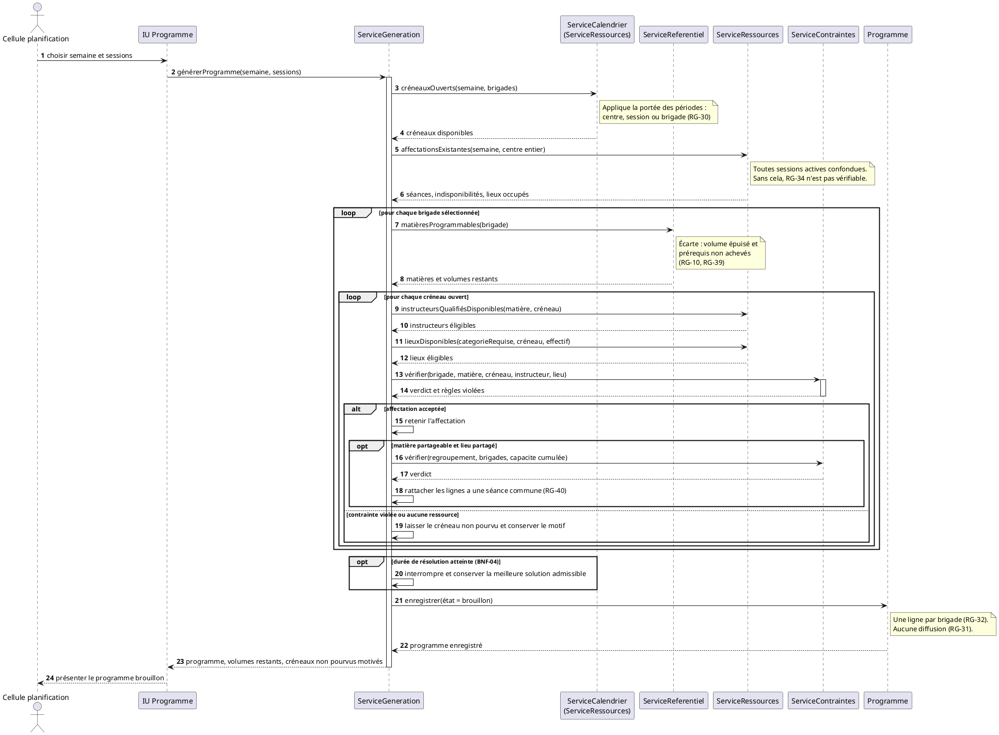
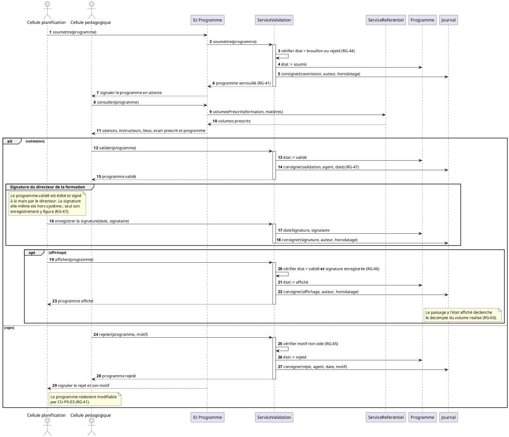
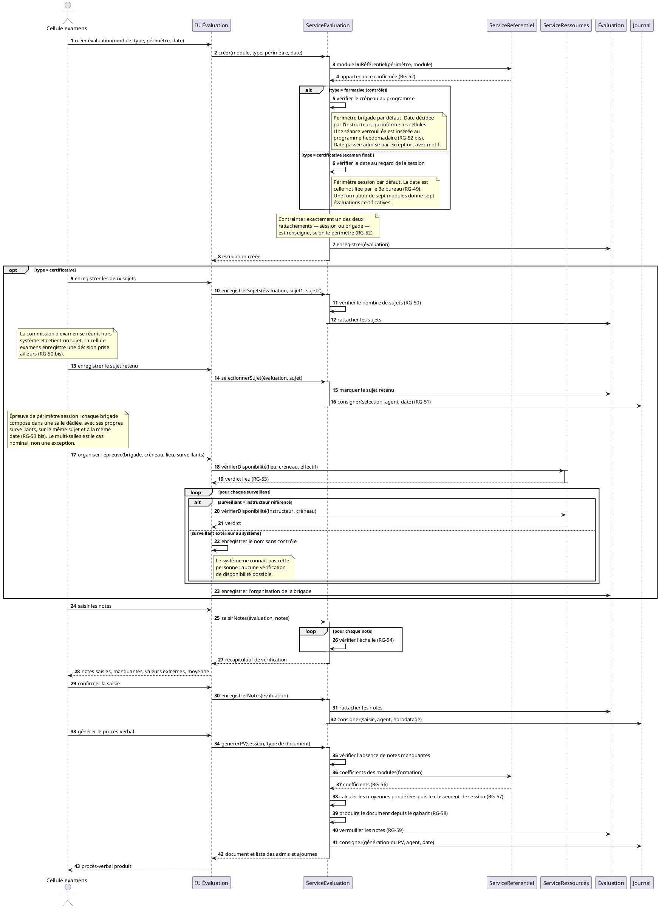
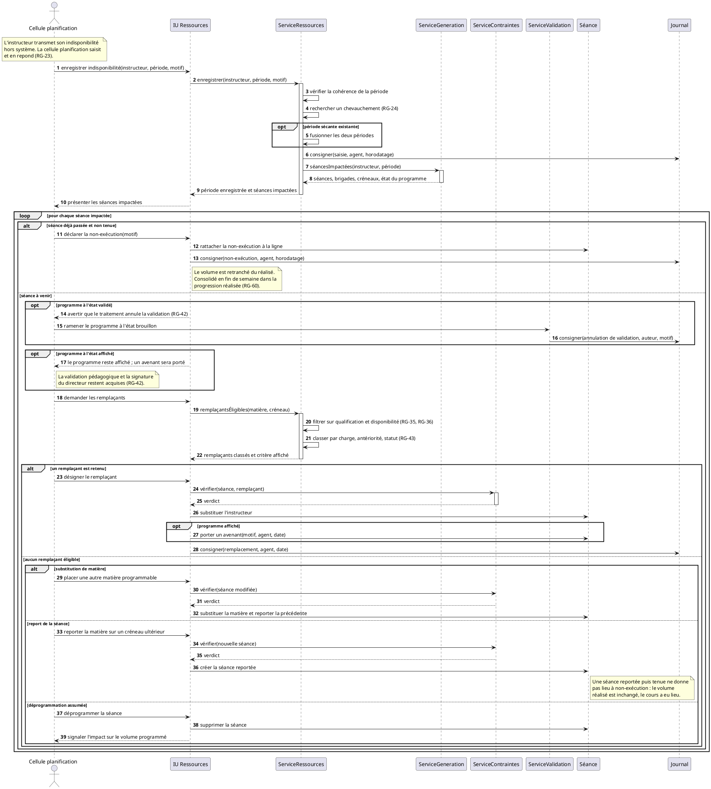

**DIAGRAMMES DE SÉQUENCE DES SCÉNARIOS PRINCIPAUX**

Projet de fin d'études · Système de gestion des activités de formation du CIT

*Livrable 2 / 5 — Phase 4 : Analyse et conception · **Version 3 du 30 août 2026** · Remplace la version 2 du 26 août 2026 · Lot WBS 4.1.2*

# 1. Objet et méthode

## 1.1 Place dans la démarche

Ce document est le deuxième livrable de la phase d'analyse et de conception. Il décrit la **chronologie des échanges** entre les acteurs et les composants du système pour quatre scénarios jugés déterminants, sélectionnés en ouverture de phase : la génération du programme hebdomadaire, la validation croisée, le circuit d'examen et le traitement d'une indisponibilité.

Le diagramme de séquence remplit ici une fonction précise. Les cas d'utilisation disent **ce que** le système fait ; les séquences disent **comment** l'information circule pour que cela se fasse. Cette différence n'est pas cosmétique : c'est en traçant les messages que l'on découvre quelles données doivent exister pour qu'un message aboutisse. Un service ne peut retourner la liste des instructeurs qualifiés et disponibles que si la qualification et l'indisponibilité sont modélisées ; un contrôle de contrainte ne peut refuser une affectation motivée que s'il dispose de la séance concurrente et de son détenteur.

Les séquences sont donc l'**instrument de vérification** du modèle avant que le diagramme de classes `CLS-00` ne le fige. La section 7 récapitule ce qu'elles ont révélé.

## 1.2 Ce que les séquences intègrent depuis la version 1 des cas d'utilisation

Sept décisions prises en analyse de terrain le 23 août sont intégrées directement, sans attendre la version 2 du livrable des cas d'utilisation.

| Décision | Effet sur les séquences |
| --- | --- |
| La résolution de la génération est **centre-entier**, quelle que soit la sélection | `SEQ-01` : le service de génération lit les affectations de **toutes** les sessions actives |
| Une évaluation porte sur **un seul module** | `SEQ-03` : le multi-modules disparaît |
| Les surveillants peuvent être **extérieurs au système** | `SEQ-03` : le contrôle de disponibilité devient conditionnel |
| Les **contrôles continus** admettent une saisie rétroactive | `SEQ-03` : le contrôle de date se restreint aux examens |
| Le **PFE** était réputé sans séance | Décision **annulée le 25 août** : le terrain a établi que le PFE est un module enseigné. L'attribut de modalité a été retiré du modèle |
| La **salle attitrée** relève de la cellule planification | Sans effet sur les quatre séquences |
| La constatation se fait par **déclaration d'exception** | Section 6.5 : mécanisme décrit, distinct de `SEQ-04` |

**Quatre décisions supplémentaires du 26 août** sont intégrées à la version 2, toutes issues des réponses du chef de bureau pédagogique.

| Décision | Effet sur les séquences |
| --- | --- |
| Après affichage, une modification **ne fait pas retomber le programme à brouillon** | `SEQ-04` : la validation et la signature restent acquises, la séance porte un **avenant** |
| Le remplacement en urgence relève de la **cellule planification avec le directeur** | `SEQ-04` : la cellule pédagogique n'est plus dans le circuit d'ajustement |
| Une séance manquée peut être **reportée** plutôt que déclarée non exécutée | `SEQ-04` : quatrième issue au traitement, sans effet sur le volume réalisé |
| Les absences sont **consolidées en fin de semaine** dans une progression réalisée | Section 5.5 : rythme et propriétaire du mécanisme |

## 1.3 Convention de nommage des participants

Un diagramme de séquence n'a de valeur que si ses participants sont désignés avec la même rigueur d'un diagramme à l'autre. Trois catégories sont distinguées, et **aucun participant n'est introduit hors de cette grille**.

| Catégorie | Rôle | Convention |
| --- | --- | --- |
| **Acteur** | Utilisateur humain, conforme à la section 2 du livrable des cas d'utilisation | Nom du profil |
| **Interface** | Écran par lequel l'acteur agit | `IU` suivi du domaine |
| **Service** | Logique métier, couche services de l'architecture | `Service` suivi du domaine |
| **Entité** | Donnée persistante, future classe de `CLS-00` | Nom métier au singulier |

Les services nommés ici constituent un **engagement** : ils seront repris tels quels dans le dossier d'architecture et dans le squelette Django. Un service qui apparaîtrait dans une séquence sans figurer dans l'architecture signalerait une incohérence.

| Service | Paquetage | Responsabilité |
| --- | --- | --- |
| `ServiceReferentiel` | P2 | Matières programmables, volumes prescrits, prérequis, modalité |
| `ServiceRessources` | P4 | Disponibilité des instructeurs et des lieux, qualifications, calendrier |
| `ServiceGeneration` | P5 | Construction du programme hebdomadaire |
| `ServiceContraintes` | P5 | Contrôle des six contraintes dures — `CU-P5-02` |
| `ServiceValidation` | P5 | Machine à états du programme, circuit de validation |
| `ServiceEvaluation` | P6 | Évaluations, sujets, notes, moyennes, procès-verbaux |
| `ServiceSuivi` | P6 | Rapprochement prescrit et réalisé |

`ServiceRessources` appartient au paquetage P4 et non à P5, parce que P6 l'appelle également pour les épreuves — `RG-53`. Ce point, établi dans le livrable précédent, se vérifie dans `SEQ-03`.

## 1.4 Règles de lecture

Les fragments UML sont employés avec leur sens strict : `alt` pour des branches exclusives, `opt` pour un comportement conditionnel sans alternative, `loop` pour une itération, `ref` pour un renvoi à une autre séquence. Les barres d'activation figurent la durée de traitement, ce qui rend visible la profondeur d'appel — un point important pour `SEQ-01`, où elle est la plus grande du système.

Les messages de retour ne sont représentés que lorsqu'ils portent une information exploitée par la suite. Représenter chaque retour alourdirait les diagrammes sans rien apprendre.

Les diagrammes ne descendent **pas** au niveau des méthodes ni des requêtes en base. Ils s'arrêtent à la granularité des responsabilités métier, seul niveau utile pour vérifier le modèle et pour figurer dans un mémoire.

## 1.5 Mise en conformité de la version 3

Une relecture de conformité du binôme, comparant les trois familles de diagrammes entre elles et avec les fiches, a mis au jour un défaut de méthode : **les décisions des 25 et 26 août avaient été portées dans les cas d'utilisation et le diagramme de classes, mais pas dans les diagrammes de séquence**. Trois figures étaient en retard.

| Figure | Défaut | Correction |
| --- | --- | --- |
| `SEQ-01` | Mentionnait la modalité d'enseignement du PFE, attribut supprimé du modèle le 25 août | Note retirée |
| `SEQ-02` | Passait de l'état *validé* à l'état *affiché* sans enregistrement de la signature du directeur | Séquence de signature ajoutée entre les deux |
| `SEQ-03` | Portait encore trois types d'évaluation, une brigade en paramètre, et la sélection du sujet par la cellule examens | Réécrit intégralement |

**La leçon dépasse la correction.** Un modèle tenu par trois familles de diagrammes n'est cohérent que si chaque décision les traverse toutes. Le contrôle croisé — relire les séquences contre les fiches et contre le diagramme de classes — devient une étape à part entière avant toute revue, et non une vérification implicite.

# 2. SEQ-01 — Génération du programme hebdomadaire

## 2.1 Objet et portée

C'est le scénario central du système et le plus profond en appels. Il met en jeu cinq services, traverse les six paquetages métier et matérialise la totalité des contraintes dures.

**Portée de résolution.** La cellule planification sélectionne librement une session, plusieurs, ou toutes. Mais le service de génération lit systématiquement **les affectations de toutes les sessions actives** de la semaine comme contraintes fixes. Cette distinction entre périmètre de sélection et périmètre de résolution est structurante : `RG-34` interdit à un instructeur d'être affecté à deux séances simultanées toutes sessions confondues, et une génération qui n'aurait connaissance que de la session sélectionnée produirait un résultat dépendant de l'ordre de traitement. Trois sessions générées successivement dans un ordre donné n'aboutissent pas au même programme que dans un autre ordre, et la dernière traitée peut se retrouver sans ressource disponible alors qu'une résolution conjointe aurait abouti.

| | |
| --- | --- |
| **Cas d'utilisation source** | `CU-P5-01`, `CU-P5-02`, `CU-P5-04` — besoins BF-PLAN-03 et BF-PLAN-12 |
| **Cas d'utilisation amont** | `CU-P2-04`, `CU-P2-07`, `CU-P4-02`, `CU-P4-05` |
| **Acteur** | Cellule planification |
| **Règles mises en œuvre** | `RG-10`, `RG-28` à `RG-40` |
| **Préconditions** | Référentiel composé, calendrier déclaré, qualifications établies, lieux enregistrés, brigades constituées |
| **Postcondition** | Un programme à l'état brouillon par brigade traitée, sans violation de contrainte dure, assorti des créneaux non pourvus et de leur motif |

## 2.2 Diagramme SEQ-01

## 2.3 Commentaire du scénario

**Les deux lectures préalables, messages 2 à 5.** Le service de génération commence par deux interrogations qui bornent l'espace de recherche : les créneaux ouverts du calendrier, et les affectations déjà existantes sur la semaine. La seconde est la traduction directe de la portée centre-entier — elle rapatrie les séances de toutes les sessions actives, les indisponibilités déclarées et les lieux occupés, y compris par des épreuves d'examen. Sans elle, `ServiceContraintes` ne pourrait vérifier ni `RG-34` ni `RG-37`.

**Le filtrage du référentiel, message 6.** `ServiceReferentiel` écarte deux catégories de matières : celles dont le volume prescrit est épuisé, et celles dont les prérequis ne sont pas achevés — l'ordre topologique établi par `CU-P2-07`.

*La version 1 en écartait une troisième, celles dont la modalité d'enseignement était « non enseignée », introduite pour le cas du projet de fin d'études. Le terrain a établi le 25 août que le PFE est un module enseigné comme les autres, avec volume horaire décompté à chaque apparition dans la progression. L'attribut de modalité, devenu sans cas d'usage, a été retiré du modèle.*

**La double boucle, messages 6 à 20.** L'itération sur les brigades puis sur les créneaux traduit la construction heuristique. Elle est présentée ainsi parce qu'elle correspond au comportement de repli inscrit aux critères d'acceptation, et parce qu'un diagramme de séquence décrit une chronologie d'échanges, non un algorithme d'optimisation. Si `CU-P5-06` est réalisé, la résolution sous contraintes remplace le contenu des deux boucles sans changer les échanges avec les autres services : `ServiceGeneration` interroge les mêmes sources et appelle le même contrôle. **C'est la démonstration que l'abandon éventuel de l'optimisation au jalon J2 ne remet pas en cause l'architecture.**

**Le point de convergence, message 12.** Chaque affectation candidate passe par `ServiceContraintes`, quel que soit le chemin. Ce service est appelé aussi depuis la modification manuelle, le regroupement et la duplication : il constitue l'unique implantation des six contraintes dures. Le verdict retourné porte **la liste des règles violées**, pas seulement la première, faute de quoi la cellule planification corrigerait une contrainte pour en découvrir une autre à l'essai suivant.

**Le regroupement, messages 15 à 18.** Lorsque la matière s'y prête et qu'un lieu partagé est disponible, les lignes de plusieurs brigades sont rattachées à une séance commune. Le contrôle porte alors sur la capacité cumulée. C'est ici que se matérialise la distinction entre la séance et la ligne de programme : le diagramme ne peut pas se lire autrement, et cette lecture est la justification de `RG-40`.

**L'interruption, message 22.** Au-delà de la durée fixée par BNF-04, la résolution s'arrête et retourne la meilleure solution admissible obtenue. Elle ne retourne jamais rien : un système qui échouerait sans produire serait inutilisable en exploitation, où la semaine doit être préparée quoi qu'il arrive.

**La sortie, messages 23 à 26.** Le programme est enregistré à l'état brouillon et rien n'est diffusé. Le retour comporte les créneaux non pourvus **avec leur motif** — matière concernée, instructeurs qualifiés et cause d'indisponibilité de chacun. C'est l'exigence d'ergonomie la plus importante du scénario : un créneau vide sans explication oblige la cellule planification à refaire à la main le raisonnement du moteur.

## 2.4 Ce que la séquence exige du modèle

| Message | Donnée nécessaire | Conséquence pour `CLS-00` |
| --- | --- | --- |
| 3 | Portée d'une période de calendrier | Attribut de portée sur la période, avec la brigade ou la session visée |
| 5 | Affectations toutes sessions | La séance doit être interrogeable par créneau sans passer par la session |
| 6 | Modalité d'une matière du référentiel | Attribut sur le couple formation-matière |
| 6 | Volume restant | Dérivé : volume prescrit moins volume programmé, non stocké |
| 9 | Qualification par matière du catalogue | Classe d'association instructeur-matière |
| 11 | Catégorie de lieu requise | Attribut sur le couple formation-matière |
| 18 | Séance commune à plusieurs lignes | Séance et ligne de programme sont deux classes distinctes |
| 25 | Motif d'un créneau non pourvu | **Non persistant** : information de restitution, pas une entité |

# 3. SEQ-02 — Validation croisée d'un programme

## 3.1 Objet et portée

Ce scénario porte la valeur ajoutée organisationnelle de la solution : la cellule planification élabore, la cellule pédagogique valide, et rien ne s'affiche sans validation. Il est court en échanges mais dense en règles, et c'est celui qui se présente le plus facilement en soutenance.

**Unité de validation.** Le programme d'**une brigade pour une semaine**. La validation groupée existe — plusieurs brigades d'une même session en une opération — mais chaque validation demeure individuelle et journalisée séparément. `RG-47` en fait un acte nominatif engageant la responsabilité de son auteur : une entrée unique pour trois validations priverait le dispositif de sa valeur probante.

| | |
| --- | --- |
| **Cas d'utilisation source** | `CU-P5-10`, `CU-P5-11`, `CU-P5-12` |
| **Acteurs** | Cellule planification, cellule pédagogique |
| **Règles mises en œuvre** | `RG-41`, `RG-44` à `RG-47` |
| **Préconditions** | Un programme existe à l'état brouillon |
| **Postcondition** | Le programme est validé et affichable, ou rejeté avec motif et de nouveau modifiable |

## 3.2 Diagramme SEQ-02

## 3.3 Commentaire du scénario

**Le verrouillage, message 6.** Dès la soumission, le programme devient non modifiable. C'est le garde-fou du dispositif : sans lui, la cellule planification pourrait modifier un programme pendant que la pédagogique l'examine, et la validation porterait sur un objet qui n'existe plus. `RG-41` limite la modification aux seuls états brouillon et rejeté.

**La comparaison au prescrit, messages 9 et 10.** La cellule pédagogique ne valide pas un planning en tant qu'agencement de créneaux — c'est le métier de la planification — mais la conformité pédagogique de ce qui est programmé. Elle a donc besoin de l'écart entre le volume prescrit et le volume programmé, matière par matière. Ce message justifie que `ServiceReferentiel` soit appelé au moment de la consultation et non à la soumission : l'écart est calculé à la lecture, jamais figé.

**La signature du directeur, ajoutée en version 3.** Entre la validation et l'affichage s'intercale un acte que la version 2 omettait : le programme validé est édité et signé à la main par le directeur de la formation, puis la cellule planification enregistre la date et le nom du signataire. La signature elle-même est hors système ; **son enregistrement y figure et conditionne l'affichage**. Les progressions d'instruction des 23, 24 et 25 février portent toutes cette signature unique pour l'ensemble du centre.

**Les deux branches.** Le fragment `alt` est ici au sens strict : validation et rejet sont exclusifs et terminent tous deux le circuit. Le rejet exige un motif non vide, contrôlé avant transition — sans motif, la cellule planification ne saurait pas quoi corriger, et le circuit tournerait en boucle.

**L'affichage, messages 13 à 17.** Il est volontairement placé en fragment `opt` à l'intérieur de la branche de validation, et non comme une suite automatique. Un programme validé n'est pas nécessairement affiché immédiatement, et l'affichage est un acte de la cellule planification, pas de la pédagogique. Le contrôle d'état au message 14 matérialise `RG-46`, la règle centrale du dispositif : cette vérification est portée en base et non seulement par l'interface.

**Le déclenchement du suivi.** Le passage à l'état affiché est le moment où les séances entrent dans le calcul du volume réalisé. C'est le point de jonction entre le paquetage P5 et le paquetage P6, et il explique pourquoi la transition doit être un acte explicite et daté plutôt qu'un effet de bord de la validation.

## 3.4 Ce que la séquence exige du modèle

| Élément | Conséquence pour `CLS-00` |
| --- | --- |
| Machine à états | Attribut d'état sur le programme, valeurs contraintes par `RG-44` |
| Traçabilité de la validation | Auteur, date et décision conservés — entité de décision de validation, ou entrées de journal typées |
| Motif de rejet | Attribut obligatoire lorsque la décision est un rejet |
| Écart prescrit et programmé | Dérivé, jamais stocké |
| Date d'affichage | Attribut daté sur le programme, nécessaire au calcul du réalisé |

# 4. SEQ-03 — Circuit d'examen

## 4.1 Objet et portée

Ce scénario suit une évaluation de son ouverture à la production du procès-verbal. Il intègre trois corrections issues de l'analyse de terrain du 23 août : une évaluation porte sur **un seul module**, les surveillants peuvent être **extérieurs au système**, et les contrôles continus admettent une **saisie rétroactive**.

**Les deux circuits ne diffèrent que par le décideur de la date.** Pour une évaluation formative — le contrôle — l'instructeur décide de la date et informe les cellules, qui insèrent une séance verrouillée au programme. Pour une évaluation certificative — l'examen final — la date est celle notifiée par le 3ᵉ bureau, et l'organisation matérielle est requise : deux sujets soumis à la commission d'examen, une salle et des surveillants par brigade. Le périmètre est explicite dans les deux cas : une brigade ou la session entière.

| | |
| --- | --- |
| **Cas d'utilisation source** | `CU-P6-01`, `CU-P6-03`, `CU-P6-04`, `CU-P6-05`, `CU-P6-06`, `CU-P6-07` |
| **Acteur** | Cellule examens |
| **Acteurs métier hors système** | Instructeur, 3ᵉ bureau |
| **Règles mises en œuvre** | `RG-48` à `RG-59` |
| **Préconditions** | La brigade existe, le module appartient au référentiel de sa formation |
| **Postcondition** | Les notes sont saisies, les moyennes et le classement calculés, le procès-verbal produit et les notes verrouillées |

## 4.2 Diagramme SEQ-03

## 4.3 Commentaire du scénario

**Le contrôle d'appartenance, messages 3 et 4.** Toute évaluation commence par une vérification : le module évalué appartient-il au référentiel de la formation de la brigade ? C'est `RG-52`, et c'est la cardinalité que la question 5 au terrain a fixée — une évaluation, un module, sans regroupement possible. Cette réponse a supprimé une alternative de la version 1 des cas d'utilisation et **débloque le diagramme de classes**.

**Deux types, et non trois — correction de la version 3.** Le fragment de branchement opposait le contrôle continu au partiel et au final. Le terrain a établi le 25 août qu'il n'existe que deux types : formative et certificative, l'examen partiel étant le contrôle sous un autre nom. Le premier message passe désormais le **périmètre** en paramètre, et non une brigade : c'est le périmètre qui détermine conjointement la date, le sujet et l'organisation.

**Le fragment de branchement par type.** C'est ici que se matérialise `RG-48` : le type ne caractérise pas la nature de l'épreuve mais le **décideur de la date**. La branche formative vérifie le créneau au programme, puisque le contrôle est programmé et informé aux cellules ; la date passée y est admise par exception, avec motif. La branche certificative conserve le contrôle de cohérence, la date étant subie et non décidée, puisqu'elle vient du 3ᵉ bureau.

**Le fragment optionnel des sujets et de l'organisation.** Il englobe tout ce qui ne concerne que les évaluations certificatives. Le regrouper en un seul `opt` plutôt qu'en plusieurs rend visible que la différence entre les deux circuits n'est pas une succession de petites variations mais un bloc entier de procédure qui s'applique ou non.

**La règle des deux sujets.** Elle ne vaut que pour le certificatif : une évaluation formative porte un seul sujet, rédigé par l'instructeur, sans mécanisme de sélection. Deux sujets sont enregistrés, un seul est retenu **par la commission d'examen**, et l'enregistrement de cette décision est journalisé. Le dispositif limite le risque de divulgation ; sa transposition dans le système ne doit pas être simplifiée. La journalisation porte ici sur la **sélection**, et `RG-51` étend la traçabilité à chaque **consultation** du sujet retenu — cas rare où l'accès en lecture est journalisé.

**Le traitement des surveillants, messages 24 à 30.** C'est la correction la plus structurante de votre relecture. `RG-53` soumettait les surveillants au même contrôle de disponibilité que les séances, ce qui n'a de sens que pour une personne connue du système. Le fragment `alt` distingue donc deux natures de surveillant : l'instructeur référencé, dont la disponibilité est vérifiable, et la personne extérieure, dont on n'enregistre que le nom. **Sans cette distinction, le système aurait refusé toute organisation d'épreuve faisant appel à un surveillant extérieur**, ce qui est le cas courant.

**La double pondération, messages 39 et 40.** `ServiceReferentiel` fournit les coefficients des modules, propres à la formation. Le calcul applique ensuite deux niveaux : le poids du module dans la moyenne, et le poids de chaque type d'évaluation dans la note du module. Le second n'apparaît pas comme un message parce qu'il relève d'un paramétrage global, non d'une donnée du référentiel.

**Le verrouillage, message 42.** La génération du procès-verbal fige les notes. La correction ultérieure d'un procès-verbal relève de la réglementation et sort du périmètre du système — un point qu'il faut savoir énoncer en soutenance plutôt que de laisser croire à une lacune.

## 4.4 Ce que la séquence exige du modèle

| Élément | Conséquence pour `CLS-00` |
| --- | --- |
| Type d'évaluation | Attribut contraint à trois valeurs, gouvernant le circuit |
| Deux sujets, un retenu | Le sujet est une classe rattachée à l'évaluation, avec un indicateur de sélection |
| Surveillant de deux natures | Association optionnelle vers l'instructeur **et** attribut de nom libre — l'un ou l'autre |
| Coefficient du module | Attribut sur le couple formation-matière, variable d'une formation à l'autre |
| Poids par type d'évaluation | **Paramétrage**, non une entité |
| Verrouillage des notes | Attribut dérivé de l'existence d'un procès-verbal, ou indicateur explicite |
| Épreuve et séance | Deux objets distincts consommant les mêmes ressources — lieux et personnes |

## 4.5 Comment les examens de fin de formation s'organisent sans entité dédiée

Le cas concret : formation X, brigade X1, sept modules à évaluer sur la semaine du 12 au 16 octobre.

La cellule planification déclare au calendrier une **période bloquante** du 12 au 16, de nature examen, de portée brigade X1 — `RG-29` et `RG-30`. Aucune séance ne peut plus y être programmée : la semaine est réservée. La cellule examens crée ensuite sept évaluations par `SEQ-03`, une par module, chacune datée et organisée séparément.

Le regroupement des sept épreuves est **calculé** par filtre sur la période, non stocké. Il n'existe donc pas d'entité « session d'examens » : la période bloquante en tient lieu, et elle en porte déjà les dates, la portée et le caractère réservé. Une brigade décalée déclare sa propre période, une épreuve reportée change de date sans détachement, et les dates ne sont lues qu'à un seul endroit.

**La réserve a été levée le 25 août.** L'administration produit bien un acte unique de fin de formation : un procès-verbal reprenant tous les modules, avec le classement de tous les stagiaires de la session. Cet acte a un auteur, une date et un numéro, qui ne se déduisent d'aucune date : il figure donc dans `CLS-00` sous la classe `ProcesVerbal`, rattachée à la session. En revanche, **aucune entité « session d'examens » n'a été créée** : la période bloquante du calendrier en tient lieu.

# 5. SEQ-04 — Traitement d'une indisponibilité

## 5.1 Objet et portée

Ce scénario est celui qui traite le premier motif de reprise manuelle du programme dans la situation actuelle. Il enchaîne deux cas d'utilisation appartenant à deux paquetages : l'enregistrement de la période dans P4, son traitement dans P5.

**La saisie est déléguée.** L'instructeur transmet son indisponibilité par les canaux en vigueur au CIT ; la cellule planification la saisit et en répond. `RG-23` rattache la saisie à l'agent qui l'enregistre, jamais à l'instructeur concerné.

| | |
| --- | --- |
| **Cas d'utilisation source** | `CU-P4-03`, `CU-P5-07`, `CU-P5-08` |
| **Acteur** | Cellule planification |
| **Acteur métier hors système** | Instructeur |
| **Règles mises en œuvre** | `RG-23` à `RG-25`, `RG-34` à `RG-39`, `RG-42`, `RG-43` |
| **Préconditions** | L'instructeur existe |
| **Postcondition** | La période est enregistrée et chaque séance impactée est traitée : remplacement, substitution ou déprogrammation assumée |

## 5.2 Diagramme SEQ-04

## 5.3 Commentaire du scénario

**La fusion des périodes, messages 5 à 7.** Deux indisponibilités sécantes d'un même instructeur sont fusionnées plutôt que juxtaposées. C'est une hypothèse de conception que votre relecture a laissée passer sans objection ; elle évite un état où deux périodes se recouvrent partiellement, dont il faudrait décider laquelle fait foi.

**La recherche d'impact, messages 9 et 10.** Immédiatement après l'enregistrement, le système identifie les séances programmées de cet instructeur recoupant la période. C'est ce message qui transforme un simple enregistrement administratif en outil de pilotage : dans la situation actuelle, cette recherche est faite de mémoire, et c'est là que se produisent les oublis.

**La branche de la séance passée, messages 11 à 13.** Une séance déjà écoulée ne reçoit pas de remplaçant — ce serait absurde. Mais elle n'est pas pour autant laissée en suspens : si le cours n'a pas eu lieu, la cellule planification **déclare la non-exécution avec son motif**, et le volume est retranché du réalisé. La version 1 renvoyait vaguement « au suivi prescrit et réalisé » ; elle avait été écrite avant que le mécanisme de déclaration existe.

**Les deux traitements du programme selon son état, messages 14 à 17.** C'est la correction la plus lourde de la version 2. La version 1 faisait retomber le programme à brouillon dès qu'une séance validée ou affichée était touchée. Or le programme couvre le centre entier : une absence sur une seule séance aurait annulé la validation de toute la semaine, pour toutes les brigades, et exigé une nouvelle signature du directeur de la formation. Sur un centre où une quinzaine de groupes tournent, la procédure aurait été contournée dès la première semaine.

Le terrain a tranché le 26 août : la cellule planification gère l'ajustement avec le directeur, sans repasser par la cellule pédagogique. Deux cas sont donc distingués. **Avant affichage**, le programme est validé mais non diffusé : il retombe à brouillon et repasse le circuit complet, ce qui est cohérent puisque rien n'est sorti. **Après affichage**, le programme reste affiché et la séance modifiée porte un **avenant** — trace datée indiquant ce qui a changé, pourquoi et qui l'a décidé. La validation pédagogique et la signature restent acquises : elles portaient sur le programme prévisionnel, qui a bien été validé.

L'avenant est la transposition de ce que fait le papier : on ne réimprime pas la feuille signée, on annote et l'on prévient.

**L'annulation de validation, messages 17 à 20.** Si la séance appartient à un programme validé ou affiché, son traitement fait retomber le programme à l'état brouillon et **annule la validation**. Le système l'annonce avant d'agir. `RG-42` interdit toute modification silencieuse d'un programme validé : c'est le corollaire de `RG-46`, sans quoi la validation croisée pourrait être contournée par le biais du traitement d'indisponibilité.

**Le classement des remplaçants, messages 22 à 26.** `ServiceRessources` filtre d'abord sur les critères éliminatoires — qualification et disponibilité — puis classe selon des règles explicites : charge d'enseignement courante, antériorité d'intervention sur la matière dans la brigade, statut. **Le critère de classement est affiché** et l'utilisateur reste libre de désigner un autre instructeur éligible. L'absence d'apprentissage automatique est une contrainte du projet, mais elle produit ici un avantage : dans un contexte où l'affectation d'un instructeur est un acte de commandement, un classement explicable vaut mieux qu'un classement performant.

**Les quatre issues.** Remplacement, substitution de matière, **report**, déprogrammation. Aucune n'est appliquée d'office : le système propose et la cellule planification décide.

**Le report se distingue de la non-exécution, et la distinction porte sur le volume.** Une séance reportée puis tenue n'entame pas le volume réalisé : le cours a eu lieu, plus tard. Une séance déclarée non exécutée le retranche. Confondre les deux ferait apparaître en retard une matière qui a été rattrapée — et le rapprochement prescrit-réalisé perdrait sa valeur.

Le report n'est jamais proposé d'office. Une matière reportée consomme un créneau qui aurait servi à autre chose, et cet arbitrage appartient au terrain.

## 5.4 Ce que la séquence exige du modèle

| Élément | Conséquence pour `CLS-00` |
| --- | --- |
| **Avenant** | Classe rattachée à la séance : motif, nature de la modification, date, auteur. Plusieurs avenants possibles sur une même séance |
| Période d'indisponibilité | Classe rattachée à l'instructeur : début, fin, motif, agent saisisseur |
| Recherche par instructeur et période | La séance doit porter son créneau sous une forme interrogeable par intervalle |
| Annulation de validation | Transition inverse dans la machine à états, tracée avec son motif |
| Classement des remplaçants | **Calculé**, aucune donnée persistante — la charge est dérivée des séances |
| Report d'une matière substituée | Aucune entité : le volume restant se recalcule des séances existantes |

## 5.5 Le mécanisme voisin — la déclaration de non-exécution

Ce mécanisme, issu de l'analyse de terrain du 23 août, ne fait pas l'objet d'un diagramme de séquence : la nomenclature de phase fixe quatre séquences, et son enchaînement est trop simple pour en justifier une cinquième. Il est décrit ici parce qu'il complète `SEQ-04` et qu'il conditionne l'objectif OS4.

**Le principe est celui de la déclaration par exception.** Une séance appartenant à un programme affiché est réputée exécutée. On ne déclare que ce qui n'a pas eu lieu, y compris rétroactivement. Le silence vaut exécution.

Ce choix est le bon pour une raison de charge : une constatation systématique représenterait une vingtaine de saisies hebdomadaires par brigade pour signaler deux anomalies. La déclaration par exception ramène cela aux seules anomalies réelles.

**L'enchaînement.** La cellule planification, sur signalement de l'instructeur ou du chef de module, sélectionne une séance passée d'un programme affiché, déclare qu'elle n'a pas été exécutée et en saisit le motif. Le service de suivi retranche alors son volume du volume réalisé de la matière pour la brigade concernée. La déclaration est journalisée avec son auteur et son horodatage.

**Sur le modèle**, la séance porte une **non-exécution optionnelle** — motif, date de déclaration, auteur — absente dans le cas nominal. Elle ne porte pas un état obligatoire à trois valeurs comme je l'avais initialement proposé : cette première version supposait une constatation systématique que le terrain ne pratique pas.

**Sur le backlog**, la user story de déclaration de non-exécution — 2 points, épic E8, priorité Must — a été intégrée en version 6 sous le code US-SUI-05, avec le besoin BF-SUI-05 créé en version 6 du cahier des charges. `RG-60` est réécrite en conséquence : le volume réalisé est celui des séances des programmes affichés, **diminué des non-exécutions déclarées**.

**Le rythme et le propriétaire, établis le 26 août.** Le chef de bureau pédagogique a précisé que *les absences sont reportées pour la fin de semaine, et la planification donne la progression et les heures vraiment faites en fin de semaine*. La déclaration n'est donc pas saisie au fil de l'eau mais **consolidée en fin de semaine par la cellule planification**.

**Ce que cette phrase révèle est plus important que le rythme.** Le CIT produit déjà, chaque semaine, un document indiquant ce qui a réellement été dispensé et combien d'heures. C'est exactement l'objectif OS4, et il existe sur le terrain sous forme manuelle. Le système ne crée donc pas un besoin : il automatise un document que la cellule planification établit à la main chaque fin de semaine — argument à faire valoir en soutenance.

**Il en découle un livrable manquant : l'édition de la progression réalisée hebdomadaire.** Ni le cahier des charges ni le backlog ne la prévoient ; US-SUI-01 est une consultation à l'écran et US-SUI-04 un export en priorité Could. Un besoin et une story sont à créer, estimés à 3 points, priorité Must, puisqu'ils matérialisent un objectif SMART. Le document est **calculé** — séances du programme affiché, moins les non-exécutions déclarées, plus les avenants de la semaine — et ne donne lieu à aucune entité nouvelle.

# 6. Ce que les séquences apportent au diagramme de classes

Le tracé des quatre séquences a mis au jour cinq éléments qui n'apparaissaient pas dans les cas d'utilisation et qui doivent figurer dans `CLS-00`.

**La période de calendrier porte une portée.** Le message 3 de `SEQ-01` ne peut retourner les créneaux ouverts d'une brigade que si chaque période sait ce qu'elle bloque : le centre, une session ou une brigade. Sans cet attribut, un bivouac concernant une brigade bloquerait toutes les autres.

**Le couple formation-matière porte quatre attributs, non deux.** Volume horaire prescrit et catégorie de lieu requise étaient acquis ; s'y ajoutent le **coefficient**, variable d'une formation à l'autre, et les **deux poids** qui règlent la part du formatif et du certificatif dans la note du module. Cette classe d'association devient l'élément le plus chargé du modèle, ce qui confirme qu'elle en est le pivot. *La modalité d'enseignement, cinquième attribut envisagé le 23 août, a été retirée le 25 : le terrain a établi que le projet de fin d'études est un module enseigné comme les autres.*

**Le surveillant est de deux natures.** L'instructeur référencé et la personne extérieure ne peuvent être modélisés par une simple association vers l'instructeur. Il faut une association optionnelle et un attribut de nom libre, l'un excluant l'autre.

**La séance porte une non-exécution optionnelle.** Absente dans le cas nominal, elle porte un motif, une date de déclaration et un auteur.

**Trois grandeurs sont dérivées et ne doivent pas être stockées** : le volume restant d'une matière, l'écart entre prescrit et programmé, et la charge d'enseignement d'un instructeur. Toutes trois se recalculent des séances existantes. Les stocker créerait trois occasions de divergence entre une valeur enregistrée et la réalité qu'elle prétend décrire.

**Une entité a été confirmée depuis** : le procès-verbal de fin de formation est bien un acte unique pour la session, portant le classement de tous les stagiaires. Il figure dans `CLS-00` sous la classe `ProcesVerbal`, rattachée à la session.

**Une entité est née de la version 2** : l'avenant, qui porte l'ajustement d'une séance après affichage du programme. Motif, nature de la modification, date et auteur ; plusieurs avenants sont possibles sur une même séance. Il ne remplace pas la non-exécution — l'un dit *ce qui a changé*, l'autre dit *ce qui n'a pas eu lieu*.

# 7. Traçabilité

| Séquence | Cas d'utilisation | User stories | Besoins | Règles |
| --- | --- | --- | --- | --- |
| `SEQ-01` | `CU-P5-01`, `CU-P5-02`, `CU-P5-04` | US-PLAN-03, 04, 06 | BF-PLAN-03, 04, 06, 12 | `RG-10`, `RG-28` à `RG-40` |
| `SEQ-02` | `CU-P5-10`, `CU-P5-11`, `CU-P5-12` | US-VAL-01, 02, 03, 04 | BF-VAL-01, 02, 03, 04 | `RG-41`, `RG-44` à `RG-47` |
| `SEQ-03` | `CU-P6-01`, `CU-P6-03` à `CU-P6-07` | US-EVAL-01 à 07 | BF-EVAL-01 à 07 | `RG-48` à `RG-59` |
| `SEQ-04` | `CU-P4-03`, `CU-P5-07`, `CU-P5-08` | US-INS-03, US-PLAN-09, 10 | BF-INS-03, BF-PLAN-09, 10 | `RG-23` à `RG-25`, `RG-42`, `RG-43` |

Les quatre séquences couvrent 19 des 55 cas d'utilisation. Ce n'est pas une lacune : une séquence n'a d'intérêt que pour un scénario dont la chronologie n'est pas évidente. Les cas d'utilisation de gestion, dont le déroulement est décrit une fois pour toutes par la fiche générique, n'en justifient aucune.

# 8. Points ouverts et suite

**Trois questions restent au terrain**, aucune bloquante : le document de fin de semaine est-il signé et transmis à qui ; le remplacement en urgence exige-t-il l'accord du directeur à chaque cas ou seulement à la consolidation ; et un cours manqué est-il replacé ou seulement noté — l'hypothèse retenue offrant les deux possibilités.

**Effet sur le risque R6.** La portée centre-entier de la résolution augmente la taille du problème d'ordonnancement : les variables de décision couvrent toutes les brigades de toutes les sessions actives, non celles d'une seule session. Le prototype exploratoire du sprint 2 doit être dimensionné sur cette hypothèse, faute de quoi il validerait une faisabilité qui ne serait pas celle du système réel. Le registre des risques est à mettre à jour sur ce point.

**Suite immédiate.** `CLS-00` et ses vues thématiques, du 24 au 26 août, avec les cinq apports de la section 6. Puis la version 2 des cas d'utilisation et la version 6 du backlog produit, avant la revue de conception du 29 août.

---

*Livrable 2 / 5 de la phase 4 — version 3 du 30 août 2026. Remplace la version 2 du 26 août 2026. Tâche WBS 4.1.2. Intègre les décisions d'analyse de terrain des 23, 25 et 26 août 2026 et la relecture de conformité du 30 août.*
