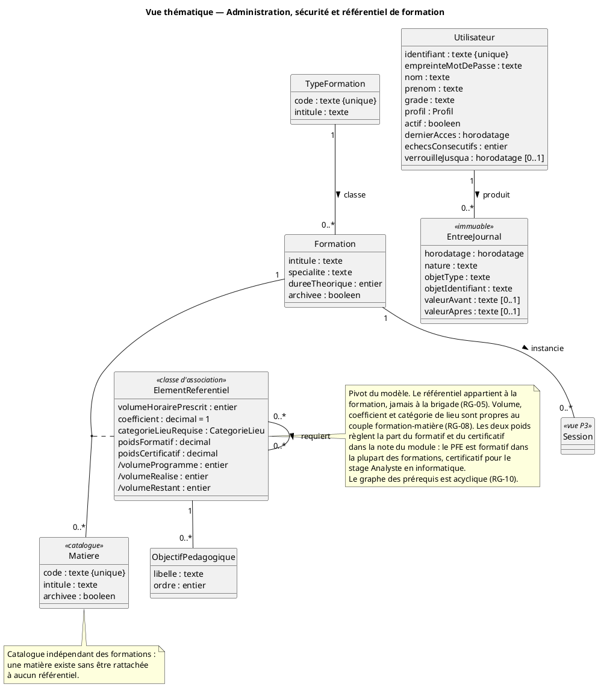
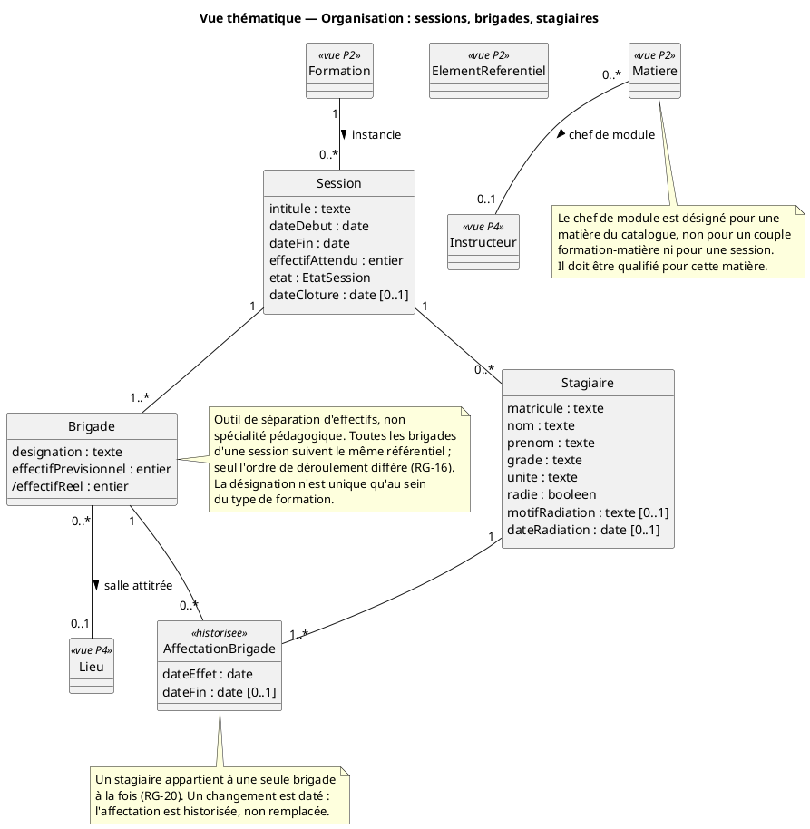
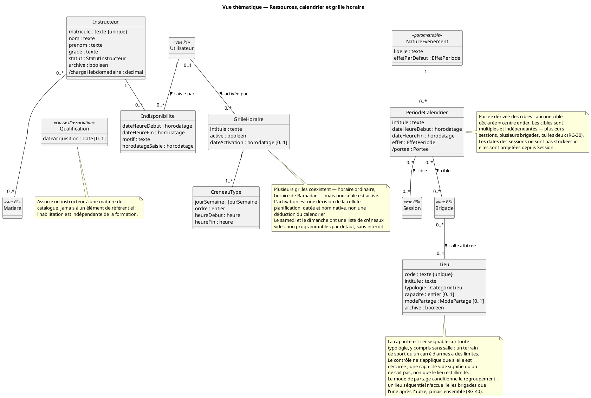
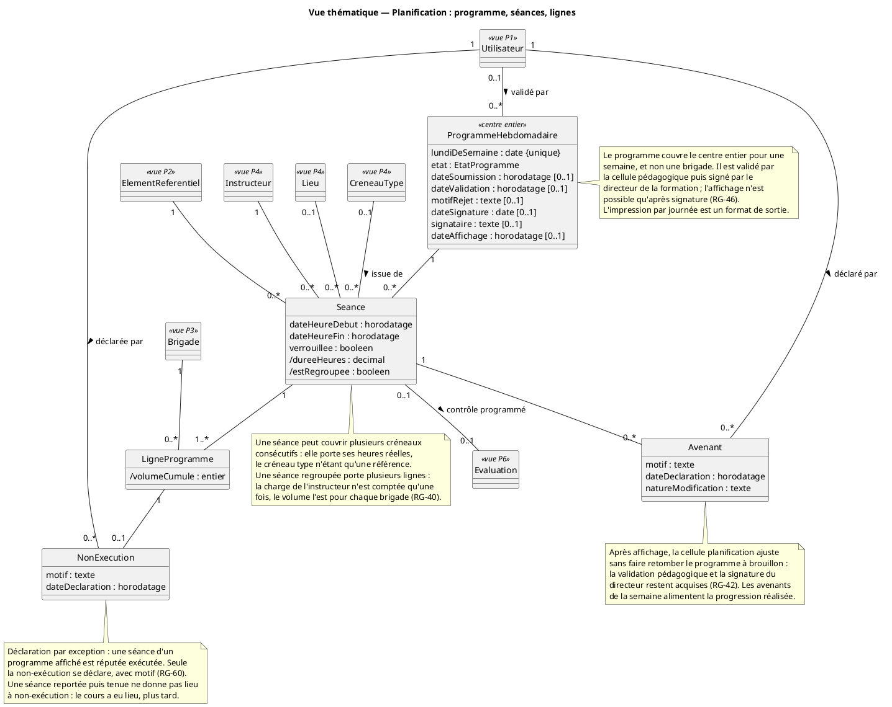
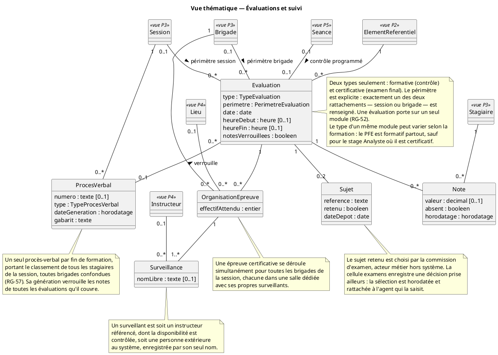

**DIAGRAMME DE CLASSES DU DOMAINE**

Projet de fin d'études · Système de gestion des activités de formation du CIT

*Livrable 3 / 5 — Phase 4 : Analyse et conception · **Version 4 du 30 août 2026** · Lot WBS 4.1.3*

# 1. Objet et méthode

## 1.1 Statut de ce document

`CLS-00` est le **modèle conceptuel unique du projet**. La démarche étant UML de bout en bout, il n'existe ni MCD ni MLD Merise : le niveau logique fait l'objet d'une note de choix d'implémentation — contraintes en base, index, types PostgreSQL — qui est une justification et non un second modèle.

Deux règles gouvernent ce livrable, posées en ouverture de phase.

**Le diagramme complet fait foi.** Les vues thématiques `CLS-01` à `CLS-05` en sont des extraits lisibles. Si une vue contredit `CLS-00`, c'est la vue qui est fausse. Le diagramme complet part en annexe du mémoire, en A3 paysage ; ce sont les vues qui figurent dans le corps.

**Il ne porte que des entités métier.** Attributs, associations avec cardinalités, classes d'association, décisions de suppression. Jamais de vues, de services ni de sérialiseurs, qui relèvent du dossier d'architecture. C'est pourquoi l'application technique `noyau` n'y apparaît pas : elle ne porte aucune entité métier.

## 1.2 Conventions de notation

| Notation | Signification |
| --- | --- |
| `attribut : type` | Attribut simple, obligatoire |
| `attribut : type [0..1]` | Attribut facultatif |
| `/attribut` | **Attribut dérivé** — calculé, jamais stocké |
| `{unique}` | Contrainte d'unicité portée en base |
| `<<classe d'association>>` | Classe portant les attributs d'une association |
| `<<vue Pn>>` | Classe d'un autre paquetage, rappelée pour le contexte |

Les types sont exprimés en termes métier — texte, entier, décimal, date, heure, horodatage, booléen — et non en types PostgreSQL. La correspondance relève de la note d'implémentation.

## 1.3 Ce que les diagrammes de séquence ont apporté

Le modèle n'a pas été écrit d'un jet : il a été **éprouvé** par les quatre séquences avant d'être figé. Cinq éléments en sont issus et n'apparaissaient pas dans les cas d'utilisation — la portée des périodes de calendrier, les quatre attributs du couple formation-matière, la double nature du surveillant, la non-exécution optionnelle de la séance, et l'identification de trois grandeurs dérivées.

C'est l'ordre de travail retenu, et il se défend devant un jury : les séquences valident le modèle, elles n'en découlent pas.

## 1.4 Décisions de terrain intégrées

Ce modèle intègre les échanges du 23 et du 25 août avec le chef de bureau pédagogique, ainsi que l'analyse de quatre documents opérationnels — les progressions d'instruction des 23, 24 et 25 février et du 7 mai 2026.

| Décision | Effet sur le modèle |
| --- | --- |
| Le programme est **hebdomadaire et couvre le centre entier** ; l'impression par journée est un format de sortie | `ProgrammeHebdomadaire` n'est plus rattaché à une brigade |
| Validation par la cellule pédagogique, puis **signature du directeur de la formation** | Deux attributs et deux dates distinctes sur le programme |
| **Deux types d'évaluation** seulement : formative et certificative | L'examen partiel disparaît : c'est le contrôle |
| Le **périmètre** d'une évaluation est la session ou la brigade | Deux rattachements exclusifs sur `Evaluation` |
| L'examen certificatif se déroule **simultanément pour toutes les brigades**, chacune dans sa salle | `OrganisationEpreuve` est un triplet brigade-salle-surveillants |
| Les **deux sujets** ne concernent que le certificatif | Cardinalité `0..2` et contrainte conditionnelle |
| Le **contrôle est programmé** et entre dans la progression | `Seance` porte un rattachement optionnel vers `Evaluation` |
| Le **procès-verbal de fin de formation** est unique pour la session | `ProcesVerbal` est rattaché à `Session`, non à `Brigade` |
| Une **séance peut couvrir plusieurs créneaux** consécutifs | La séance porte ses heures réelles |
| **Deux grilles horaires** au moins — ordinaire et Ramadan | `GrilleHoraire` datée et `CreneauType` |
| Les périodes du calendrier visent **plusieurs sessions ou brigades** | Deux associations multiples, portée dérivée |
| L'**effet** d'un événement est dissocié de sa **nature** | `NatureEvenement` paramétrable avec effet par défaut |
| Les désignations de brigade ne sont **uniques qu'au sein du type de formation** | Contrainte d'unicité composite |
| Le **contrôle porte un seul sujet** ; les deux sujets sont réservés au certificatif | Cardinalité conditionnelle au type |
| Le sujet retenu est choisi par une **commission d'examen** | Acteur métier hors système ; la cellule examens enregistre |
| Le **PFE est un module enseigné** comme les autres, avec volume, séances et coefficient | Suppression de l'attribut de modalité |
| Le **type d'évaluation d'un module varie selon la formation** | Absorbé sans modification : le type est porté par l'évaluation |
| Le classement du procès-verbal porte sur **tous les stagiaires de la session** | `RG-57` réécrite |
| Plusieurs grilles horaires coexistent, **une seule est active** | Activation décidée, non déduite du calendrier |
| Après affichage, une modification **ne fait pas retomber le programme à brouillon** | Classe `Avenant` rattachée à la séance |
| Une séance manquée peut être **reportée** plutôt que déclarée non exécutée | Aucune entité : le report est une nouvelle séance |
| La **capacité** est renseignable sur toute typologie de lieu | Attribut déjà facultatif ; le contrôle s'applique dès qu'elle est déclarée |
| Les absences sont **consolidées en fin de semaine** dans une progression réalisée | Document calculé, aucune entité |

# 2. Vue d'ensemble

Le modèle comporte **30 classes** et **12 énumérations**, réparties sur les six paquetages du découpage arrêté en ouverture de phase.

| Paquetage | Classes | Rôle |
| --- | --- | --- |
| P1 — Administration et sécurité | 2 | Comptes, habilitations, journal des actions sensibles |
| P2 — Référentiel de formation | 5 | Types, formations, catalogue des matières, référentiels, prérequis |
| P3 — Organisation | 4 | Sessions, brigades, stagiaires, affectations |
| P4 — Ressources, calendrier et grille horaire | 8 | Instructeurs, qualifications, indisponibilités, lieux, grilles, calendrier |
| P5 — Planification | 5 | Programme hebdomadaire, séances, lignes, non-exécutions, avenants |
| P6 — Évaluations et suivi | 6 | Évaluations, sujets, épreuves, surveillance, notes, procès-verbaux |

**Deux classes d'association** portent le cœur du modèle : `ElementReferentiel` entre `Formation` et `Matiere`, `Qualification` entre `Instructeur` et `Matiere`. **Neuf attributs dérivés** sont identifiés et ne seront jamais stockés.

# 3. CLS-01 — Administration, sécurité et référentiel

## 3.1 Diagramme

## 3.2 Les classes

| Classe | Rôle | Points d'attention |
| --- | --- | --- |
| `Utilisateur` | Compte d'accès, rattaché à un profil unique | `RG-01`. Le verrouillage après échecs répétés est porté par deux attributs, non par une entité |
| `EntreeJournal` | Trace immuable d'une action sensible | `RG-26`, `RG-27`. Aucune suppression, aucune modification, y compris par l'administrateur |
| `TypeFormation` | Catégorie de classement — OFF, ODR, CAT-1 | Confirmé par les documents opérationnels : la feuille de progression est organisée en blocs par type |
| `Formation` | Cursus, sans dates | Une formation n'a pas de dates ; seules ses sessions en ont |
| `Matiere` | Élément du **catalogue**, indépendant des formations | Une matière existe sans être rattachée à aucun référentiel |
| `ElementReferentiel` | **Classe d'association** formation-matière | Voir ci-dessous |
| `ObjectifPedagogique` | Objectif rattaché à un élément de référentiel | Décision de conception, voir section 9 |

## 3.3 ElementReferentiel, pivot du modèle

C'est la classe la plus sollicitée : elle est référencée par les séances, les évaluations, les désignations de chefs de module et le rapprochement prescrit-réalisé. Elle porte **cinq attributs propres et trois dérivés**.

| Attribut | Origine |
| --- | --- |
| `volumeHorairePrescrit` | `RG-08` — propre au couple, la même matière peut porter des volumes différents dans deux formations |
| `coefficient` | Terrain du 23 août — le coefficient d'un module **varie d'une formation à l'autre** |
| `categorieLieuRequise` | `BF-REF-04` — salle attitrée, lieu partagé ou sans lieu |
| `poidsFormatif`, `poidsCertificatif` | Terrain — second niveau de pondération, à l'intérieur du module. Le PFE en donne le cas d'école : formatif dans la plupart des formations, **certificatif pour le stage Analyste en informatique** |
| `/volumeProgramme`, `/volumeRealise`, `/volumeRestant` | Dérivés des séances et des non-exécutions |

**Pourquoi une classe d'association et non une simple table de liaison.** Une association plusieurs-à-plusieurs sans attributs serait insuffisante : le volume, le coefficient et la modalité n'appartiennent ni à la formation ni à la matière, mais bien au couple. La classe d'association est la construction UML exacte pour cela, et c'est aussi ce qui permet aux séances de référencer un élément de référentiel plutôt qu'une matière — ce qui garantit qu'une séance ne peut jamais porter une matière absente du référentiel de sa formation.

## 3.4 Les prérequis

L'association réflexive `requiert` sur `ElementReferentiel` — et non sur `Matiere` — porte `RG-09` **structurellement** : deux éléments de référentiel liés appartiennent nécessairement au même référentiel puisque chacun désigne un couple formation-matière. La règle n'a pas besoin d'être vérifiée par le code.

`RG-10`, l'acyclicité, n'est en revanche pas exprimable en UML ni en base : elle relève de la couche services. Voir section 8.

# 4. CLS-02 — Organisation : sessions, brigades, stagiaires

## 4.1 Diagramme

## 4.2 Les classes

| Classe | Rôle | Points d'attention |
| --- | --- | --- |
| `Session` | Instance datée d'une formation | Deux sessions d'une même formation peuvent se chevaucher |
| `Brigade` | **Outil de séparation d'effectifs**, non spécialité | `RG-16` : les progressions décalées sont voulues |
| `Stagiaire` | Personne inscrite à une session | La radiation remplace la suppression : les notes doivent survivre |
| `AffectationBrigade` | Rattachement **historisé** d'un stagiaire à une brigade | Voir ci-dessous |
| *(supprimée en v4)* | La désignation du chef de module est devenue une simple association entre la matière du catalogue et l'instructeur | Voir ci-dessous |

## 4.3 Le chef de module — une simplification du terrain

La version 3 modélisait la désignation du chef de module comme une **association ternaire réifiée** entre la session, l'élément de référentiel et l'instructeur. Elle reposait sur une information donnée le 22 août, que le terrain a corrigée le 30 : le chef de module est désigné **pour une matière du catalogue**, indépendamment de la formation et de la session.

La classe disparaît au profit d'une simple association entre `Matiere` et `Instructeur`, assortie d'une date de désignation portée par la matière. Le modèle passe de 31 à 30 classes.

**Le gain n'est pas seulement une classe.** L'association ternaire imposait une désignation par session : sur cinq sessions annuelles portant la même matière, cinq enregistrements pour une information qui n'en méritait qu'un. Une règle s'ajoute : le chef de module doit être **qualifié** pour la matière.

Le cas d'utilisation correspondant demeure dans le paquetage P3 pour rester aligné sur l'epic E3 du backlog, bien qu'il agisse désormais sur une entité de P2.

## 4.4 Pourquoi l'affectation est historisée

`RG-20` impose qu'un stagiaire appartienne à une seule brigade à la fois. La solution naïve — une clé étrangère sur `Stagiaire` — perd l'information lors d'un changement de brigade. Or `CU-P3-06` prévoit ce changement en cours de session et exige qu'il soit daté et journalisé.

`AffectationBrigade` porte donc une date d'effet et une date de fin facultative. La brigade courante est celle dont la date de fin est vide. La règle « une seule à la fois » devient : **au plus une affectation ouverte par stagiaire**, contrainte à porter en base.

## 4.4 L'unicité des désignations

Les documents opérationnels montrent `EXP1` et `EXP2` dans deux blocs de type différent. La désignation d'une brigade n'est donc **pas unique dans le centre** : elle l'est au sein du type de formation. L'unicité est composite et le vérifier globalement produirait des refus injustifiés.

# 5. CLS-03 — Ressources, calendrier et grille horaire

## 5.1 Diagramme

## 5.2 Les classes

| Classe | Rôle | Points d'attention |
| --- | --- | --- |
| `Instructeur` | Enseignant, militaire du centre, vacataire ou civil | La charge est **dérivée**, jamais stockée |
| `Qualification` | **Classe d'association** instructeur-matière | Porte sur la matière du **catalogue** |
| `Indisponibilite` | Période d'absence, en **saisie déléguée** | Rattachée à l'agent qui saisit, jamais à l'instructeur |
| `Lieu` | Salle attitrée, lieu partagé ou sans lieu | Le **mode de partage** conditionne le regroupement : un lieu séquentiel n'accueille les brigades que l'une après l'autre (`RG-40`). Attribut jusque-là orphelin, câblé en v4 |
| `GrilleHoraire` | Ensemble de créneaux types, **activable** | Deux grilles connues : ordinaire et Ramadan |
| `CreneauType` | Créneau d'une grille, pour un jour de semaine | Heures explicites, durées inégales |
| `PeriodeCalendrier` | Événement daté, à cibles multiples | Portée dérivée |
| `NatureEvenement` | Nature paramétrable, avec effet par défaut | Bivouac, conférence, visite, congé, férié, examens |

## 5.3 La grille horaire, entité nouvelle

Les documents opérationnels établissent deux grilles réelles, aux horaires irréguliers qu'aucune arithmétique n'engendre.

| Grille | Créneaux |
| --- | --- |
| Ordinaire (mai) | 08:00–09:45 · 10:10–12:00 · 13:00–14:15 · 14:40–16:00 |
| Ramadan (février) | 08:30–09:50 · 10:00–11:20 · 11:30–12:50 · 13:10–14:30 |

**La grille active est désignée, non déduite.** La cellule planification crée autant de grilles qu'elle veut et en désigne une comme active ; la génération utilise celle-là. À l'approche du Ramadan, elle active la grille correspondante, ou en crée une nouvelle. Au retour à l'horaire ordinaire, elle réactive la précédente.

Le mécanisme alternatif — rattacher la grille à une période du calendrier pour que le système choisisse tout seul selon la date — a été examiné puis écarté. Le passage à l'horaire de Ramadan est une **décision de commandement** qui ne se déduit pas d'un calendrier ; l'automatiser ajouterait une association et une règle de résolution dont personne n'a besoin, et coupleraît deux domaines distincts.

L'activation est **datée et nominative** : un changement de grille modifie le fonctionnement de tout le centre, savoir qui l'a décidé relève de la même logique que `RG-26`. Deux attributs suffisent, aucune entité n'est créée.

Un changement de grille ne réécrit **jamais l'historique** : les séances passées conservent leurs heures réelles.

**Le point de conception décisif : la grille est une aide à la génération, non une contrainte de stockage.**

Trois objets se ressemblent et doivent être distingués. La **grille horaire** est le squelette de la semaine — l'ossature vide, sans matière ni instructeur. Le **créneau type** est une case de ce squelette : *lundi, deuxième créneau, de 10:10 à 12:00*, avec un jour de semaine, un rang, une heure de début et une heure de fin, et aucune date. Le mot *type* a le sens de modèle : c'est un patron répété chaque semaine. La **séance** est ce qui remplit une case un jour donné : *le jeudi 7 mai, de 10:10 à 12:00, EXP1 suit Matériel radio avec le lieutenant Ilhami en salle B1*.

La séance porte ses heures réelles de début et de fin, et une référence *optionnelle* au créneau type dont elle est issue. Le générateur ne propose que des créneaux de la grille ; la saisie manuelle peut en sortir — séance du samedi, horaire décalé — sans rien casser. Le vendredi porte sa propre liste, plus courte ; le samedi et le dimanche ont une liste vide, ce qui les rend non programmables par défaut sans les interdire.

## 5.4 La période de calendrier à cibles multiples

Une période porte **deux ensembles de cibles** : un ensemble de sessions et un ensemble de brigades, tous deux éventuellement vides. Les deux vides, la portée est le centre entier.

La portée est donc **dérivée et non stockée**. Un attribut `portee` renseigné indépendamment des cibles finirait par les contredire — dire « session » alors que l'ensemble est vide. Le dériver supprime la classe entière de ces incohérences.

Le document du 24 février en donne l'illustration : « EXAMIN FIN STAGE CAT/1 » occupe la journée entière des lignes CAT-1 pendant que les autres blocs suivent des cours normaux. C'est exactement une période bloquante ciblant un sous-ensemble.

**Deux conséquences.** `RG-29` s'assouplit : le non-chevauchement ne peut plus se contrôler « à portée égale », deux ensembles pouvant se recouper partiellement. Seul le doublon exact est refusé ; toute autre intersection donne un avertissement, les périodes se cumulant sans se contredire. Et l'effet — bloquant ou informatif — est **dissocié de la nature** : chaque nature porte une valeur par défaut surchargeable événement par événement.

## 5.5 Les dates de session ne sont pas dans le calendrier

Le calendrier annuel comporte deux couches de nature différente : les **sessions**, affichées comme bandes de durée, et les **événements**, enregistrés comme périodes.

Seule la seconde couche donne lieu à des périodes. Les dates des sessions sont **projetées** depuis `Session`, jamais saisies au calendrier. Sans cette règle, le même fait serait enregistré à deux endroits et divergerait au premier report — c'est le défaut le plus courant des calendriers d'établissement.

# 6. CLS-04 — Planification

## 6.1 Diagramme

## 6.2 Le changement le plus lourd du modèle

`ProgrammeHebdomadaire` couvre **le centre entier pour une semaine**, et non une brigade. Les documents opérationnels sont sans ambiguïté : les progressions des 23, 24 et 25 février portent toutes la même date de signature, le 20 février, et une seule signature du directeur de la formation pour l'ensemble du centre.

Trois conséquences en découlent.

L'unité de validation n'est plus la brigade mais la semaine. La **validation groupée devient la norme** et non un enchaînement alternatif.

Le circuit gagne un acte. Il ne s'agit plus de valider puis d'afficher, mais de **soumettre, valider, signer, afficher** — la signature du directeur de la formation conditionnant l'affichage.

Et l'impression par journée, qui avait pu faire croire à un programme quotidien, est un **format de sortie** sans effet sur le modèle.

## 6.3 La séance et la ligne de programme

C'est la distinction que `SEQ-01` a rendue nécessaire et que `RG-40` formalise.

La **séance** est l'événement d'enseignement : créneau, lieu, matière, instructeur. La **ligne de programme** rattache une séance à une brigade. Une séance porte une à plusieurs lignes.

Une séance regroupée — plusieurs brigades sur la même conférence — est une séance unique portant plusieurs lignes. La charge de l'instructeur n'est comptée **qu'une fois** ; le volume horaire est décompté **pour chaque brigade**, chacune ayant bien suivi la matière. Sans cette distinction, la charge des instructeurs serait surévaluée et le générateur verrait un conflit d'affectation là où il n'y en a pas.

Les documents opérationnels confirment la pratique : « DÉFILÉS AVEC ARME » couvre plusieurs lignes du bloc CAT-2, « HISTOIRE MILITAIRE » revient sur plusieurs groupes au même créneau.

## 6.4 La séance à cheval sur plusieurs créneaux

Le document du 7 mai montre INFO1 avec « ALGORITHME + LANGAGE DE PROGRAMMATION C » sur les deux plages du matin. Une séance n'est donc pas contrainte à un créneau unique.

C'est pourquoi la séance porte ses **heures réelles** et non une référence obligatoire à un créneau type. Le lien vers `CreneauType` est facultatif et purement documentaire : il indique de quel créneau la séance est issue lorsqu'elle en épouse un.

## 6.5 Le contrôle programmé

Le terrain a établi que l'instructeur informe la cellule d'examens et la planification pour insérer le contrôle « dans la progression ». Le document du 23 février le confirme : ligne EXP3, « MESSAGERIE ÉLECTRONIQUE — TEST ».

Le contrôle **est une séance**, avec un rattachement optionnel vers `Evaluation`. Ce rattachement, joint à l'indicateur de verrouillage, la rend prioritaire et non déplaçable par une régénération.

**Une asymétrie assumée, à ne pas chercher à unifier.** Le contrôle occupe un créneau du programme hebdomadaire ; l'épreuve certificative vit hors du programme, dans une semaine entièrement bloquée au calendrier. Ce sont deux mécanismes d'occupation de ressources différents pour deux objets voisins. Cette asymétrie est métier, non un défaut de conception, et elle doit rester explicite — sans quoi quelqu'un cherchera plus tard à les unifier et cassera le modèle.

## 6.6 L'avenant

Le terrain a établi le 26 août que **la cellule planification gère l'ajustement en cours de semaine avec le directeur de la formation**, sans repasser par la cellule pédagogique.

La version 2 faisait retomber le programme à brouillon dès qu'une séance affichée était touchée. Le programme couvrant le centre entier, une absence sur une seule séance aurait annulé la validation de toute la semaine et exigé une nouvelle signature du directeur. Sur un centre où une quinzaine de groupes tournent, plusieurs absences par semaine sont certaines : la procédure aurait été contournée dès la première semaine.

`Avenant` est donc une classe rattachée à la **séance**, portant un motif, la nature de la modification, une date et un auteur. Plusieurs avenants sont possibles sur une même séance. Le programme reste affiché ; la validation pédagogique et la signature demeurent acquises, puisqu'elles portaient sur le programme prévisionnel, qui a bien été validé.

C'est la transposition de ce que fait le papier : on ne réimprime pas la feuille signée, on annote et l'on prévient.

**À ne pas confondre avec la non-exécution.** L'avenant dit *ce qui a changé* ; la non-exécution dit *ce qui n'a pas eu lieu*. Une séance dont l'instructeur a été remplacé porte un avenant et son volume compte au réalisé. Une séance annulée porte une non-exécution et son volume est retranché. Et une séance **reportée** puis tenue ne porte ni l'un ni l'autre au titre du volume : le cours a eu lieu, plus tard.

## 6.7 La non-exécution

`NonExecution` est rattachée à la **ligne de programme** et non à la séance : une séance regroupant trois brigades peut n'avoir été manquée que par l'une d'elles.

Elle est **facultative et absente dans le cas nominal**. Le principe est celui de la déclaration par exception : une séance d'un programme affiché est réputée exécutée, seule la non-exécution se déclare, avec motif. Une constatation systématique aurait représenté une vingtaine de saisies hebdomadaires par brigade pour signaler deux anomalies.

# 7. CLS-05 — Évaluations et suivi

## 7.1 Diagramme

## 7.2 Deux types, et non trois

Le terrain a fixé le vocabulaire officiel : **évaluation formative**, le contrôle, et **évaluation certificative**, l'examen final pour l'obtention du certificat. L'« examen partiel » que nous traitions comme un troisième circuit n'existe pas : c'est le contrôle sous un autre nom.

| Type | Décideur de la date | Périmètre habituel | Sujets | Organisation |
| --- | --- | --- | --- | --- |
| Formative | L'instructeur, qui informe les cellules | Brigade | Non | Séance au programme |
| Certificative | Le 3ᵉ bureau | Session | Deux, un retenu | Une salle par brigade |

## 7.3 Le périmètre, attribut explicite

`Evaluation` porte un attribut de périmètre et **deux rattachements dont un seul est renseigné** : soit une session, soit une brigade.

La raison profonde n'est pas la date mais **le sujet**. Deux brigades qui composent à des dates différentes ne peuvent pas avoir le même sujet — la première le divulguerait à la seconde. Le périmètre détermine donc conjointement la date, le sujet et l'organisation.

Le type propose une valeur par défaut — formative par brigade, certificative par session — mais la cellule examens décide au cas par cas. Un contrôle pourrait être commun à toute une session si les progressions le permettent.

Cette exclusivité n'est pas exprimable en UML : c'est une contrainte à porter en base. Voir section 8.

## 7.4 L'organisation d'épreuve suit les brigades

Le terrain est précis : « chaque brigade dans une salle avec même épreuve et des surveillants par salle ». `OrganisationEpreuve` est donc un **triplet brigade — lieu — surveillants**, et non une simple liste de salles.

Une évaluation certificative de périmètre session, pour une session à trois brigades, porte trois organisations d'épreuve, chacune avec son lieu et ses surveillants, à la même date et sur le même sujet.

## 7.5 Le surveillant de deux natures

`Surveillance` porte un rattachement facultatif vers `Instructeur` **et** un attribut de nom libre, l'un excluant l'autre. Le contrôle de disponibilité ne s'applique qu'au premier cas : le système ne peut pas vérifier la disponibilité d'une personne qu'il ne connaît pas.

Sans cette distinction, le système aurait refusé toute organisation d'épreuve faisant appel à un surveillant extérieur — cas courant.

## 7.6 Le procès-verbal

Un procès-verbal de fin de formation est **unique pour la session** et porte les résultats de toutes les brigades, le classement étant établi **au sein de chaque brigade** conformément à `RG-57`.

Sa génération verrouille les notes de toutes les évaluations qu'il couvre, en un acte unique et daté. Elle exige que **toutes** les évaluations concernées aient leurs notes complètes : une seule manquante bloque le procès-verbal de la session entière. `CU-P6-07` doit donc énumérer les manquants **par module et par brigade**, sans quoi la cellule examens chercherait à l'aveugle.

**Une entité n'a pas été créée : la « session d'examens ».** La semaine d'examens est une période bloquante du calendrier, qui en porte déjà les dates, les cibles et le caractère réservé. Le regroupement des épreuves se calcule par filtre sur la période. Ce qui devait exister, c'est le procès-verbal, parce qu'il est un acte administratif portant un auteur, une date et un numéro — cela ne se déduit pas de dates.

# 8. Contraintes non exprimables dans le diagramme

Un diagramme de classes n'exprime ni les invariants conditionnels ni les propriétés de graphe. Les contraintes suivantes doivent être portées ailleurs, et il faut savoir dire où.

| Contrainte | Origine | Portée par |
| --- | --- | --- |
| Le graphe des prérequis est acyclique | `RG-10` | **Couche services** — parcours en profondeur à chaque ajout |
| Exactement un rattachement renseigné sur `Evaluation` | Terrain 25/08 | **Base** — contrainte de vérification |
| Deux sujets uniquement si l'évaluation est certificative | `RG-50` | **Couche services** — conditionnelle au type |
| Au plus un sujet retenu par évaluation | `RG-50` | **Base** — index partiel unique |
| Au plus une affectation ouverte par stagiaire | `RG-20` | **Base** — index partiel unique |
| Capacité du lieu supérieure à l'effectif accueilli | `RG-13`, `RG-19` | **Couche services** — dépend d'un effectif dérivé |
| Non-chevauchement des indisponibilités d'un instructeur | `RG-24` | **Base** — contrainte d'exclusion sur intervalles |
| Unicité d'affectation de l'instructeur, hors séance regroupée | `RG-34` | **Couche services** — l'exception du regroupement l'exclut de la base |
| Créneau non bloqué par une période visant la brigade | `RG-38` | **Couche services** — dépend de la portée dérivée |
| Volume programmé n'excédant pas le volume prescrit | `RG-39` | **Couche services** — dépend d'un agrégat |
| Immuabilité des entrées de journal | `RG-27` | **Base** — révocation des droits de mise à jour et de suppression |
| Désignation de brigade unique au sein du type de formation | Terrain 25/08 | **Base** — unicité composite |
| Exactement une grille horaire active | Section 5.3 | **Base** — index partiel unique sur l'indicateur d'activation |
| Un seul sujet si formative, deux si certificative | `RG-50` | **Couche services** — conditionnelle au type |

Cette répartition confirme la règle d'architecture posée en phase 3 : **une couche services systématique**, y compris pour des opérations en apparence simples. Sept de ces treize contraintes ne peuvent pas descendre en base.

# 9. Attributs dérivés

Neuf attributs sont calculés et **ne doivent jamais être stockés**. Les stocker créerait autant d'occasions de divergence entre une valeur enregistrée et la réalité qu'elle prétend décrire.

| Attribut | Classe | Calcul |
| --- | --- | --- |
| `/volumeProgramme` | `ElementReferentiel` | Somme des durées des séances, tous états de programme |
| `/volumeRealise` | `ElementReferentiel` | Idem, programmes affichés seulement, moins les non-exécutions |
| `/volumeRestant` | `ElementReferentiel` | Volume prescrit moins volume programmé |
| `/effectifReel` | `Brigade` | Nombre d'affectations ouvertes de stagiaires non radiés |
| `/chargeHebdomadaire` | `Instructeur` | Somme des durées de ses séances, une séance regroupée comptée une fois |
| `/portee` | `PeriodeCalendrier` | Centre si aucune cible, sinon sessions ou brigades |
| `/dureeHeures` | `Seance` | Différence entre heures de fin et de début |
| `/estRegroupee` | `Seance` | Vrai si plus d'une ligne de programme |
| `/volumeCumule` | `LigneProgramme` | Volume dispensé à cette brigade pour cette matière, à cette date |

`/volumeCumule` mérite une mention : c'est **la fraction imprimée dans chaque case** des progressions d'instruction — 16/40, 78/80, 4/15. Le rapprochement prescrit-réalisé est donc déjà pratiqué à la main au CIT. L'objectif OS4 n'invente pas un besoin, il automatise une pratique existante — argument à faire valoir en soutenance.

# 10. CLS-00 — Diagramme complet

Le diagramme complet fait foi. Il est destiné à l'annexe du mémoire, en A3 paysage.

```plantuml
@startuml CLS-00
skinparam classAttributeIconSize 0
skinparam shadowing false

hide circle

package "P1 — Administration et sécurité" #F4F6FA {
  class Utilisateur {
    identifiant : texte {unique}
    empreinteMotDePasse : texte
    nom : texte
    prenom : texte
    grade : texte
    profil : Profil
    actif : booleen
    dernierAcces : horodatage
    echecsConsecutifs : entier
    verrouilleJusqua : horodatage [0..1]
  }
  class EntreeJournal <<immuable>> {
    horodatage : horodatage
    nature : texte
    objetType : texte
    objetIdentifiant : texte
    valeurAvant : texte [0..1]
    valeurApres : texte [0..1]
  }
}

package "P2 — Référentiel de formation" #F4F6FA {
  class TypeFormation {
    code : texte {unique}
    intitule : texte
  }
  class Formation {
    intitule : texte
    specialite : texte
    dureeTheorique : entier
    archivee : booleen
  }
  class Matiere <<catalogue>> {
    code : texte {unique}
    intitule : texte
    dateDesignationChef : date [0..1]
    archivee : booleen
  }
  class ElementReferentiel <<classe d'association>> {
    volumeHorairePrescrit : entier
    coefficient : decimal = 1
    categorieLieuRequise : CategorieLieu
    poidsFormatif : decimal
    poidsCertificatif : decimal
    /volumeProgramme : entier
    /volumeRealise : entier
    /volumeRestant : entier
  }
  class ObjectifPedagogique {
    libelle : texte
    ordre : entier
  }
}

package "P3 — Organisation" #F4F6FA {
  class Session {
    intitule : texte
    dateDebut : date
    dateFin : date
    effectifAttendu : entier
    etat : EtatSession
    dateCloture : date [0..1]
  }
  class Brigade {
    designation : texte
    effectifPrevisionnel : entier
    /effectifReel : entier
  }
  class Stagiaire {
    matricule : texte
    nom : texte
    prenom : texte
    grade : texte
    unite : texte
    radie : booleen
    motifRadiation : texte [0..1]
    dateRadiation : date [0..1]
  }
  class AffectationBrigade <<historisee>> {
    dateEffet : date
    dateFin : date [0..1]
  }
}

package "P4 — Ressources, calendrier et grille horaire" #F4F6FA {
  class Instructeur {
    matricule : texte {unique}
    nom : texte
    prenom : texte
    grade : texte
    statut : StatutInstructeur
    archive : booleen
    /chargeHebdomadaire : decimal
  }
  class Qualification <<classe d'association>> {
    dateAcquisition : date [0..1]
  }
  class Indisponibilite {
    dateHeureDebut : horodatage
    dateHeureFin : horodatage
    motif : texte
    horodatageSaisie : horodatage
  }
  class Lieu {
    code : texte {unique}
    intitule : texte
    typologie : CategorieLieu
    capacite : entier [0..1]
    modePartage : ModePartage [0..1]
    archive : booleen
  }
  class GrilleHoraire {
    intitule : texte
    active : booleen
    dateActivation : horodatage [0..1]
  }
  class CreneauType {
    jourSemaine : JourSemaine
    ordre : entier
    heureDebut : heure
    heureFin : heure
  }
  class PeriodeCalendrier {
    intitule : texte
    dateHeureDebut : horodatage
    dateHeureFin : horodatage
    effet : EffetPeriode
    /portee : Portee
  }
  class NatureEvenement <<parametrable>> {
    libelle : texte
    effetParDefaut : EffetPeriode
  }
}

package "P5 — Planification" #F4F6FA {
  class ProgrammeHebdomadaire <<centre entier>> {
    lundiDeSemaine : date {unique}
    etat : EtatProgramme
    dateSoumission : horodatage [0..1]
    dateValidation : horodatage [0..1]
    motifRejet : texte [0..1]
    dateSignature : date [0..1]
    signataire : texte [0..1]
    dateAffichage : horodatage [0..1]
  }
  class Seance {
    dateHeureDebut : horodatage
    dateHeureFin : horodatage
    verrouillee : booleen
    /dureeHeures : decimal
    /estRegroupee : booleen
  }
  class LigneProgramme {
    /volumeCumule : entier
  }
  class NonExecution {
    motif : texte
    dateDeclaration : horodatage
  }
  class Avenant {
    motif : texte
    dateDeclaration : horodatage
    natureModification : texte
  }
}

package "P6 — Évaluations et suivi" #F4F6FA {
  class Evaluation {
    type : TypeEvaluation
    perimetre : PerimetreEvaluation
    date : date
    heureDebut : heure [0..1]
    heureFin : heure [0..1]
    notesVerrouillees : booleen
  }
  class Sujet {
    reference : texte
    retenu : booleen
    dateDepot : date
  }
  class OrganisationEpreuve {
    effectifAttendu : entier
  }
  class Surveillance {
    nomLibre : texte [0..1]
  }
  class Note {
    valeur : decimal [0..1]
    absent : booleen
    horodatage : horodatage
  }
  class ProcesVerbal {
    numero : texte [0..1]
    type : TypeProcesVerbal
    dateGeneration : horodatage
    gabarit : texte
  }
}

package "Domaines de valeurs" #FBFBF8 {
  enum Profil {
    PEDAGOGIQUE
    PLANIFICATION
    EXAMENS
    DIRECTION_FORMATION
    ADMINISTRATEUR
  }
  enum CategorieLieu {
    SALLE_ATTITREE
    LIEU_PARTAGE
    SANS_LIEU
  }
  enum EtatSession {
    OUVERTE
    CLOTUREE
  }
  enum StatutInstructeur {
    MILITAIRE_DU_CENTRE
    VACATAIRE
    CIVIL
  }
  enum ModePartage {
    SIMULTANE
    SEQUENTIEL
  }
  enum JourSemaine {
    LUNDI
    MARDI
    MERCREDI
    JEUDI
    VENDREDI
    SAMEDI
    DIMANCHE
  }
  enum EffetPeriode {
    BLOQUANT
    INFORMATIF
  }
  enum Portee {
    CENTRE
    SESSIONS
    BRIGADES
  }
  enum EtatProgramme {
    BROUILLON
    SOUMIS
    VALIDE
    REJETE
    AFFICHE
  }
  enum TypeEvaluation {
    FORMATIVE
    CERTIFICATIVE
  }
  enum PerimetreEvaluation {
    BRIGADE
    SESSION
  }
  enum TypeProcesVerbal {
    EVALUATION
    FIN_DE_FORMATION
  }
}

' ---------------- P1
Utilisateur "1" -- "0..*" EntreeJournal : produit >

' ---------------- P2
TypeFormation "1" -- "0..*" Formation : classe >
Formation "1" -- "0..*" Matiere
(Formation, Matiere) .. ElementReferentiel
ElementReferentiel "0..*" -- "0..*" ElementReferentiel : requiert >
ElementReferentiel "1" -- "0..*" ObjectifPedagogique

' ---------------- P3
Formation "1" -- "0..*" Session : instancie >
Session "1" -- "1..*" Brigade
Session "1" -- "0..*" Stagiaire
Stagiaire "1" -- "1..*" AffectationBrigade
Brigade "1" -- "0..*" AffectationBrigade

' ---------------- P4
Instructeur "0..*" -- "0..*" Matiere
(Instructeur, Matiere) .. Qualification
Matiere "0..*" -- "0..1" Instructeur : chef de module >
Instructeur "1" -- "0..*" Indisponibilite
Utilisateur "1" -- "0..*" Indisponibilite : saisie par >
Brigade "0..*" -- "0..1" Lieu : salle attitrée >
GrilleHoraire "1" -- "1..*" CreneauType
Utilisateur "0..1" -- "0..*" GrilleHoraire : activée par >
NatureEvenement "1" -- "0..*" PeriodeCalendrier
PeriodeCalendrier "0..*" -- "0..*" Session : cible >
PeriodeCalendrier "0..*" -- "0..*" Brigade : cible >

' ---------------- P5
ProgrammeHebdomadaire "1" -- "0..*" Seance
Seance "1" -- "1..*" LigneProgramme
Brigade "1" -- "0..*" LigneProgramme
ElementReferentiel "1" -- "0..*" Seance
Instructeur "1" -- "0..*" Seance
Lieu "0..1" -- "0..*" Seance
CreneauType "0..1" -- "0..*" Seance : issue de >
LigneProgramme "1" -- "0..1" NonExecution
Seance "1" -- "0..*" Avenant
Utilisateur "1" -- "0..*" Avenant : déclaré par >
Utilisateur "1" -- "0..*" NonExecution : déclarée par >

' ---------------- P6
ElementReferentiel "1" -- "0..*" Evaluation
Session "0..1" -- "0..*" Evaluation : périmètre session >
Brigade "0..1" -- "0..*" Evaluation : périmètre brigade >
Evaluation "1" -- "0..2" Sujet
Evaluation "1" -- "0..*" OrganisationEpreuve
Brigade "1" -- "0..*" OrganisationEpreuve
Lieu "0..1" -- "0..*" OrganisationEpreuve
OrganisationEpreuve "1" -- "1..*" Surveillance
Instructeur "0..1" -- "0..*" Surveillance
Evaluation "1" -- "0..*" Note
Stagiaire "1" -- "0..*" Note
Session "1" -- "0..*" ProcesVerbal
Evaluation "0..*" -- "0..1" ProcesVerbal : verrouille <
Seance "0..1" -- "0..1" Evaluation : contrôle programmé >

note top of ElementReferentiel
  Pivot du modèle. Le référentiel appartient
  à la formation, jamais à la brigade (RG-05).
  Volume, coefficient et catégorie de lieu sont
  propres au couple formation-matière (RG-08).
  Les deux poids règlent la part du formatif et
  du certificatif dans la note du module.
end note

note bottom of Seance
  Une séance peut couvrir plusieurs créneaux
  consécutifs : elle porte ses heures réelles,
  le créneau type n'est qu'une référence.
  Une séance regroupée porte plusieurs lignes ;
  la charge instructeur n'est comptée qu'une
  fois, le volume l'est par brigade (RG-40).
  Après affichage, une modification ne fait pas
  retomber le programme à brouillon : elle porte
  un avenant daté et motivé (RG-42).
end note

note bottom of Evaluation
  Contrainte : exactement un des deux
  rattachements — session ou brigade —
  est renseigné, selon le périmètre.
  Deux sujets si certificative, dont un retenu
  par la commission d'examen ; un seul sujet
  si formative (RG-50).
end note

note bottom of PeriodeCalendrier
  Portée dérivée : aucune cible = centre entier.
  Cibles multiples possibles, sessions et
  brigades indépendamment (RG-30).
end note
@enduml
```

# 11. Traçabilité des règles métier vers les classes

| Règles | Classes concernées |
| --- | --- |
| `RG-01` à `RG-04` | `Utilisateur`, `EntreeJournal` |
| `RG-05` à `RG-10` | `Formation`, `Matiere`, `ElementReferentiel`, association `requiert` |
| `RG-11` à `RG-20` | `Session`, `Brigade`, `Stagiaire`, `AffectationBrigade`, `Lieu` |
| `RG-21` à `RG-25` | `Instructeur`, `Qualification`, `Indisponibilite` |
| `RG-26`, `RG-27` | `EntreeJournal` |
| `RG-28` à `RG-30` | `GrilleHoraire`, `CreneauType`, `PeriodeCalendrier`, `NatureEvenement` |
| `RG-50` | `Sujet` — deux si certificative, un si formative |
| `RG-57` | `ProcesVerbal` — classement au niveau session |
| `RG-31` à `RG-40` | `ProgrammeHebdomadaire`, `Seance`, `LigneProgramme` |
| `RG-41` à `RG-47` | `ProgrammeHebdomadaire`, `Utilisateur` |
| `RG-48` à `RG-59` | `Evaluation`, `Sujet`, `OrganisationEpreuve`, `Surveillance`, `Note`, `ProcesVerbal` |
| `RG-42`, `RG-42 bis`, `RG-42 ter` | `Avenant`, `Seance`, `ProgrammeHebdomadaire` |
| `RG-60`, `RG-61` | `NonExecution`, `ElementReferentiel` |
| `RG-62` à `RG-64` | `GrilleHoraire`, `CreneauType`, `Seance` |
| `RG-65` | Attributs déclaratifs et dérivés de `Formation`, `Session`, `ElementReferentiel` |

Les règles `RG-48` à `RG-53` sont à réécrire au titre des décisions du 25 août — deux types au lieu de trois, périmètre explicite, surveillant de deux natures. La version 2 des cas d'utilisation portera cette réécriture.

# 12. Points ouverts

**Une lacune de traçabilité à combler avant le développement.** `GrilleHoraire` et `CreneauType` sont apparues dans ce modèle **sans besoin fonctionnel ni user story derrière elles**. La chaîne `BF → US → CU → RG → CLS` est rompue sur ce point, et c'est exactement ce qu'un jury vérifie. Il faut créer un besoin — gérer les grilles horaires et leurs créneaux types, et désigner la grille active — et la story correspondante, estimée à 5 points, priorité Must, sprint 2, puisque la génération en dépend. À porter dans le cahier des charges v7 et le backlog v7.

**Le cas du projet de fin d'études est tranché** et vaut d'être cité en soutenance. Le terrain a établi que le PFE est un module enseigné comme les autres — volume horaire retranché du global à chaque apparition dans la progression, séances à planifier, coefficient, note entrant dans la moyenne. L'attribut de modalité d'enseignement, que j'avais introduit pour rendre licite un volume nul, **a donc été supprimé** : sans cas d'usage, il serait resté dans le modèle sans que personne sache l'expliquer. Plus intéressant encore, son type d'évaluation varie selon la formation : formatif dans la plupart, **certificatif pour le stage Analyste en informatique**. Le modèle l'absorbe sans modification, le type étant porté par chaque évaluation, et c'est la validation par un cas réel de la double pondération du couple formation-matière.

**Deux décisions de conception à confirmer.** Les objectifs pédagogiques sont rattachés à l'élément de référentiel et non à la matière du catalogue, ce qui autorise des objectifs différents selon la formation au prix d'une duplication si le CIT les définit une fois pour toutes. Et le procès-verbal porte un attribut de gabarit, hypothèse liée au risque R18 qui demeure ouvert pour le procès-verbal et la convocation — le format de la progression d'instruction, lui, est désormais connu.

**Un document à obtenir si l'occasion se présente.** Si le CIT établit un document de programmation de la semaine d'examens, distinct du procès-verbal, il faudra une entité pour le porter. Sans urgence.

# 13. Suite

| Livrable | Objet | Échéance |
| --- | --- | --- |
| Note d'implémentation | Contraintes en base, index, types PostgreSQL | 26 août |
| `ARC-01`, `ARC-02` | Architecture en couches et déploiement | 26–27 août |
| `MAQ-01` à `MAQ-05` | Maquettes des écrans principaux | 27–28 août |
| Cas d'utilisation v2 | Réécriture de `RG-28` à `RG-30`, `RG-41` à `RG-59`, ajout de la commission d'examen aux acteurs | Après la revue |
| Cahier des charges v7, backlog v7 | Report des décisions des 23 et 25 août | Après la revue |
| Revue de conception | Jalon J1 | 29 août |

**Le report des corrections documentaires après la revue est un choix assumé.** Le diagramme de classes est l'endroit où ces décisions devaient se matérialiser ; corriger les documents avant reviendrait à écrire deux fois les mêmes corrections. Pour la revue, `CLS-00` et le relevé de décisions daté suffisent à démontrer la maîtrise du domaine.

---

*Livrable 3 / 5 de la phase 4 — version 4 du 30 août 2026. Tâche WBS 4.1.3. Intègre les décisions de terrain des 23 et 25 août 2026, dont les réponses de fin de journée du 25, et l'analyse de quatre progressions d'instruction.*
