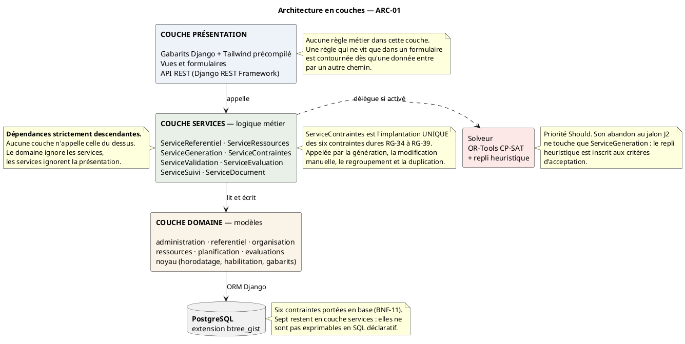
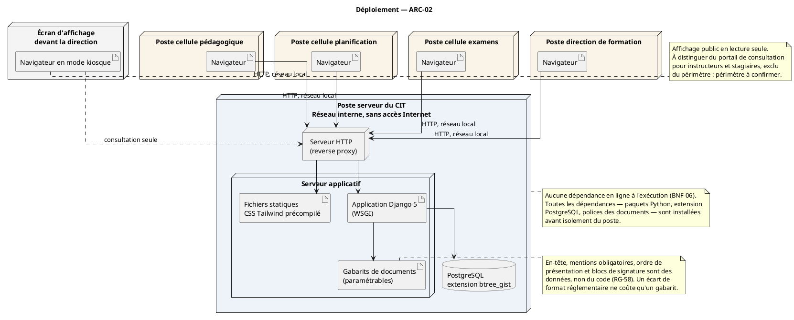

**DOSSIER D'ARCHITECTURE**

Architecture en couches et déploiement · Système de gestion des activités de formation du CIT

*Livrable 5 / 5 — Phase 4 : Analyse et conception · **Version 2 du 30 août 2026** · Lots WBS 4.2.1 et 4.2.3*

# 1. Objet

Ce dossier fixe l'organisation interne du logiciel et les conditions de son installation. Il complète le diagramme de classes, qui dit **quelles données** le système manipule, en disant **comment le code s'organise** pour les manipuler.

La règle posée en ouverture de phase s'applique ici en négatif : `CLS-00` ne porte que des entités métier, jamais de vues, de services ni de sérialiseurs. Ceux-ci relèvent du présent document.

Il tranche également le lot 4.2.3, le choix de la bibliothèque de génération de documents, resté ouvert depuis l'ouverture de la phase.

# 2. Principes retenus

## 2.1 Trois couches, dépendances strictement descendantes

L'architecture comporte trois couches. **Aucune couche n'appelle celle du dessus** : le domaine ignore les services, les services ignorent la présentation. Cette règle n'est pas une élégance, c'est ce qui rend le code testable — un service se teste sans navigateur, un modèle se teste sans service.

## 2.2 Aucune règle métier dans la présentation

Une règle qui ne vit que dans un formulaire est contournée dès qu'une donnée entre par un autre chemin : import de fichier, interface de programmation, migration, commande d'administration. Le contrôle en formulaire existe — il donne un retour immédiat à l'utilisateur — mais il **double** un contrôle porté plus bas, il ne le remplace jamais.

## 2.3 Une couche services systématique, y compris pour le CRUD

C'est le choix d'architecture le plus discutable du projet, et il a été assumé en phase 3 : passer par un service pour créer une matière est verbeux. Deux raisons le justifient, et la phase 4 les a confirmées.

**L'homogénéité.** Un développeur qui cherche où se trouve une règle sait qu'elle est dans un service, sans avoir à se demander si l'opération était « assez simple » pour s'en passer. La question ne se pose jamais.

**Sept contraintes ne peuvent pas descendre en base.** La note d'implémentation les recense : acyclicité du graphe des prérequis, conditionnalité des sujets au type d'évaluation, capacité comparée à un effectif dérivé, unicité d'affectation de l'instructeur avec l'exception du regroupement, créneau non bloqué compte tenu d'une portée dérivée, volume programmé comparé à un agrégat, unicité de désignation remontant trois niveaux de relations. Sans couche services, elles seraient dispersées entre les vues et les formulaires, avec la certitude de divergences.

## 2.4 Une implantation unique des contraintes dures

`ServiceContraintes` est le point de convergence du système : il est appelé par la génération, la modification manuelle, le regroupement et la duplication. Une duplication de ces contrôles produirait mécaniquement des divergences de comportement — un programme généré et un programme saisi n'obéiraient plus aux mêmes règles.

# 3. ARC-01 — Architecture en couches

## 3.1 La couche présentation

Elle comprend les gabarits Django assortis de Tailwind CSS **précompilé**, les vues et formulaires, et l'interface de programmation bâtie sur Django REST Framework.

**La précompilation de Tailwind est une contrainte de déploiement, non un choix esthétique.** Le poste cible est dépourvu de Node ; le CSS est donc généré sur le poste de développement et versionné comme un fichier statique. C'est l'une des trois dépendances à préparer avant l'isolement du poste, avec l'extension `btree_gist` et les paquets Python.

**L'interface de programmation est de priorité Should et son périmètre est restreint** : consultation seule, limitée au référentiel, aux sessions et au programme affiché. Les notes et les sujets en sont exclus au titre de BNF-02. Aucun consommateur n'est identifié à ce jour ; c'est le premier candidat à l'abandon en cas de dérive.

## 3.2 La couche services

Huit services, dont sept ont été nommés par les diagrammes de séquence et constituent un **engagement** : un service apparaissant dans une séquence sans figurer ici signalerait une incohérence.

| Service | Paquetage | Responsabilité |
| --- | --- | --- |
| `ServiceReferentiel` | P2 | Matières programmables, volumes prescrits, prérequis, coefficients |
| `ServiceRessources` | P4 | Disponibilité des instructeurs et des lieux, qualifications, calendrier, grille active |
| `ServiceGeneration` | P5 | Construction du programme hebdomadaire |
| `ServiceContraintes` | P5 | Contrôle des six contraintes dures |
| `ServiceValidation` | P5 | Machine à états du programme, circuit de validation et de signature |
| `ServiceEvaluation` | P6 | Évaluations, sujets, notes, moyennes |
| `ServiceSuivi` | P6 | Rapprochement prescrit et réalisé, progression réalisée hebdomadaire |
| `ServiceDocument` | transverse | Production des documents à partir des gabarits paramétrables |

**`ServiceRessources` appartient à P4 et non à P5**, bien que la planification soit son principal appelant : le paquetage des évaluations l'appelle également pour vérifier la disponibilité des lieux et des surveillants d'épreuve. Le placer dans P5 créerait une dépendance circulaire entre P5 et P6.

**`ServiceDocument` est transverse** : il sert les procès-verbaux, la progression d'instruction et la progression réalisée. Il ne connaît que des gabarits et des données à y injecter.

## 3.3 La couche domaine

Six applications Django portant les entités métier, plus une application technique.

| Application | Contenu |
| --- | --- |
| `noyau` | **Aucune entité métier.** Classe de base assurant horodatage et rattachement à l'auteur (BNF-14), mécanisme d'habilitation (`RG-02`), pagination et recherche (BNF-15), gabarits d'écran |
| `administration` | Comptes, journal des actions sensibles |
| `referentiel` | Types, formations, catalogue des matières, référentiels, prérequis |
| `organisation` | Sessions, brigades, stagiaires, affectations |
| `ressources` | Instructeurs, qualifications, indisponibilités, lieux, grilles horaires, calendrier |
| `planification` | Programme, séances, lignes, non-exécutions, avenants |
| `evaluations` | Évaluations, sujets, épreuves, surveillance, notes, procès-verbaux |

**L'ordre de dépendance** — P1 ne dépend de rien, P2 dépend de P1, P3 de P2 et P4, P4 de P2, P5 de P2, P3 et P4, P6 de P3 et P5 — est exactement celui du découpage en sprints arrêté en phase 3. Cette coïncidence n'est pas fortuite : elle confirme que le découpage de réalisation suit la structure du domaine.

## 3.4 Le solveur, isolé derrière un service

Le solveur OR-Tools CP-SAT n'est appelé que par `ServiceGeneration`, et son activation est conditionnelle. Deux conséquences.

**Son abandon au jalon J2 du 10 octobre ne touche qu'un seul point du code.** Le repli heuristique est inscrit aux critères d'acceptation et produit un programme à l'état brouillon soumis exactement aux mêmes contrôles.

**Le prototype exploratoire du sprint 2 ne dépend que du modèle de données.** C'est ce qui a permis de l'avancer de trois semaines lors de la planification. Il doit être dimensionné sur **plusieurs sessions simultanées** : la résolution étant centre-entier, un prototype validé sur une session unique attesterait d'une faisabilité qui n'est pas celle du système réel. C'est le traitement du risque R6, réévalué à 9 le 23 août.

# 4. ARC-02 — Déploiement

## 4.1 Une machine, plusieurs postes clients

Le système est installé sur un **poste serveur unique** du CIT : base de données, application et serveur HTTP sur la même machine. Les cellules y accèdent par navigateur depuis leurs postes, sur le réseau local.

Ce dimensionnement est délibéré. Le nombre d'utilisateurs simultanés est de l'ordre de la dizaine, et séparer la base de l'application sur deux machines ajouterait une administration sans bénéfice mesurable. Si la volumétrie l'exigeait un jour, la séparation ne demanderait qu'un changement de paramètre de connexion.

## 4.2 Aucune dépendance en ligne à l'exécution

BNF-06 est la contrainte la plus structurante du déploiement. Trois dépendances doivent être **installées avant l'isolement du poste** et figurent à ce titre dans la procédure d'installation.

| Dépendance | Motif | Conséquence si oubliée |
| --- | --- | --- |
| Paquets Python, téléchargés au préalable | Django, DRF, OR-Tools, bibliothèque de documents | Installation impossible |
| Extension PostgreSQL `btree_gist` | Contrainte d'exclusion sur les indisponibilités | Migration en échec |
| Polices des documents | Production des PDF sans ressource en ligne | Documents illisibles ou substitution de police |

Le CSS Tailwind, lui, est précompilé et versionné : il ne constitue pas une dépendance d'installation.

**Le test d'installation hors ligne est inscrit au jalon C1**, fin du premier sprint, le 12 septembre. C'est le premier point de vérité du projet et le moment où le risque R9 sera réévalué.

**Une conteneurisation par Docker est envisagée en repli**, et non retenue comme référence. Elle répondrait précisément au point faible de ce déploiement — les dépendances natives de WeasyPrint et l'extension PostgreSQL — puisqu'une image les embarque toutes et réduit l'installation au chargement de cette image.

Quatre inconnues interdisent de la retenir aujourd'hui. Le système d'exploitation du poste n'est pas connu ; la présence de Docker ne l'est pas davantage ; l'autorisation de l'installer sur un réseau militaire reste à obtenir ; et le transfert hors ligne d'une image représente plusieurs centaines de mégaoctets à acheminer, contre quelques dizaines pour des paquets.

**Le motif décisif est ailleurs.** Après la soutenance, le système sera maintenu par le CIT. Une installation classique se dépanne avec les compétences d'un administrateur ordinaire ; une image conteneurisée exige une compétence supplémentaire que le centre ne possède peut-être pas. Livrer un système que son détenteur ne sait pas maintenir est un échec différé.

La décision est donc reportée au **jalon C1** : si les dépendances natives résistent au test hors ligne, la conteneurisation devient la réponse évidente et son coût sera justifié ; sinon rien n'aura été dépensé.

## 4.3 L'écran d'affichage

Le programme est affiché sur un écran devant la direction de la formation. Le déploiement le traite comme un poste client supplémentaire, en navigateur mode kiosque, en **consultation seule**.

**Une frontière de périmètre reste à tracer.** Le cahier des charges exclut le portail de consultation pour instructeurs et stagiaires. Un affichage public en lecture seule n'est pas un portail — il n'y a ni compte, ni personnalisation, ni interaction — mais la distinction doit être écrite, faute de quoi un membre du jury demandera pourquoi le système ne fait pas ce que le centre fait déjà. À confirmer auprès du terrain : cet écran est-il alimenté par un système existant, ou la progression y est-elle projetée à la main ?

## 4.4 Ce que le déploiement ne couvre pas

La stratégie de sauvegarde, la politique de mise à jour et l'accès physique au poste relèvent du dossier de déploiement, produit en phase 7. **L'accès au poste doit être demandé fin octobre** — c'est le risque R15, et le délai d'anticipation de trois semaines pour toute sollicitation externe s'y applique.

# 5. Décision — bibliothèque de génération de documents

Le lot 4.2.3 devait être tranché avant la fin de la phase 4. Quatre candidates ont été examinées au regard de trois exigences : produire des documents sans aucune ressource en ligne (BNF-06), permettre qu'un écart de format réglementaire ne coûte qu'un changement de gabarit (`RG-58`), et rendre les mises en page réelles du CIT — en-tête, blocs par type de formation, pied de signature, format paysage.

| Candidate | Nature | Gabarit modifiable sans code | Dépendances natives |
| --- | --- | --- | --- |
| **WeasyPrint** | HTML et CSS vers PDF | **Oui** — le gabarit est un modèle Django | Pango, cairo |
| ReportLab | Construction programmatique | Non — la mise en page est du code | Aucune |
| fpdf2 | Construction programmatique | Non | Aucune |
| xhtml2pdf | HTML vers PDF | Oui, mais support CSS limité | Aucune |

**WeasyPrint est retenue.** Le critère décisif est `RG-58` : le gabarit doit être une **donnée**, pas du code. Avec WeasyPrint, un procès-verbal est un modèle Django ordinaire assorti d'une feuille de style ; en-tête, mentions obligatoires, ordre de présentation et blocs de signature s'y modifient sans toucher au code Python. Avec ReportLab ou fpdf2, la mise en page est écrite en Python et tout écart de format réglementaire devient une modification de code — précisément ce que le risque R18 nous demande d'éviter, puisque le format du procès-verbal et de la convocation reste inconnu.

S'y ajoutent deux avantages pratiques : les règles CSS de pagination gèrent nativement l'orientation paysage, les en-têtes et pieds répétés et la numérotation des pages, ce que la progression d'instruction exige ; et les gabarits de documents partagent la même technologie que les écrans, donc la même compétence.

**La réserve, et le point de décision.** WeasyPrint dépend de bibliothèques natives — Pango et cairo — dont l'installation sur un poste isolé peut poser difficulté selon le système d'exploitation. Ce point sera vérifié au **test d'installation hors ligne du jalon C1**, le 12 septembre.

**Repli en cas d'échec : ReportLab**, sans dépendance native, au prix d'une mise en page écrite en Python. Le coût de bascule est contenu parce que `ServiceDocument` isole la production documentaire derrière une interface unique : changer de bibliothèque n'affecte que ce service. C'est une raison supplémentaire de l'avoir posé comme service transverse.

Cette décision et son repli sont à consigner au registre des risques, en prévention de R9 — échec de l'installation hors ligne.

# 6. Sécurité

| Exigence | Mise en œuvre |
| --- | --- |
| Authentification (BNF-03) | Modèle d'utilisateur Django étendu, empreintes de mot de passe par l'algorithme par défaut du framework |
| Contrôle d'accès (`RG-02`) | Mécanisme d'habilitation unique porté par `noyau`, appliqué en couche services et non dans chaque vue. Les droits d'un profil reposent sur les **groupes et permissions Django** : ils sont **configurables par l'administrateur** sans modification du code (`RG-02 bis`), le système étant livré avec les cinq profils préconfigurés |
| Données sensibles (BNF-02) | Sujets d'examen et notes exclus de l'interface de programmation ; consultation d'un sujet retenu journalisée à chaque accès |
| Journal immuable (`RG-27`) | Droits de mise à jour et de suppression révoqués sur la table du journal pour le rôle de connexion de l'application |
| Confidentialité du dépôt | Dépôt privé, aucune donnée réelle du CIT versionnée, jeux de test entièrement fictifs |

**Le contrôle d'accès est porté en couche services, non dans les vues.** Une habilitation vérifiée dans une vue laisse passer toute donnée entrant par un autre chemin — c'est l'application directe du principe de la section 2.2.

# 7. Points ouverts

**Le système d'exploitation du poste cible n'est pas connu.** Il conditionne la difficulté d'installation des dépendances natives de WeasyPrint et de l'extension `btree_gist`. À déterminer avec la demande d'accès au poste, fin octobre, risque R15.

**La frontière avec l'écran d'affichage** reste à confirmer, section 4.3.

**Le dimensionnement** — nombre de sessions simultanées, de brigades, d'instructeurs — n'est connu qu'approximativement. Il sera précisé au sprint 2, sur le jeu de données du prototype du solveur, et pourra conduire à revoir les index proposés dans la note d'implémentation.

---

*Livrable 5 / 5 de la phase 4 — version 2 du 30 août 2026. Lots WBS 4.2.1 et 4.2.3. Tranche le choix de la bibliothèque de génération de documents, resté ouvert depuis l'ouverture de la phase.*
