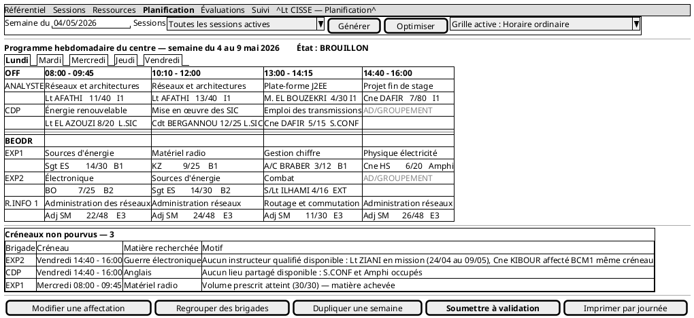
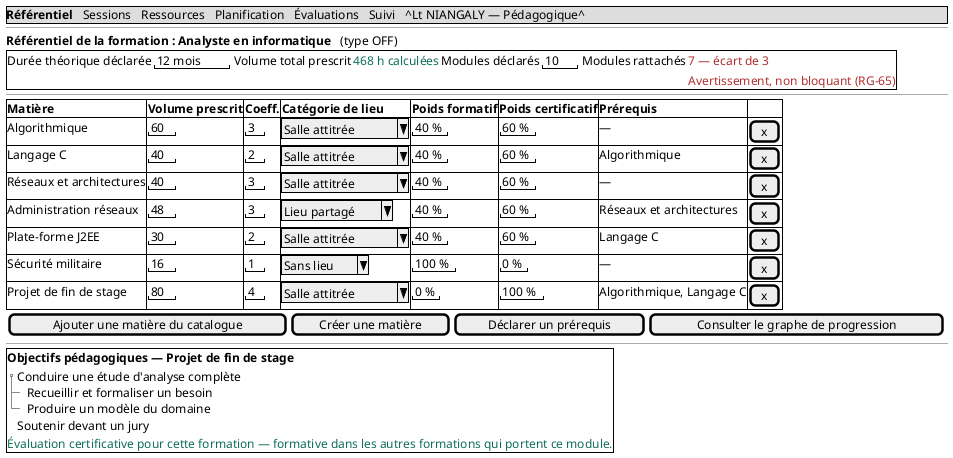
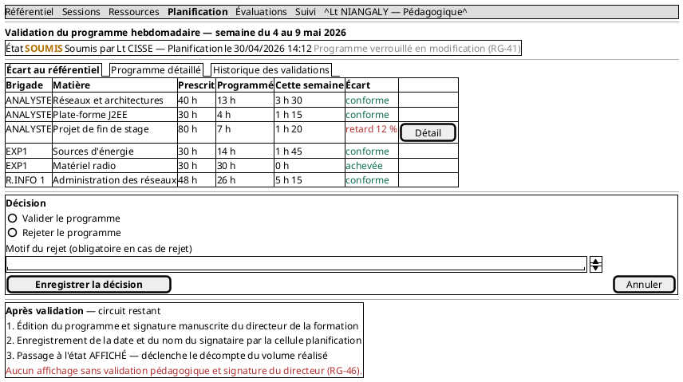
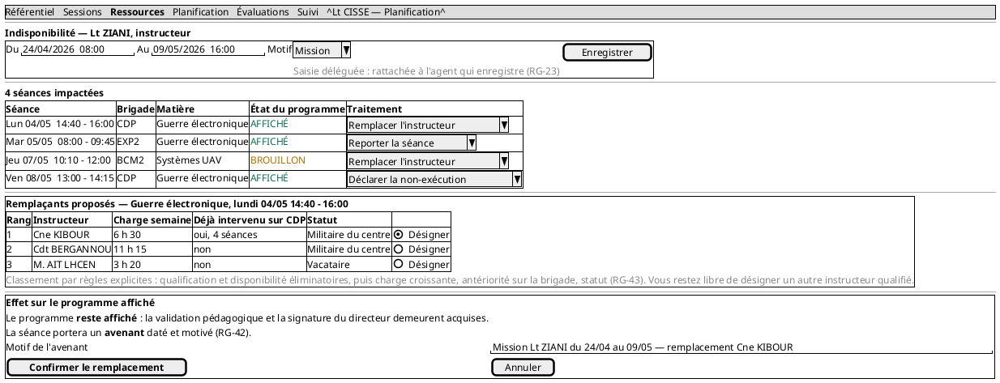
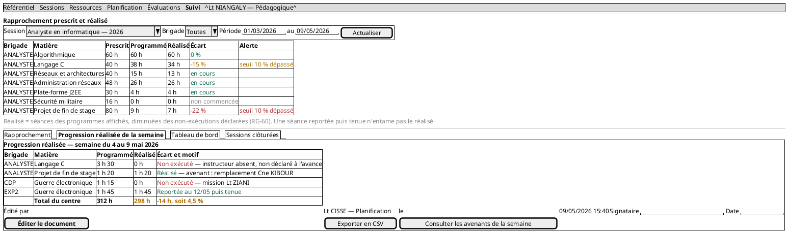

**MAQUETTES DES ÉCRANS PRINCIPAUX**

Wireframes des cinq écrans structurants · Système de gestion des activités de formation du CIT

*Livrable 6 / 6 — Phase 4 : Analyse et conception · **Version 2 du 30 août 2026** · Lot WBS 4.4*

# 1. Objet et méthode

## 1.1 Des wireframes, pas des maquettes graphiques

Ces maquettes sont des **wireframes** : elles fixent la structure de l'information, les actions disponibles et les données présentées, sans traiter les couleurs, la typographie ni les espacements. C'est le niveau attendu en phase de conception, et le seul qui soit utile.

Une maquette graphique produite avant le développement serait un investissement à perte : elle serait retouchée dès la première confrontation à un écran réel, et elle donnerait au commanditaire l'illusion d'un système plus avancé qu'il ne l'est. Le rendu visuel relève de Tailwind CSS, dont les classes utilitaires sont appliquées au moment de l'intégration.

## 1.2 Une chaîne d'outils unique

Les maquettes sont produites en PlantUML, comme les seize autres figures du projet. Le même dépôt, la même commande de rendu, le même format texte versionnable. Elles se relisent en diff, ce qu'aucun outil de maquettage graphique ne permet.

Le rendu est volontairement austère. Ce n'est pas une limite subie : un wireframe qui ressemble à un écran fini détourne la discussion vers l'esthétique, alors qu'elle doit porter sur le contenu et sur les enchaînements.

## 1.3 Le choix des cinq écrans

Cinq écrans sur la quarantaine que comptera le système. Le critère de sélection n'est pas la fréquence d'usage mais la **densité de décisions de conception** : chacun matérialise des règles métier qu'aucun autre écran ne porte.

| Maquette | Écran | Ce qu'elle démontre | Objectif |
| --- | --- | --- | --- |
| `MAQ-01` | Génération du programme hebdomadaire | Programme centre-entier, créneaux non pourvus motivés, mention AD/GROUPEMENT | OS2, OS5 |
| `MAQ-02` | Composition du référentiel | Élément de référentiel à cinq attributs, écart déclaré et calculé | OS1 |
| `MAQ-03` | Validation croisée | Écart au prescrit, décision nominative, circuit de signature | OS2 |
| `MAQ-04` | Traitement d'une indisponibilité | Classement explicable des remplaçants, avenant sur programme affiché | OS6 |
| `MAQ-05` | Suivi prescrit et réalisé | Trois volumes distincts, progression réalisée hebdomadaire | OS4 |

Les écrans de gestion — formations, matières, instructeurs, lieux, comptes — ne sont pas maquettés : ils suivent la fiche générique de cas d'utilisation, dont le déroulement est décrit une fois pour toutes. Les maquetter reviendrait à produire une dizaine de variations d'un même formulaire.

## 1.4 Principes d'interface communs

Ces principes s'appliquent à tous les écrans et ne sont pas rappelés maquette par maquette.

**Terminologie du CIT** (BNF-08). Brigade, séance, progression, référentiel, AD/GROUPEMENT. Aucun terme inventé, aucun anglicisme.

**Message d'erreur indiquant l'action corrective** (BNF-10). « Aucun instructeur qualifié disponible » n'est pas un message : « Lt ZIANI en mission du 24/04 au 09/05, Cne KIBOUR affecté à BCM1 sur le même créneau » en est un.

**Confirmation explicite avant toute action irréversible** (BNF-09), et pagination assortie d'une recherche dès qu'une liste peut dépasser vingt éléments (BNF-15).

**Avertir plutôt que bloquer** lorsque l'écart relève d'une décision de commandement et non d'une erreur de saisie. C'est `RG-65`, et c'est visible sur `MAQ-02`.

# 2. MAQ-01 — Génération du programme hebdomadaire

## 2.1 Ce que l'écran reprend du document réel

La disposition suit celle des progressions d'instruction du CIT : blocs par type de formation — OFF, BEODR, CAT — lignes par groupe, colonnes par créneau de la grille active. Chaque case porte les six éléments identifiés à la lecture des documents : matière, instructeur, progression sous forme de fraction, salle.

Cette fidélité n'est pas une coquetterie. Un utilisateur qui retrouve la forme de son document de travail adopte l'outil sans réapprentissage, et le rejet d'un système tient plus souvent à un dépaysement de forme qu'à un défaut de fonction.

## 2.2 Trois décisions visibles à l'écran

**Le programme couvre le centre entier.** L'écran présente tous les groupes de toutes les sessions actives, pas une brigade. C'est la correction la plus lourde de la phase, établie par la date de signature unique des progressions des 23, 24 et 25 février.

**Les créneaux non pourvus portent leur motif.** Le panneau du bas énumère les échecs de la génération avec la cause exacte : instructeurs qualifiés et raison d'indisponibilité de chacun, lieux occupés et par qui, volume prescrit atteint. Un créneau vide sans explication obligerait la cellule planification à refaire à la main le raisonnement du moteur — c'est l'exigence d'ergonomie la plus importante de tout le système.

**La grille active est rappelée en permanence.** L'utilisateur voit quelle grille sert de base, et sait donc pourquoi les créneaux ont ces bornes. Au passage à l'horaire de Ramadan, le changement est visible sans avoir à le chercher.

## 2.3 La mention AD/GROUPEMENT

Les cases sans séance portent la mention en usage au centre. Ce n'est pas un vide : c'est une information — le groupe est à disposition du groupement. La reprendre littéralement évite qu'un utilisateur croie à un défaut d'affichage.

# 3. MAQ-02 — Composition du référentiel d'une formation

## 3.1 L'élément de référentiel, pivot du modèle

Chaque ligne du tableau est un `ElementReferentiel` et porte ses cinq attributs propres : volume prescrit, coefficient, catégorie de lieu requise, poids formatif et poids certificatif. L'écran rend visible ce que le diagramme de classes affirme — ces valeurs appartiennent au couple formation-matière, non à la matière.

La dernière ligne le démontre. Le projet de fin de stage porte un poids certificatif de 100 % **pour cette formation** ; dans les autres formations qui l'inscrivent à leur référentiel, il est formatif. Le même module, deux rôles, aucune règle particulière.

## 3.2 L'écart entre le déclaré et le calculé

Le bandeau supérieur juxtapose trois informations : la durée théorique déclarée, le volume total calculé à partir des matières rattachées, et le nombre de modules déclaré face au nombre effectivement rattaché.

L'écart de trois modules est signalé en avertissement, **jamais en refus**. C'est `RG-65`, née de la relecture du 26 août. La valeur déclarative est une cible, souvent saisie avant que le détail existe ; interdire de s'en écarter empêcherait une révision légitime du cursus et conduirait le terrain à gonfler la cible pour se donner de l'air — ce qui priverait l'indicateur de tout sens.

# 4. MAQ-03 — Validation croisée du programme

## 4.1 Ce que la cellule pédagogique regarde

Elle ne valide pas un agencement de créneaux — c'est le métier de la planification. Elle valide la **conformité pédagogique** de ce qui est programmé. L'onglet par défaut est donc l'écart au référentiel, matière par matière et brigade par brigade, et non le tableau des séances.

Cet ordre d'affichage est une décision de conception : présenter d'abord le planning inviterait à commenter des choix qui ne relèvent pas de cette cellule.

## 4.2 Le verrouillage et le motif de rejet

Le bandeau rappelle que le programme est verrouillé en modification depuis sa soumission. Sans ce verrou, la cellule planification pourrait le modifier pendant que la pédagogique l'examine, et la validation porterait sur un objet qui n'existe plus.

Le motif de rejet est un champ obligatoire, contrôlé avant enregistrement. Sans motif, la cellule planification ne saurait pas quoi corriger et le circuit tournerait en boucle.

## 4.3 Le circuit après validation

Le panneau du bas énonce les trois étapes restantes : édition, signature manuscrite du directeur de la formation, enregistrement de la date et du signataire, puis passage à l'état affiché.

Il est là pour une raison précise : la validation pédagogique **ne suffit pas** à afficher. Un utilisateur qui l'ignorerait croirait son travail terminé. `RG-46` est rappelée en clair à l'écran.

# 5. MAQ-04 — Traitement d'une indisponibilité

## 5.1 De la saisie à l'impact, sans rupture

L'écran enchaîne trois moments : l'enregistrement de la période, la liste des séances impactées, le traitement de chacune. C'est ce qui transforme un enregistrement administratif en outil de pilotage — dans la situation actuelle, la recherche des séances impactées se fait de mémoire, et c'est là que se produisent les oublis.

Chaque séance impactée propose son traitement : remplacer l'instructeur, reporter la séance, substituer une matière, déclarer la non-exécution. **Aucun n'est appliqué d'office.**

## 5.2 Le classement des remplaçants est explicable

Les trois colonnes du tableau sont les critères du classement : charge de la semaine, antériorité sur la brigade, statut. L'utilisateur voit **pourquoi** Cne KIBOUR est en tête, et reste libre de désigner quelqu'un d'autre.

C'est la traduction visuelle de `RG-43`. L'absence d'apprentissage automatique est une contrainte du projet — l'historique des affectations est confidentiel et inaccessible — mais elle produit ici un avantage : dans un contexte où l'affectation d'un instructeur est un acte de commandement, un classement explicable vaut mieux qu'un classement performant.

## 5.3 L'avenant

Le panneau final annonce l'effet sur un programme affiché : le programme **reste affiché**, la validation pédagogique et la signature demeurent acquises, et la séance porte un avenant daté et motivé.

C'est la correction du 26 août. La version antérieure faisait retomber tout le programme du centre à brouillon dès qu'une séance était touchée, ce qui aurait exigé une nouvelle signature du directeur à chaque absence — procédure inapplicable, contournée dès la première semaine.

L'écran demande le motif de l'avenant avant de confirmer. C'est ce motif qui apparaîtra dans la progression réalisée de fin de semaine, sur `MAQ-05`.

# 6. MAQ-05 — Suivi prescrit et réalisé

## 6.1 Trois volumes, et non deux

Le tableau distingue le **prescrit** — ce que le référentiel impose —, le **programmé** — ce qui a été placé au programme, tous états confondus — et le **réalisé** — ce qui a effectivement été dispensé.

La distinction entre programmé et réalisé est ce qui a manqué au projet jusqu'au 23 août. Sans elle, le système aurait mesuré un écart entre le prescrit et le prévu, alors que l'objectif OS4 annonce le prescrit et le dispensé.

La note sous le tableau énonce la définition exacte, parce qu'un utilisateur qui ne sait pas ce que compte une colonne ne s'en sert pas.

## 6.2 La progression réalisée hebdomadaire

Le second onglet produit le document que la cellule planification établit aujourd'hui à la main chaque fin de semaine — le chef de bureau pédagogique l'a confirmé le 26 août : *la planification donne la progression et les heures vraiment faites en fin de semaine*.

**Cet écran est l'argument le plus solide du projet sur OS4.** Le système n'invente pas un besoin : il automatise une pratique existante.

Le tableau montre les quatre situations que le modèle sait distinguer, et c'est cette finesse qui fait la valeur du document. Une séance non exécutée avec son motif, retranchée du réalisé. Une séance tenue malgré un remplacement, avec mention de l'avenant, comptée au réalisé. Une séance annulée pour mission, retranchée. Et une séance **reportée puis tenue**, comptée au réalisé — le cours a eu lieu, plus tard.

Confondre le report et la non-exécution ferait apparaître en retard une matière rattrapée, et le rapprochement perdrait sa valeur.

## 6.3 Un tableau de bord par cellule

`MAQ-05` présente la vue de la cellule pédagogique. La version 2 étend le tableau de bord aux **quatre cellules**, chacune voyant un contenu filtré sur son domaine : la planification ses créneaux non pourvus et ses indisponibilités à traiter, les examens ses évaluations sans sujet ou sans notes saisies, la Direction de Formation la vue d'ensemble.

Les données sont déjà calculées ; il ne s'agit que de les filtrer. La priorité demeure **Should** — l'écran est un confort de pilotage, non une fonction dont dépend un objectif SMART, et il sera abandonné si le sprint 3 dérape.

## 6.4 Les sessions clôturées

Un onglet donne accès aux sessions achevées, avec filtre par période et par formation. Il répond à un besoin relevé en relecture le 26 août : le modèle conserve tout — rien n'est supprimé, les notes et procès-verbaux sont archivés — mais aucun écran ne donnait accès à cet historique.

L'analyse comparative entre sessions successives est mentionnée comme perspective d'évolution dans le mémoire, et non traitée. Le triangle d'or ne permet pas d'ouvrir un chantier à ce stade.

# 7. Ce que ces maquettes ne couvrent pas

**Les écrans de gestion**, qui suivent la fiche générique de cas d'utilisation : formations, matières, types de formation, instructeurs, lieux, comptes, sessions, brigades, stagiaires.

**Les écrans du paquetage Évaluations** : création d'une évaluation, enregistrement des sujets, organisation d'une épreuve, saisie des notes, génération des procès-verbaux. Ils sont décrits en détail par leurs fiches de cas d'utilisation et par `SEQ-03`. Un sixième wireframe aurait été utile mais la nomenclature de phase en fixe cinq, et le temps disponible avant la revue ne permet pas d'en ajouter sans sacrifier ailleurs. **À produire au sprint 4**, avant la réalisation de ces écrans.

**Le rendu visuel** : couleurs, typographie, espacements, comportement sur écran étroit. Il relève de l'intégration Tailwind.

**L'écran d'affichage devant la direction de la formation**, dont le périmètre reste à confirmer. Il consomme la même vue que `MAQ-01` en lecture seule, sans les actions.

---

*Livrable 6 / 6 de la phase 4 — version 2 du 30 août 2026. Tâche WBS 4.4. Les cinq wireframes matérialisent les décisions de conception des 23, 25 et 26 août 2026.*
